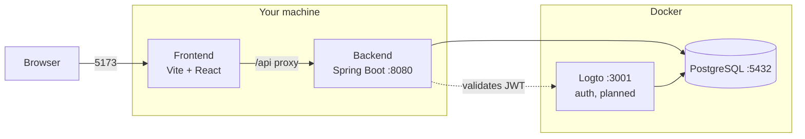

<div align="center">

# 🐝 SE2

**Learn to code by solving problems, earn honey, keep your streak alive.**

A LeetCode-style learning platform: solve programming problems in the browser, get instant feedback on every test, and level up from larva to queen.


University project for **Software Engineering II**, built by team **TTVZ**.
*SE2 is a placeholder name; the final product name is not decided yet.*

</div>

---

## Contents

- [What is it](#what-is-it)
- [Quick start](#quick-start)
- [Daily workflow](#daily-workflow)
- [How it fits together](#how-it-fits-together)
- [Tech stack](#tech-stack)
- [Repository layout](#repository-layout)
- [Configuration](#configuration)
- [Troubleshooting](#troubleshooting)
- [Documentation map](#documentation-map)
- [Working in the team](#working-in-the-team)

## What is it

Users log in, pick a problem, write code, submit it and see exactly **which tests passed and why the others failed**. Progress is rewarded with gamification, themed around a bee:

| Mechanic | Theme |
| --- | --- |
| XP | Honey 🍯 |
| Activity | A honeycomb (hexagon) grid |
| Levels | From larva to queen |
| Daily streak | Keep the hive buzzing |

The MVP flow: **log in → pick a problem → write code → submit → see results → streak and XP update.**

## Quick start

### 1. Install the basics

You need three things before anything else; `just setup` takes care of the rest.

| Tool | Why | Install |
| --- | --- | --- |
| [Git](https://git-scm.com) | clone and contribute | your package manager or the website |
| [just](https://github.com/casey/just#installation) | the command runner used everywhere in this repo | Windows: `winget install Casey.Just`<br>macOS: `brew install just`<br>Debian/Ubuntu: `sudo apt install just`<br>Fedora: `sudo dnf install just` |
| [Docker](https://www.docker.com/products/docker-desktop/) | runs PostgreSQL and Logto | Docker Desktop (Windows, macOS) or Docker Engine (Linux). **Install it yourself**, `just setup` only checks it |

Open a **new terminal** after installing, so the new commands are found.

### 2. Get the code and set up

```bash
git clone https://github.com/Kerolly/software_engineering_II.git
cd software_engineering_II
just setup
```

`just setup` is safe to run as many times as you like. It:

1. checks for **JDK 25** and **Node 22+** and offers to install what is missing (winget on Windows, Homebrew on macOS; on Linux it tells you what to install),
2. creates your local `.env` from `.env.example` (never committed),
3. downloads the Maven and npm dependencies,
4. pulls the Docker images, and warns you at the end if Docker is missing or not running.

> If it installed a tool, **open a new terminal and run `just setup` again** to finish.

### 3. Start everything

Start Docker, then:

```bash
just dev
```

This starts PostgreSQL and Logto in Docker, then the backend and the frontend directly on your machine, so you get instant hot reload.

| Service | URL | Notes |
| --- | --- | --- |
| Frontend | http://localhost:5173 | Vite dev server; `/api` is proxied to the backend |
| Backend | http://localhost:8080 | Health: `/actuator/health`, OpenAPI: `/v3/api-docs` |
| Logto | http://localhost:3001 | Auth endpoint |
| Logto Admin | http://localhost:3002 | Admin console |
| PostgreSQL | `localhost:5432` | Database `se2` (Logto uses its own database, `logto`) |

`Ctrl+C` stops the backend and the frontend. The Docker services keep running; stop them with `just down`.

## Daily workflow

Run `just` with no arguments to list every command. The ones you will use most:

| Command | What it does |
| --- | --- |
| `just dev` | Start Docker services, backend and frontend |
| `just dev-backend` / `just dev-frontend` | Run only one of the apps on your machine |
| `just infra` (alias `just up`) | Start only PostgreSQL and Logto |
| `just down` | Stop the Docker services |
| `just restart [service]` | Restart the Docker services, or just one |
| `just logs [service]` | Follow the logs of the Docker services |
| `just ps` | Show the status of the containers |
| `just test` | Run all tests (backend and frontend) |
| `just test-backend` / `just test-frontend` | Run one side only |
| `just db-shell` | Open `psql` in the application database |
| `just db-reset` | **Delete all local data** (asks for confirmation) |
| `just setup` | Check and install what the project needs |

Coming with the first API endpoint: `just gen-api`, which regenerates `backend/openapi.json` and the frontend API client.

## How it fits together



- The frontend and backend run on your machine; PostgreSQL and Logto run in Docker.
- The browser only ever talks to one origin. In dev the Vite proxy forwards `/api` to the backend, and in production Caddy will do the same.
- Authentication with Logto is planned; the provider is not final yet.

## Tech stack

| Layer | Technology |
| --- | --- |
| Backend | Java 25, Spring Boot, Maven, Spring Data JPA, Flyway, springdoc-openapi |
| Frontend | React, TypeScript, Vite, Tailwind CSS, DaisyUI, Vitest (TanStack Query, Axios, Orval and Zod come with the first endpoints) |
| API client | Generated with Orval from `backend/openapi.json` |
| Auth | Logto, self-hosted (provider not final) |
| Database | PostgreSQL 18 |
| Tooling | Docker Compose, just, GitHub Actions |
| Hosting (planned) | Oracle Cloud Free Tier VM, with Caddy and Cloudflare in front |

## Repository layout

```text
backend/              Spring Boot API (Maven)
frontend/             React + Vite app
infra/postgres/init/  SQL run on first database start
docs/                 Documentation and decisions
scripts/              Setup scripts used by `just setup`
.github/              PR template and CI workflow
docker-compose.yml    Development services: PostgreSQL and Logto
justfile              All project commands
.env.example          Template for your local .env
```

## Configuration

All configuration comes from environment variables. `.env.example` is committed with placeholder values; your `.env` is local and ignored by git. `just` loads it automatically.

- Never commit `.env`, passwords or tokens.
- A new variable always gets an entry in `.env.example`.

## Troubleshooting

| Problem | What to do |
| --- | --- |
| `just: command not found` | Install just (see [Quick start](#1-install-the-basics)) and open a new terminal. |
| A tool installed by `just setup` is "not found" | Open a **new terminal**, so `PATH` and `JAVA_HOME` are refreshed, and run `just setup` again. |
| Docker is not installed / not running | Install or start Docker Desktop, then run `just infra` again. `just setup` only warns, it does not install Docker. |
| `port is already allocated` on 5432 | Another PostgreSQL (or an old container) uses the port. Stop it, or set `POSTGRES_PORT` **and** the port inside `SPRING_DATASOURCE_URL` in your `.env`. |
| Backend cannot connect to the database | Run `just ps` and wait for `postgres` to be `healthy`. Check that `.env` matches `.env.example`. |
| Wrong Java version | Run `java -version` and check your `JAVA_HOME`. The backend needs JDK 25; an older JDK earlier in `PATH` or in `JAVA_HOME` wins. |
| `Permission denied` on `mvnw` or `setup.sh` (macOS/Linux) | Run `chmod +x backend/mvnw scripts/setup.sh`. |
| First visit to http://localhost:3002 asks for an account | Logto runs locally, so you create your own admin account the first time. It exists only on your machine. |
| Something is badly broken locally | `just db-reset` deletes all local data (including Logto accounts) and starts clean. |

## Documentation map

| Document | What is in it |
| --- | --- |
| [CONTRIBUTING.md](CONTRIBUTING.md) | Team workflow, Jira, branch, commit and pull request rules |
| [docs/api-conventions.md](docs/api-conventions.md) | Rules for every HTTP endpoint, with an example |
| [CLAUDE.md](CLAUDE.md) | Project context for Claude Code and other AI assistants (stack, commands, security rules, open decisions) |
| [.github/pull_request_template.md](.github/pull_request_template.md) | The checklist every pull request starts with |
| [.github/workflows/ci.yml](.github/workflows/ci.yml) | Continuous integration: backend, frontend and naming checks |

## Working in the team

The short version, in full in [CONTRIBUTING.md](CONTRIBUTING.md):

| | Format | Example |
| --- | --- | --- |
| Jira task | `[TTVZ][Area] Description` | `[TTVZ][Auth] Implement login with Logto` |
| Branch | `type/SCRUM-<nr>-short-description` | `feat/SCRUM-58-login-with-logto` |
| Commit | `type: description` | `feat: add login button to navbar` |
| Pull request | `SCRUM-<nr> Description` | `SCRUM-58 Implement login with Logto` |

Before opening a pull request, run `just test`. CI runs the same checks and must be green.
