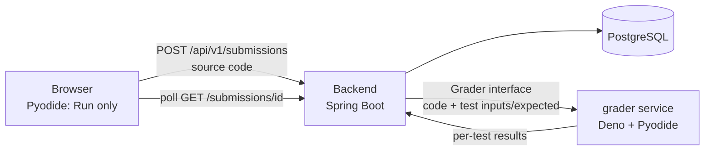

# 0001: Authentication, hosting and code execution

- **Date:** 2026-11-03
- **Status:** the first three decisions are **accepted** by the team; the grader (decision 4) is **proposed, pending review by the security teammate**.
- **Supersedes:** the earlier plan of self-hosted Logto, Caddy, an Oracle Cloud VM and Judge0.

## Context

The original plan needed a VM we operate ourselves (Logto, Caddy, Judge0). The team wants to deploy for free on managed platforms instead, with no server to maintain. That removes the places where we could run privileged containers, so the code runner has to change too. The one hard requirement stays the same: **XP and streaks are awarded only from results the server verified itself.**

## Decisions

### 1. Authentication: Firebase Authentication (accepted)

- Email + password login on the free Spark plan. No card, no SMTP server of our own; Firebase sends the password-reset emails.
- The frontend uses the Firebase JS SDK only to log in and get an ID token. The token goes to the backend in `Authorization: Bearer ...`.
- The backend stays provider-agnostic: it validates a standard JWT (issuer `https://securetoken.google.com/<project-id>`) and stores the Firebase UID in `users.authSubject`.
- Spring's resource server checks the issuer and the signature but **not the audience**. The auth task (B4) must add a validator that requires `aud == <project-id>`.
- Spring Security is still added only in the auth task (see CLAUDE.md).

### 2. Hosting: Vercel + Render + Neon, no Caddy (accepted)

| Part | Service | Notes |
| --- | --- | --- |
| Frontend | Vercel (Hobby) | Hobby is for non-commercial use, which fits a university project. |
| Backend | Render (free web service, Docker) | Sleeps after inactivity, so the first request is slow (Spring Boot cold start). Submissions are already asynchronous (`202` + polling). |
| Database | Neon (free PostgreSQL) | Do not use the free Render database: it expires. Local dev keeps PostgreSQL in Docker. |

- The browser keeps talking to a single origin: `frontend/vercel.json` rewrites `/api/*` to the Render backend, exactly like the Vite proxy does in dev. That is why there is still no CORS configuration.
- Free-tier limits change often. **Verify the current limits and terms before relying on them** (RAM, monthly instance hours, sleep behaviour, database size).

### 3. Python "Run" in the browser; no Judge0 (accepted)

- "Run" executes Python with Pyodide (WebAssembly) in a Web Worker. It gives instant feedback and is **never trusted for scoring**.
- Judge0 is dropped: it needs privileged containers, which free managed platforms do not offer.

### 4. Server-side verification of "Submit" (proposed)

A verdict computed in the browser can always be forged: whatever logic or key we ship to the browser, the user controls. So "Submit" must **not** send a result; it sends the source code, and the server runs it again and decides.

**Proposal: a separate `grader` service that runs the same Pyodide build in Deno.**

- The only Python interpreter that decides anything is Pyodide in the grader. The WebAssembly boundary means user code has no system calls: no sockets, no processes, no real filesystem. It does **not** need a privileged container, so it can run on a free platform.
- Deno runs with permissions denied: `--deny-net --deny-env --deny-run --deny-write --deny-ffi --deny-sys`, and read access only to the Pyodide files. Pyodide packages are vendored, not downloaded at run time.
- One fresh process per submission, with a wall-clock timeout (the parent kills it), a V8 heap limit, and caps on code size and output size.
- The grader holds **no secrets and has no database access**. The backend calls it over HTTPS with a shared secret, and the grader accepts no other callers.
- The backend reaches it through the existing `Grader` interface (an implementation such as `WasmPythonGrader`), so the public API does not change.
- Expected outputs must never enter the interpreter that runs user code. The Python side only returns the value a test produced; the comparison happens outside Python. Otherwise user code could read the expected output, or print a forged "passed" line.
- Rate limiting per user on `POST /submissions`.

**Why this is also free and simple:** it is one more small Docker service on Render, and the browser and server use the same Python implementation, so "it works on my screen" and "the server accepts it" agree.

**Alternatives considered**

| Option | Why not (for now) |
| --- | --- |
| Run Deno as a child process inside the backend container | One free service instead of two, but a sandbox escape would land next to the database credentials. Acceptable only as a fallback. |
| GraalPy inside the JVM | Keeps one process, but untrusted code then lives inside the backend's JVM, and library support is narrower. |
| Public Judge0 / Piston APIs | Free tiers are small and their terms change; we would depend on a third party for the core feature. Verify before listing as a fallback. |
| Trust the browser verdict | Trivially forged from DevTools. Rejected. |
| Keep the Oracle VM only for Judge0 | Works, but brings back the server we wanted to stop operating. |

**Risks the security review (task I1) must close**

- Pyodide exposes the JavaScript globals to Python (the `js` module). Lock down or remove what Python must not reach, and keep expected outputs out of that scope.
- Confirm the Deno flags against the version we pin; verify that nothing in the allowed read path is sensitive.
- Pyodide's memory use on a small free instance, and what happens when an instance is killed in the middle of a run.
- Denial of service: many submissions at once on a small instance (queue and limits).
- Test the grader with malicious payloads (fork bombs, memory bombs, infinite loops, output floods, attempts to reach `js` globals).

## Other ways to cheat, and how we limit them

Even with server-side execution:

- **Hard-coding the expected outputs.** All tests are visible, so a user can write code that returns the expected values and passes. The server verdict is "correct" but the solution is not. **Decided (2026-11-03): no hidden tests; this limitation is accepted.** It is limited by the XP rules below, and hidden tests can be added later because results are already stored per test.
- **Farming XP.** Award XP only the first time a problem is solved, cap XP per day, and rate-limit submissions.
- **Replaying requests.** Submissions belong to the authenticated user; the verdict is stored by the server and never taken from the request.

## Open questions

1. ~~Hidden or generated tests~~ **Decided: no hidden tests** (see above).
2. **Problem style:** function-based (`def solve(...)`, easiest to grade safely) or stdin/stdout. Not decided yet; it depends on which problems we write.
3. **Free-tier fit:** do two Render services fit the free RAM and instance hours? **Not verified.** Task I6 (a hello-world deploy and a Pyodide-in-Deno measurement) answers it; if not, fall back to the child-process option above.
