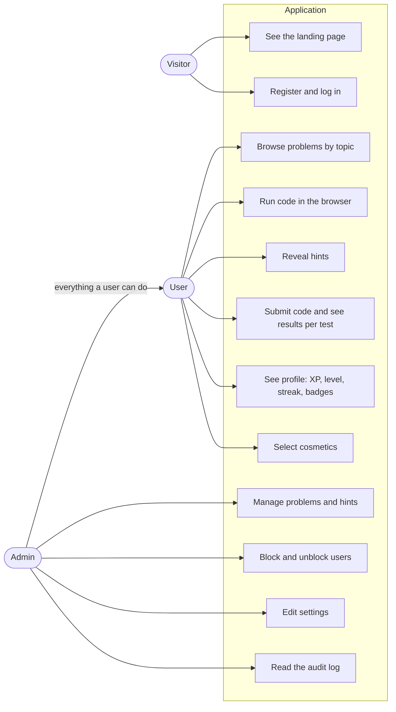
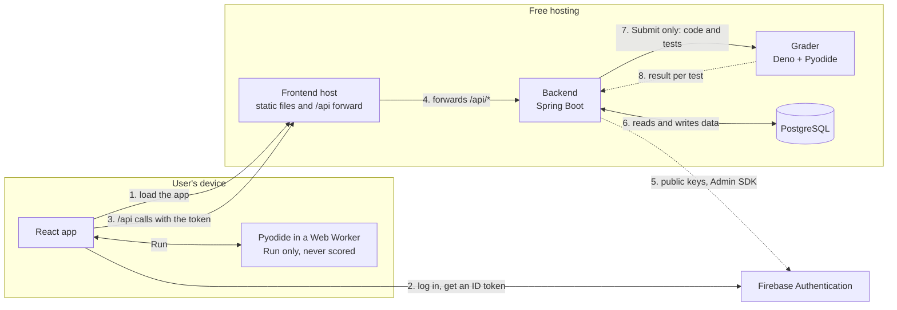
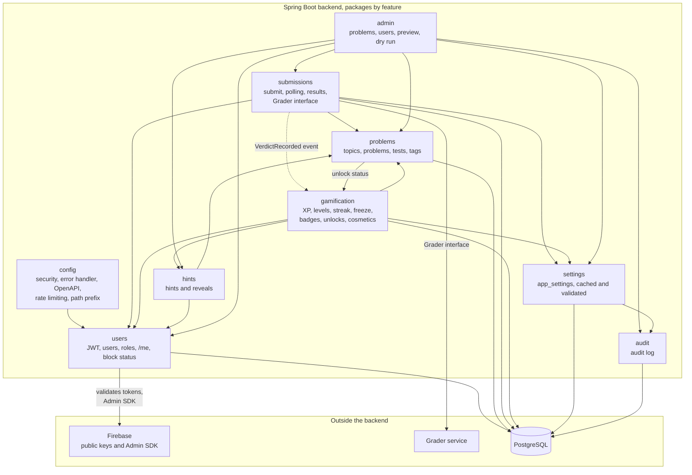

# Architecture

How the pieces fit together: who uses the app, which systems talk to each other, and how the backend is organized inside. The diagrams are written in [Mermaid](https://mermaid.js.org/), so GitHub renders them and they can be reviewed in a pull request.

## 1. Use cases

**What it shows.** The three kinds of actors and what each one can do. A visitor can only see the landing page and log in. A user solves problems and follows their progress. An admin does everything a user does, plus manages content, users and settings.

## 2. System context

**What it shows.** The parts of the system and who calls whom. The browser talks to only two addresses: Firebase (login) and the frontend host (the app and the `/api` forward). The backend is the only part that reaches the database, and the grader is called only by the backend. "Run" never leaves the browser and is never scored; "Submit" is the only path that reaches the grader.

## 3. Backend components

**What it shows.** The backend is split by feature (one package per feature, each with its own controller, service, repository and DTOs). An arrow means "uses". The important point is how a verdict flows: `submissions` records the result and publishes a `VerdictRecorded` event; `gamification` reacts to it (XP, streak, badges, unlocks). That way `submissions` does not depend on the gamification rules. All numbers come from `settings`, never from constants, and every admin action ends in `audit`.

