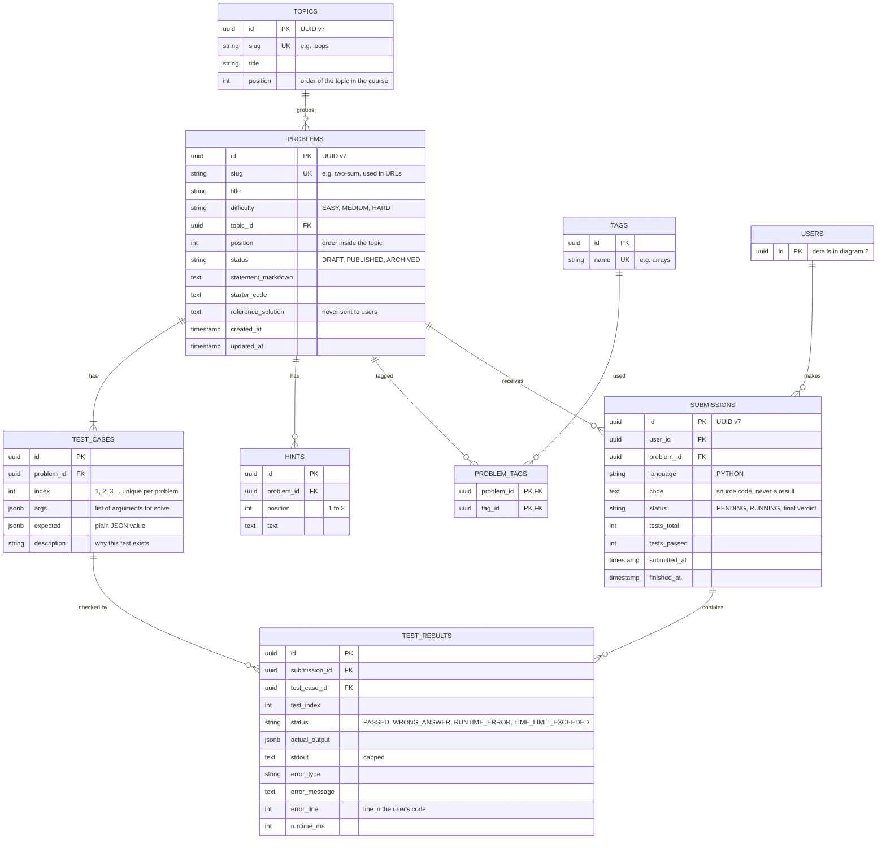

# The database

Two Entity-Relationship diagrams: one for content and submissions, one for users, progress, gamification and administration. Entities that appear in both (users, problems, hints, submissions) are shown with only their key in the second diagram.

Conventions: ids are UUID v7, column names are `snake_case`, timestamps are stored in UTC, enums are strings, and the inputs and expected outputs of tests are `jsonb`.

## 1. Content and submissions

**What it shows.** What a problem is made of and what happens when someone submits code. A topic groups ordered problems. A problem has tests (all visible), up to 3 hints, and tags. A submission stores the source code and a final status; its result per test (where and why it failed) is stored in `test_results`, so hidden tests can be added later without changing the model. `reference_solution` is only for admins and is never returned to users.

## 2. Users, progress, gamification and administration

**What it shows.** Everything derived from verdicts, plus administration. `xp_events` has a unique `(user_id, problem_id)` key: it is what guarantees that XP is awarded only on the first accepted solve, even when two submissions race. `user_streaks` and `activity_days` hold the streak, the freeze and the star-map grid (one row per day with activity). `hint_reveals` records every hint a user opened; it drives the XP penalty and the Sharpshooter badge. `app_settings` holds every tunable number, and `audit_log` records every admin action. The counters `users.xp` and `users.level` are a copy of what the events add up to, kept for fast reads.

```mermaid
erDiagram
    USERS {
        uuid id PK "UUID v7"
        string auth_subject UK "sub claim of the Firebase token"
        string email
        string display_name
        string role "USER or ADMIN"
        string status "ACTIVE or BLOCKED"
        boolean must_change_password "true for the first admins"
        string time_zone "IANA name, e.g. Europe/Bucharest"
        timestamp time_zone_changed_at "limit: once every 7 days"
        int xp "copy of the sum of xp_events"
        int level
        timestamp created_at
    }

    PROBLEMS {
        uuid id PK "details in diagram 1"
    }

    HINTS {
        uuid id PK "details in diagram 1"
    }

    SUBMISSIONS {
        uuid id PK "details in diagram 1"
    }

    XP_EVENTS {
        uuid id PK
        uuid user_id FK "UNIQUE with problem_id"
        uuid problem_id FK "UNIQUE with user_id"
        uuid submission_id FK "the accepted submission"
        int base_xp "from the difficulty"
        int hints_used "revealed before this solve"
        int xp_awarded "after the penalty and the daily cap"
        date day "user's local day, for the daily cap"
        timestamp awarded_at
    }

    USER_STREAKS {
        uuid user_id PK, FK
        int current_streak
        int longest_streak
        date last_active_day "in the user's time zone"
        int freezes_available "0 or 1"
    }

    ACTIVITY_DAYS {
        uuid user_id PK, FK
        date day PK
        int accepted_count "colors the star map"
        boolean freeze_used "a freeze saved this day"
    }

    HINT_REVEALS {
        uuid id PK
        uuid user_id FK "UNIQUE with hint_id"
        uuid hint_id FK "UNIQUE with user_id"
        timestamp revealed_at
    }

    BADGES {
        uuid id PK
        string code UK "e.g. FIRST_LAUNCH"
        string name
        string description
        string rule_type "SOLVED_COUNT, SOLVED_EASY, STREAK ..."
        int threshold
    }

    USER_BADGES {
        uuid user_id PK, FK
        uuid badge_id PK, FK
        timestamp awarded_at
    }

    COSMETICS {
        uuid id PK
        string code UK
        string type "AVATAR, COLOR, FRAME"
        string name
        int unlock_level "optional rule"
        uuid unlock_badge_id FK "optional rule"
    }

    COSMETIC_SELECTIONS {
        uuid user_id PK, FK
        string slot PK "AVATAR, COLOR, FRAME"
        uuid cosmetic_id FK "must be unlocked"
    }

    APP_SETTINGS {
        string key PK "e.g. xp.easy"
        string value
        string value_type "INT, BOOLEAN, ..."
        string min_value
        string max_value
        timestamp updated_at
        uuid updated_by FK
    }

    AUDIT_LOG {
        uuid id PK
        uuid admin_id FK
        string action "e.g. PROBLEM_PUBLISHED"
        string entity_type
        string entity_id
        jsonb details
        timestamp created_at
    }

    USERS ||--|| USER_STREAKS : has
    USERS ||--o{ ACTIVITY_DAYS : has
    USERS ||--o{ XP_EVENTS : earns
    PROBLEMS ||--o{ XP_EVENTS : "first solve of"
    SUBMISSIONS ||--o| XP_EVENTS : triggers
    USERS ||--o{ HINT_REVEALS : opens
    HINTS ||--o{ HINT_REVEALS : "revealed in"
    USERS ||--o{ USER_BADGES : earns
    BADGES ||--o{ USER_BADGES : awarded
    BADGES |o--o{ COSMETICS : unlocks
    USERS ||--o{ COSMETIC_SELECTIONS : selects
    COSMETICS ||--o{ COSMETIC_SELECTIONS : "selected in"
    USERS ||--o{ AUDIT_LOG : performs
    USERS ||--o{ APP_SETTINGS : edits
```

## 3. Key constraints and indexes

**What it shows.** The rules the database itself enforces, because they protect game integrity and cannot be left only to application code.

| Table | Constraint or index | Why |
| --- | --- | --- |
| `xp_events` | `UNIQUE (user_id, problem_id)` | XP only on the first accepted solve, even with two submissions at the same moment |
| `xp_events` | `UNIQUE (submission_id)` | a verdict is counted once |
| `hint_reveals` | `UNIQUE (user_id, hint_id)` | revealing twice is harmless and costs nothing more |
| `user_badges` | primary key `(user_id, badge_id)` | a badge is awarded once |
| `activity_days` | primary key `(user_id, day)` | one cell of the star map per day |
| `problems` | `UNIQUE (topic_id, position)` | a stable order inside a topic |
| `test_cases` | `UNIQUE (problem_id, index)` | tests are numbered per problem |
| `hints` | `UNIQUE (problem_id, position)` and `CHECK (position BETWEEN 1 AND 3)` | at most 3 hints |
| `test_results` | `UNIQUE (submission_id, test_index)` | one result per test |
| `users` | `UNIQUE (auth_subject)` | one account per Firebase user; also protects against two first-login requests at once |
| `submissions` | index `(user_id, submitted_at)` | rate limits are counted from this table |
| `submissions` | index `(status, submitted_at)` | the job that marks stuck `RUNNING` submissions as `INTERNAL_ERROR` |
