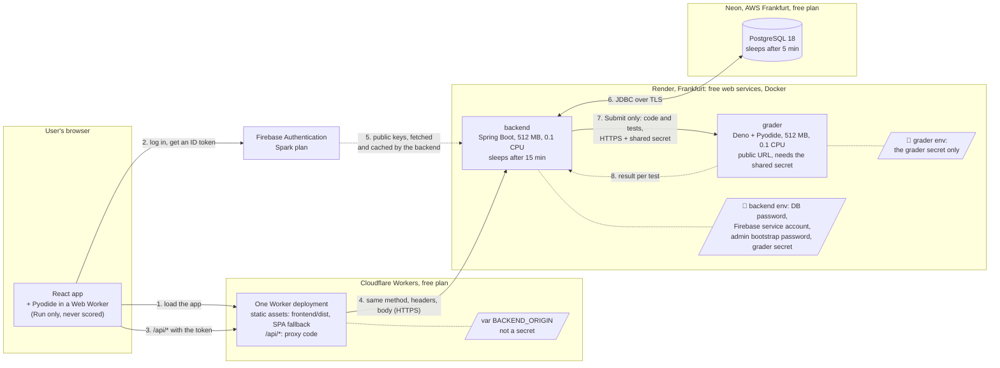
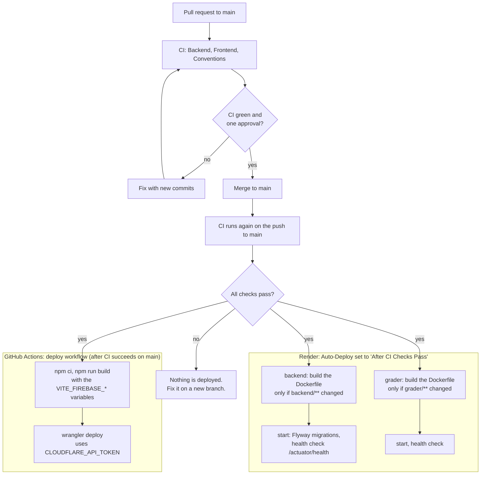
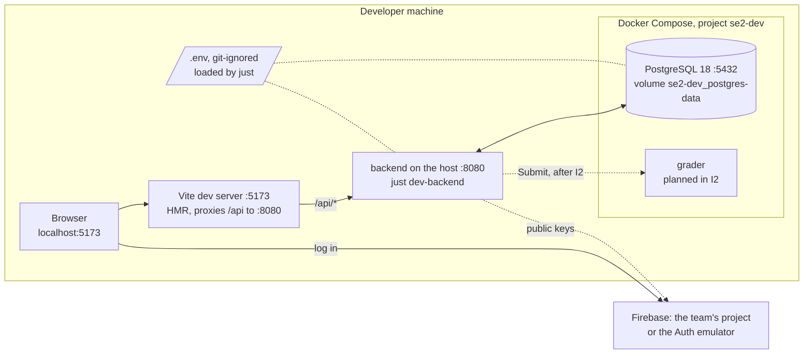

# Deployment

> **Status:** proposal from the hosting research (SCRUM-11), checked on 2026-11-08. The free-tier spike (I7) confirms it before the deployment files (I4) are written. Free plans change often: check the numbers against the sources at the end before relying on them.

## Recommended combination

| Part | Platform (free plan) | Why |
| --- | --- | --- |
| Frontend and the `/api/*` forward | **Cloudflare Workers** with static assets, plus a small proxy Worker that runs only for `/api/*` | No card. Static files are free. The Worker counts only API calls (100,000 per day). There is no documented time limit while it waits for a sleeping backend. The free plan is not limited to personal use, and teammates can be invited. |
| Backend | **Render** free web service, Docker, region Frankfurt | No card. 512 MB RAM, 0.1 CPU. Builds the Dockerfile from the repository. |
| Grader | A **second Render** free web service, Docker, Frankfurt | Same platform and region as the backend. |
| Database | **Neon** Free, PostgreSQL 18, region AWS Frankfurt | No card. It never expires. It is in the same region as the backend. |
| Login | **Firebase Authentication**, Spark plan | Already decided. |

**Alternative for the frontend: Vercel Hobby.** One rewrite rule in `vercel.json` does the forward, and Vercel documents a 120-second wait for the origin. Two limits apply: the Hobby plan is for personal, non-commercial use only, and it has no team features (one teammate owns the project). Also, a private repository owned by a GitHub organization needs the paid plan.

**Plan B for the backend and the grader: Azure for Students.** Use it if Spring Boot is too slow or too big on Render's 0.1 CPU and 512 MB (the spike decides).
- It needs no card. It gives $100 of credit for 12 months, renewable while you are a student.
- Container Apps has an always-free monthly grant: 180,000 vCPU-seconds, 360,000 GiB-seconds and 2 million requests. Apps scale to zero.
- The grader can use *internal* ingress, so it is not reachable from the internet.
- The cost: the deployment belongs to one student's subscription, and the setup takes more work. To stay inside the free grant, use GHCR for the images instead of a paid registry and keep logging minimal.

## Free limits that matter

| Platform | Limit | What it means for us |
| --- | --- | --- |
| Render | 512 MB RAM and 0.1 CPU per free service | The JVM must be sized for 512 MB. Start-up at 0.1 CPU is slow; the spike measures it. |
| Render | **750 free instance hours per workspace per month**, shared by all free services. A sleeping service uses none. When the hours run out, the service is suspended until the next month. | Backend and grader both awake all month would need about 1,488 h. They fit only because both sleep when idle. **No keep-alive pings.** |
| Render | Sleeps after 15 minutes without inbound traffic. Waking takes about a minute, plus the app's own start-up. | The first request after a pause is slow (see "Consequences"). |
| Render | Free services **cannot receive private network traffic**. | The grader needs a public HTTPS URL. It answers only requests that carry the shared secret. |
| Render | 5 GB outbound bandwidth and 500 build minutes per month (Hobby). Without a payment method, new builds stop when the minutes run out. | Build a service only when its folder changes. |
| Render | Ephemeral filesystem. The service may be restarted at any time. | No local state. Everything goes in PostgreSQL. |
| Neon | 1 GB storage and 100 CU-hours per project per month. Scales to zero after 5 minutes (cannot be turned off). 5 GB egress. | Plenty for the MVP. The connection pool must survive the compute suspending. |
| Neon | Free projects are not paused or deleted for inactivity. When the CU-hours run out, compute stops until the next month, and the data is kept. | No expiry date to plan around. |
| Cloudflare Workers | 100,000 Worker requests per day (reset at midnight UTC, then error 1027). 10 ms of CPU per request; time spent waiting on `fetch()` does not count. | Only `/api/*` calls count, including result polling. Enough for a class project. |

## Answers to the hosting questions in the overview

1. **Can the frontend host forward `/api/*` to a backend on another host?**
   - Cloudflare: yes, with a Worker. The `_redirects` file alone cannot proxy to an external domain.
   - Vercel: yes, with a rewrite.
   - Netlify: yes, with a `200` rewrite.
   - GitHub Pages: no rewrites at all.
   - Firebase Hosting: rewrites only to Google services that need a billing account.
2. **Does it wait long enough for a sleeping backend?** Render takes about a minute to wake, plus the Spring Boot start at 0.1 CPU, which is not measured yet.
   - Netlify gives up after **26 s**, which is too short.
   - Vercel waits **120 s**.
   - Cloudflare documents **no hard limit**.

   The spike measures both Vercel and Cloudflare against a real cold start. Whatever the result, the frontend must handle a slow first request.
3. **Are the `Authorization` header and the request body passed unchanged and without caching?** The proxy Worker forwards the original request (method, headers, body) and does not use the cache. To be safe, the backend also sends `Cache-Control: no-store` on every `/api` response: some hosts cache proxied responses that carry ETag or Last-Modified headers (Netlify, for example). The spike checks this with an echo endpoint.
4. **Do the backend and the grader fit in the free memory and hours?**
   - **Hours:** yes, as long as both sleep when idle (see the table).
   - **Memory:** 512 MB each is tight for a JVM and for Pyodide. The spike measures both.
   - The child-process fallback (the grader inside the backend container) saves hours, but it puts the JVM, Deno and Pyodide in the same 512 MB, which is probably too small. If two services do not fit, go to Plan B rather than the fallback.
5. **Does the free database expire, and how big can it be?**
   - Neon: no expiry, 1 GB.
   - Render Postgres: expires 30 days after creation and is deleted after a 14-day grace period, so we do not use it.
   - Supabase: 500 MB, paused after a week of inactivity.
   - Aiven: 1 GB and 20 connections, powered off when inactive.
6. **Terms of use, payment card:**
   - Render, Neon, Cloudflare and Firebase Spark need no card.
   - Render says its free services are not meant for production, which is acceptable for a university project.
   - Vercel Hobby is non-commercial and personal only.

### Rejected options

| Option | Why not |
| --- | --- |
| Netlify | The proxy times out after 26 s. The free plan is 300 credits per month at 15 credits per production deploy, so about 20 deploys. Going over the limit pauses every project on the account. |
| Render Postgres | Expires 30 days after creation. |
| Koyeb | Only one free service, and it needs a card (a $29 pre-authorization hold). |
| Fly.io | No monthly free allowance. A card is required after a 7-day trial. |
| Railway | After the trial, only $1 of credit per month (about 100 MB of RAM). |
| Hugging Face Spaces | Since July 2026, new Docker Spaces on free CPU need a PRO subscription (community reports). |
| Google Cloud Run, AWS | Generous free tiers, but a payment card is required. |
| Deno Deploy (for the grader) | No subprocesses, so we cannot start one fresh process per submission. |

## Production

Who runs where, and how a request travels. The step numbers match [overview.md](../overview.md).

- The browser talks only to Cloudflare (the app and `/api`) and to Firebase (login). It never learns the backend's or the grader's address.
- The backend is the only part that holds secrets that matter and the only part that reaches the database.
- The grader holds a single secret, the one it checks on incoming calls. It has no database access and no Firebase access.

### Where each secret lives

| Name | Where it is set | Secret? | Used by |
| --- | --- | --- | --- |
| `SPRING_DATASOURCE_URL`, `SPRING_DATASOURCE_USERNAME` | Render, backend environment | No (config) | backend |
| `SPRING_DATASOURCE_PASSWORD` | Render, backend environment (copied from the Neon console) | **Yes** | backend |
| `FIREBASE_PROJECT_ID` | Render, backend environment | No | backend: token issuer and audience |
| `FIREBASE_SERVICE_ACCOUNT_JSON` | Render, backend environment | **Yes** | backend: Admin SDK (first admins, blocking users) |
| `ADMIN_BOOTSTRAP_EMAILS` | Render, backend environment | No | backend, at start-up |
| `ADMIN_BOOTSTRAP_PASSWORD` | Render, backend environment | **Yes** | backend, at start-up |
| `GRADER_URL` *(new)* | Render, backend environment | No | backend |
| `GRADER_SHARED_SECRET` *(new)* | Render, the **same value** in the backend and in the grader environment | **Yes** | backend sends it, grader checks it |
| `VITE_FIREBASE_API_KEY`, `VITE_FIREBASE_AUTH_DOMAIN`, `VITE_FIREBASE_PROJECT_ID` | GitHub Actions **variables**, read at build time | No: they end up in the JavaScript bundle by design | frontend |
| `BACKEND_ORIGIN` *(new)* | Cloudflare Worker variable, in the Wrangler config | No | proxy Worker |
| `CLOUDFLARE_API_TOKEN`, `CLOUDFLARE_ACCOUNT_ID` | GitHub Actions **secrets** | The token, **yes** | deploy workflow |

- Render reads the repository through its GitHub app, so no Render key lives in GitHub.
- Never: a secret in git, a secret in the frontend bundle, or a secret in the grader other than its own.
- New variables also get a placeholder in `.env.example`.

## CI/CD: merge to `main`, build, deploy

- The existing `ci.yml` already runs on pull requests and on pushes to `main`. The `Conventions` job is skipped on pushes, and Render does not treat a skipped check as a failure.
- Render waits for the checks of the merge commit, so a red `main` never reaches production.
- Building only when a service's folder changes keeps us under Render's 500 build minutes.
- Flyway runs when the backend starts. A migration must therefore work with the frontend that is already live (add columns first, remove them in a later release).

## Local development

`just dev` starts PostgreSQL, the backend and the frontend. The Vite proxy plays the part of the Cloudflare Worker, so the code is the same in both places: the browser always calls `/api` on its own origin.

## Consequences for other tasks

- **Deployment files (I4):**
  - Multi-stage Dockerfiles for the backend (JRE 25, sized for 512 MB: `-XX:MaxRAMPercentage`, Serial GC, the JDK's AOT cache for a faster start) and for the grader.
  - A `render.yaml` with the two free web services in `frankfurt`, a build filter per folder, and `/actuator/health` as the health check.
  - A `wrangler.jsonc` with `frontend/dist` as the assets, the single-page-app fallback and `run_worker_first` for `/api/*`, plus the proxy Worker itself, about twenty lines.
  - `GRADER_URL`, `GRADER_SHARED_SECRET` and `BACKEND_ORIGIN` added to `.env.example`.
- **Backend:**
  - Add `Cache-Control: no-store` on `/api` responses.
  - Add a tiny public endpoint the frontend can call to wake the backend, for example `GET /api/v1/ping`.
  - Use `sslmode=require` in the Neon JDBC URL and a small connection pool that reconnects after Neon suspends. Do not run keep-alive queries: they would keep Neon awake and burn CU-hours.
- **Backend → grader:** the call is already asynchronous (`202` and polling). Give it a timeout long enough for the grader to wake (at least two minutes) and one retry, then fall back to `INTERNAL_ERROR`. Run one submission at a time on 0.1 CPU and queue the rest.
- **Frontend:**
  - Call the wake endpoint as soon as the app loads.
  - If it has not answered after a few seconds, show a "waking up the station" message and retry GET requests.
  - Never retry a POST automatically.
- **Grader:** compare the shared secret in constant time and reject a bad secret before loading Pyodide, so random requests stay cheap.

## What the spike (I7) must measure

- **Cold start:** the backend's time from sleep to its first answer on Render (wake plus Spring Boot at 0.1 CPU), and its memory use.
- **Grader:** the memory and time of one Deno + Pyodide run of a trivial test.
- **Proxy:** whether the Cloudflare Worker (and Vercel, for comparison) waits through a full cold start. Use an echo endpoint to check that `Authorization` and a POST body arrive unchanged and that nothing is cached.
- **Neon:** the wake-up time, and whether the pool reconnects after Neon suspends.
- **Usage:** Render build minutes per deploy, and the instance hours used over one week of normal use.

## Sources (checked 2026-11-08)

- Render: [Deploy for Free](https://render.com/docs/free), [Pricing](https://render.com/pricing), [Compute plans update](https://render.com/docs/compute-plans-update.md), [Skip auto-deploying if CI checks fail](https://render.com/changelog/skip-auto-deploying-if-ci-checks-fail), [Render in mid-2026: the 1 August plan change](https://jwatte.com/blog/render-com-platform-review/), [Service suspended until the next billing period](https://community.render.com/t/your-service-is-now-suspended-until-the-next-billing-period-upgrade-your-plan-to-restore-your-service/25987)
- Cloudflare: [Workers limits](https://developers.cloudflare.com/workers/platform/limits/), [Static assets redirects](https://developers.cloudflare.com/workers/static-assets/redirects/)
- Vercel: [CDN origin timeout increased to two minutes](https://vercel.com/changelog/cdn-origin-timeout-increased-to-two-minutes), [Hobby plan](https://vercel.com/docs/plans/hobby), [Hobby and GitHub organizations](https://community.vercel.com/t/why-cant-hobby-accounts-deploy-from-organizations/10015)
- Netlify: [Rewrites and proxies](https://docs.netlify.com/manage/routing/redirects/rewrites-proxies/)
- Neon: [Pricing](https://neon.com/pricing), [Free plan limits](https://neon.com/faqs/free-plan-limits-and-quotas), [Postgres version support](https://neon.com/docs/postgresql/postgres-version-support)
- Others: [Supabase pricing](https://supabase.com/docs/pricing), [Aiven free tier](https://aiven.io/docs/products/postgresql/concepts/pg-free-tier), [Koyeb pricing FAQ](https://www.koyeb.com/docs/faq/pricing), [Azure for Students](https://azure.microsoft.com/en-us/free/students), [Hosting free tiers side by side (September 2026)](https://flaviocopes.com/hosting-free-tiers/), [Hugging Face: free CPU Basic Spaces](https://discuss.huggingface.co/t/official-community-complaint-revert-free-cpu-basic-spaces-and-remove-anti-developer-sdk-restrictions/177703)
