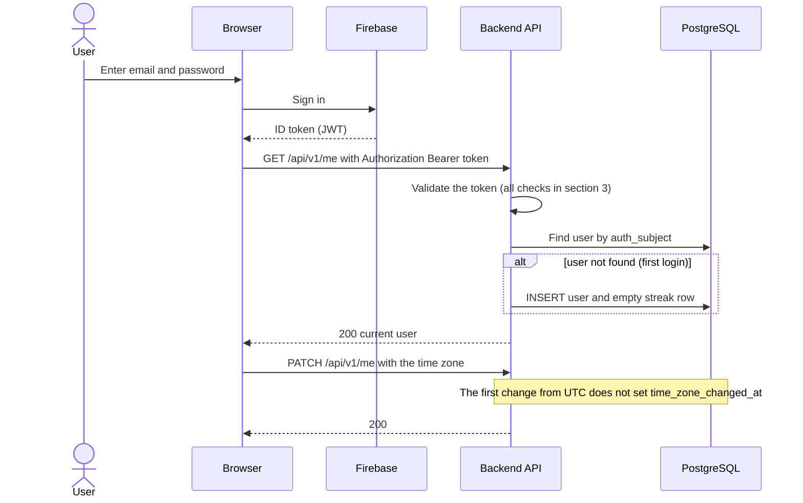
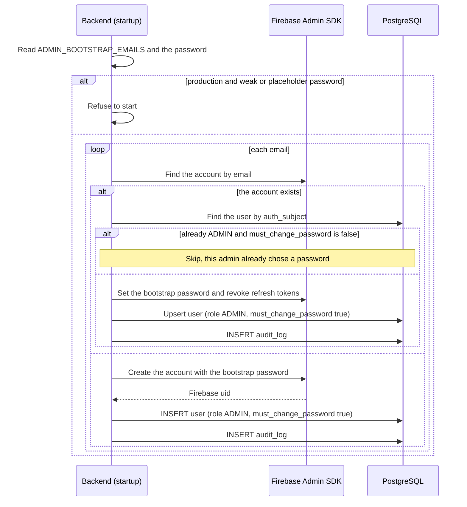
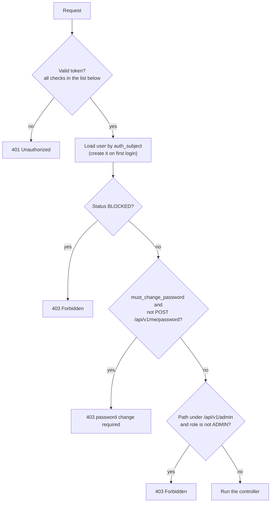
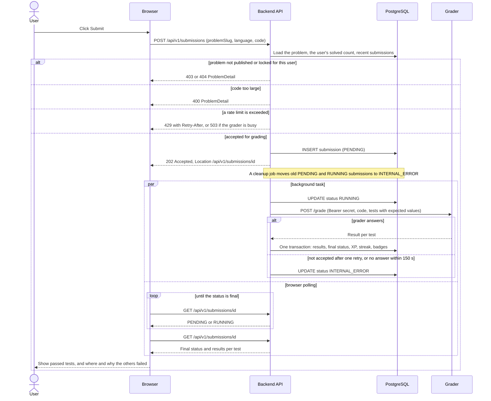
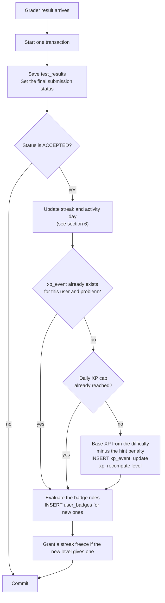
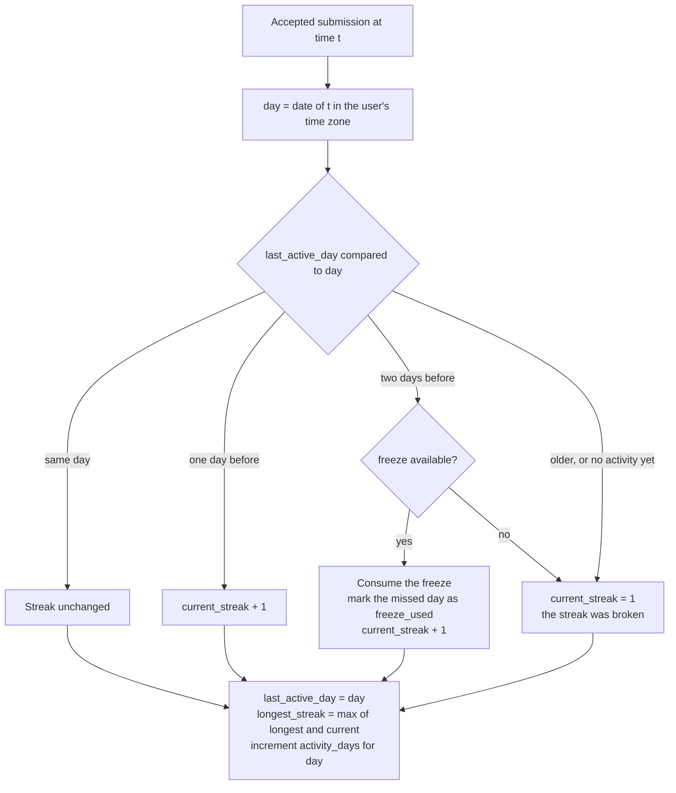
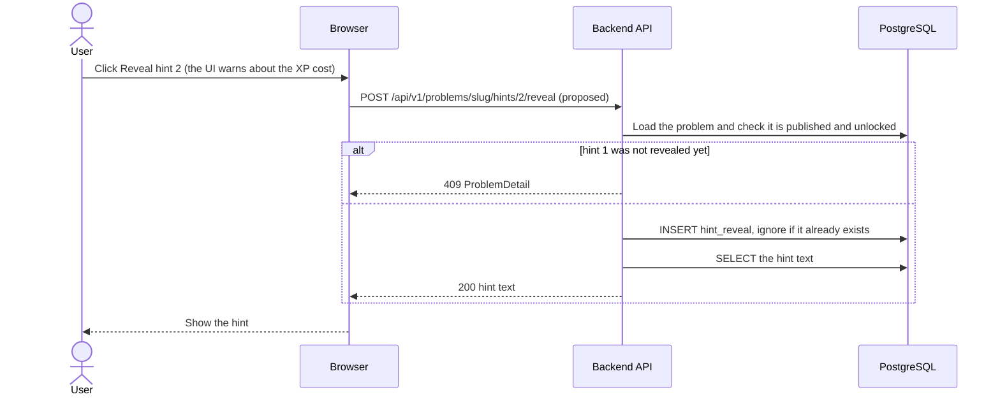
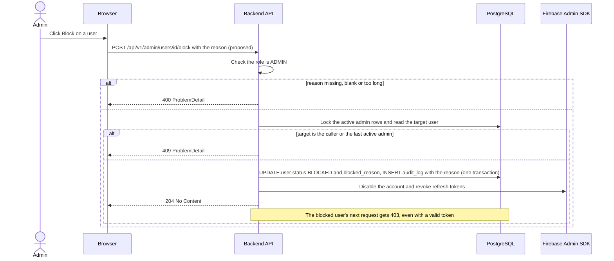
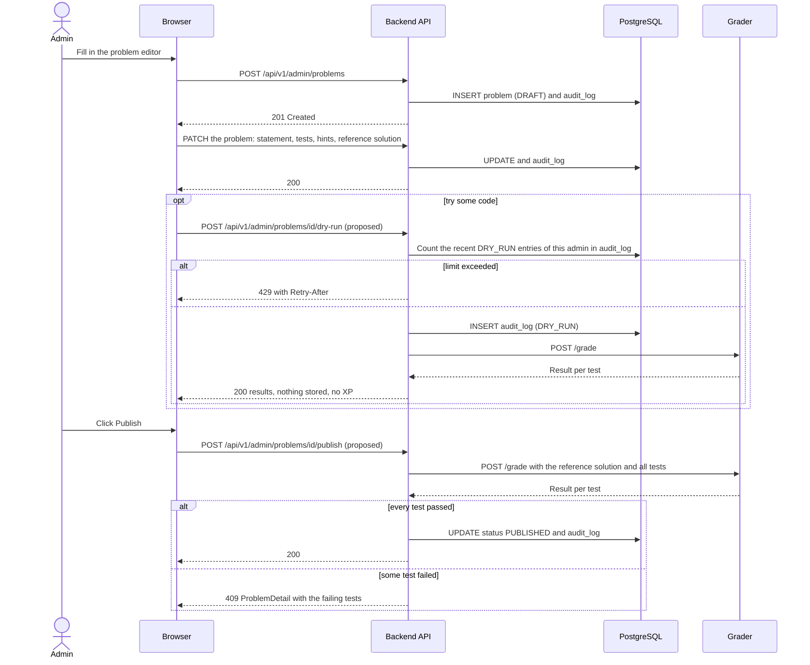
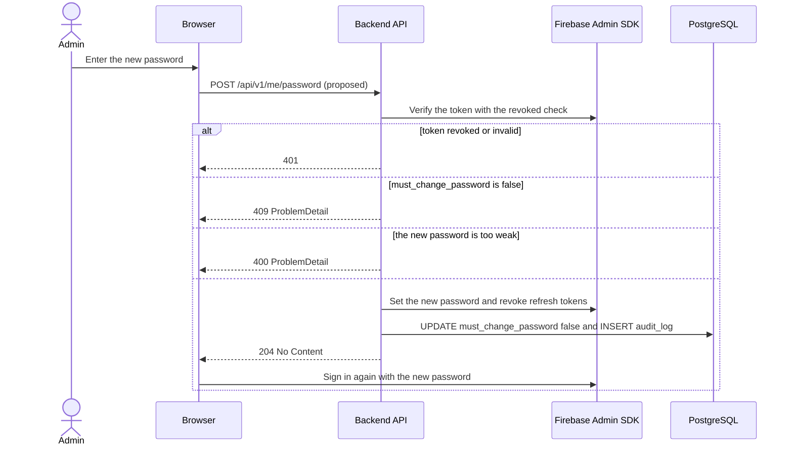

# Flows over time

The main sequences of the backend, in the order a user (and then an admin) meets them. Endpoint names that are not yet fixed are marked *proposed*; they are also listed in [api-conventions.md](../api-conventions.md).

## 1. Login and first-login user sync

**What it shows.** The browser logs in with Firebase and gets an ID token; the backend never sees the password. On the first request with a token whose `sub` is unknown, the backend creates the user (role `USER`, status `ACTIVE`, level 1, an empty streak row, time zone `UTC`). The browser then sets the real time zone with `PATCH /api/v1/me`. That first change does **not** start the 7-day limit: `time_zone_changed_at` stays empty until the user changes the time zone themselves. If two first requests arrive at the same moment, the unique `auth_subject` makes one insert fail and that request simply reads the existing user.

## 2. Creating the first admins at startup

**What it shows.** There is no admin UI before the first admin exists, so the backend creates them at startup from `ADMIN_BOOTSTRAP_EMAILS` and `ADMIN_BOOTSTRAP_PASSWORD`. In production it refuses to start if the password is weak or still the placeholder.

Sign-up with email and password is open and Firebase does not verify the email, so someone could register an admin's email before the first startup. That is why, when the account already exists, the backend does not trust it: it sets the bootstrap password and revokes the refresh tokens, so only the person who knows the bootstrap password gets in. The new admins are marked `must_change_password`, and can do nothing else until they change it (section 10).

Bootstrap runs at **every** startup, so it skips an admin who already chose a password (`ADMIN` with `must_change_password = false`); otherwise it would reset a legitimate password. Every step is written to `audit_log`; the `admin_id` is empty because the actor is the system.

## 3. Checking a request (every call)

**What it shows.** The decisions made, in order, for every authenticated request. The token is checked locally with Firebase's public keys. The user's status is read from our database on every request, so blocking takes effect immediately even though the token itself stays valid for up to an hour. Roles are stored in our database and checked on the server; hiding a menu is not security. A user who must change the password can call only `POST /api/v1/me/password` (section 10).

The token checks, all of them (so the auth task does not miss one):

| Check | Expected |
| --- | --- |
| Algorithm | `alg` is `RS256` |
| Key | `kid` is one of Google's public keys for Firebase tokens (cached) |
| Signature | valid for that key |
| Expiry | `exp` is in the future |
| Issue time | `iat` and `auth_time` are in the past |
| Audience | `aud` is the Firebase project id (Spring does not check this by default: add a validator) |
| Issuer | `iss` is `https://securetoken.google.com/<projectId>` |
| Subject | `sub` is not empty |

## 4. Submitting code

**What it shows.** The full Submit chain. The browser sends only the source code. Before anything is stored, the backend rejects what it can: a problem that is not published or is locked for this user (the unlock rule is checked on the server), code that is too large, and rate limits. Otherwise it stores a `PENDING` submission and answers `202` immediately. The grader call runs in the background, with a 150 s timeout, long enough for a sleeping grader to wake up. It is retried once only when the grader did not accept it; after the timeout the backend gives up and the grader drops the request ([grader.md](grader.md#2-contract-between-the-backend-and-the-grader)). Meanwhile the browser polls until the status leaves `PENDING` and `RUNNING`.

To shorten the wait after a long pause, the backend wakes the grader early: it calls the grader's `GET /health`, without waiting for the answer, when the backend starts and when a user opens a problem page (at most once every 10 minutes).

The free host can restart the backend at any time. A cleanup job therefore moves submissions that stay `PENDING` or `RUNNING` for more than 5 minutes to `INTERNAL_ERROR`. "Grader unreachable" always happens in `RUNNING`, because the status is set before the call.

## 5. After a verdict: XP, streak, badges

**What it shows.** Everything that happens in the single transaction that stores a verdict, so a verdict is never counted twice. The streak and the activity day are updated for **every** accepted submission (see section 6).

XP follows these rules:

- It is awarded only if the user has no `xp_event` for this problem yet. The unique key in the database is the final guard if two submissions race.
- If the daily cap is already reached, **no** `xp_event` is created. The user keeps the chance to earn this problem's XP with a later accepted submission (for example the next day). Below the cap the user gets the full XP, with no partial amounts.
- The hint penalty counts the hints revealed **before the `submitted_at` of the user's first accepted submission** for this problem, even when XP is awarded on a later one. A hint opened while a submission was running, or after the problem was solved, costs nothing.
- Because of the cap, "problem solved" is **not** derived from `xp_events`. It means that an `ACCEPTED` submission exists for the user and the problem. Unlocks and badges use that.

Badge rules and unlocks are evaluated from stored data after XP and streak are updated. All numbers (XP per difficulty, hint penalty, daily cap, level thresholds) are read from `app_settings`.

## 6. Daily streak calculation

**What it shows.** How the streak is updated when an accepted submission arrives. The "day" is the date in the user's stored time zone at the moment of the verdict. Same day: nothing changes except the activity counter. Next day: the streak grows. Two days ago (exactly one day missed): a freeze, if the user has one, is consumed and the streak continues. Anything older: the streak restarts from 1.

## 7. Revealing a hint

**What it shows.** Hints are revealed one by one, and the text is never available any other way: the problem detail returns only the number of hints. The backend records the reveal **before** returning the text, so a user cannot read a hint for free. Revealing the same hint twice is harmless. The XP penalty is computed later, in the verdict transaction (section 5), from the reveals made before the first accepted submission of the problem.

## 8. Blocking a user

**What it shows.** An admin blocks a user and must give a reason (not blank, at most 500 characters), which is stored in `users.blocked_reason` and in the audit entry. Unblocking clears `blocked_reason`; the earlier reasons stay in `audit_log`. An admin cannot block themselves or the last active admin; the check runs in the same transaction as the block, with the active admin rows locked, so two admins cannot block each other at the same moment. The status change and the audit entry are written in that transaction. The Firebase account is also disabled and its refresh tokens revoked, so the user cannot get new tokens. If the Firebase call fails, the block still works, because the status is checked on every request (section 3).

## 9. An admin creates and publishes a problem

**What it shows.** The content workflow. A problem starts as a draft; the admin adds tests, up to 3 hints and a reference solution. A dry run sends code to the grader without storing a submission or giving XP. Because nothing is stored in `submissions`, its rate limit is counted from `audit_log` (a `DRY_RUN` entry per call, index on `(admin_id, created_at)`). Publishing is accepted only if the reference solution passes every test, checked through the grader at that moment. Every step goes to the audit log.

## 10. Changing the password of a first admin

**What it shows.** How `must_change_password` is cleared. The password lives in Firebase, so the backend cannot know that it changed unless it makes the change itself. A client call such as "I changed it" would let anyone who knows the bootstrap password clear the flag. So the backend does everything in one step: it checks the strength of the new password, changes it through the Admin SDK, revokes the refresh tokens, and clears the flag. The client then signs in again.

A token issued before the bootstrap reset stays valid for up to an hour, so on this endpoint only the token is verified with the revoked check (one extra call to Firebase). The endpoint works only while the flag is true; this is also the only endpoint the check in section 3 lets through for such a user.

