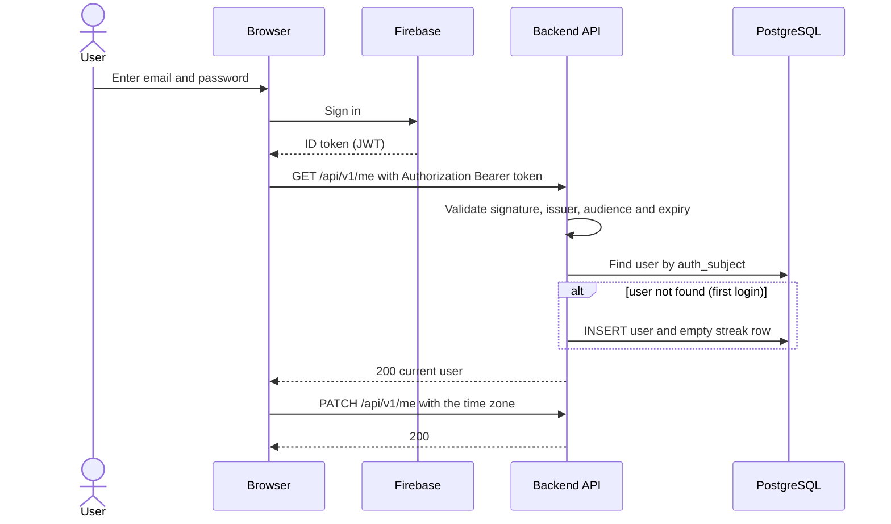
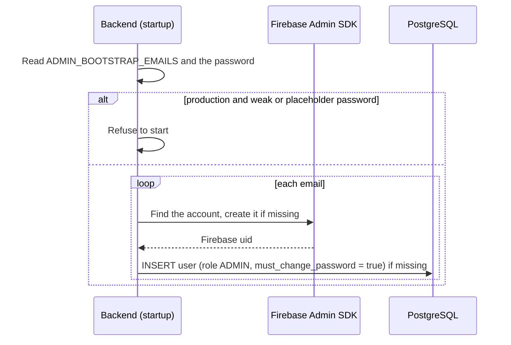
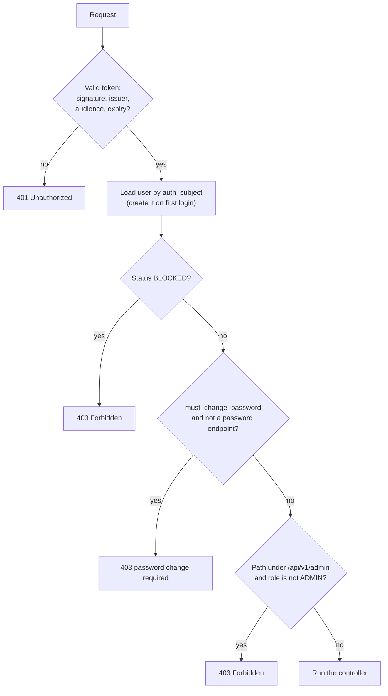
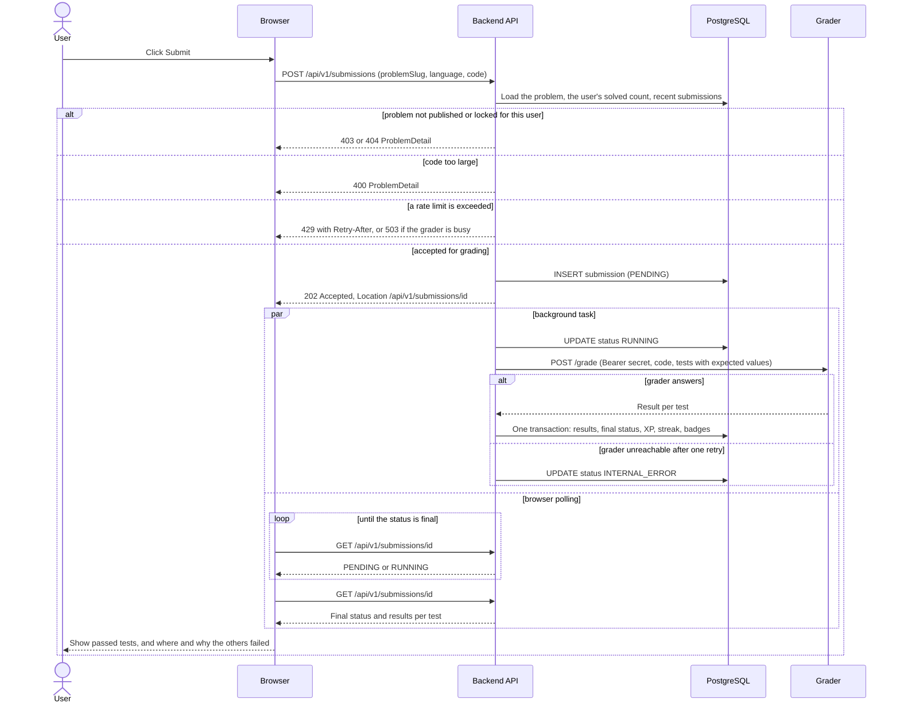
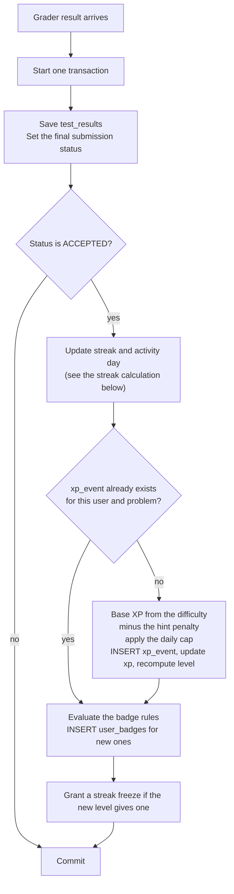
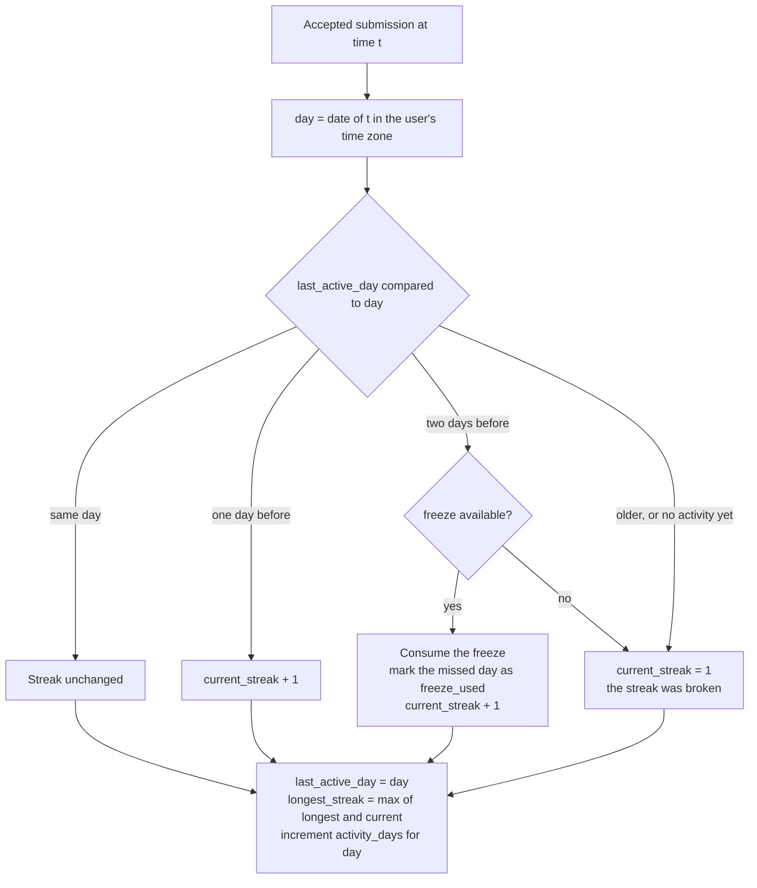
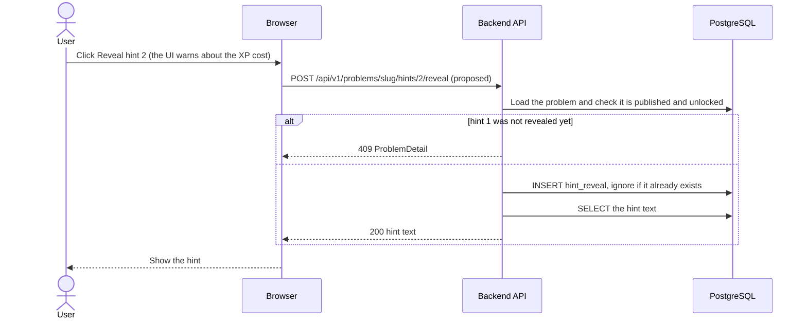
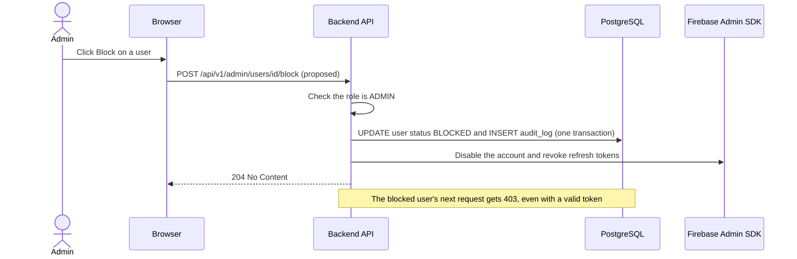
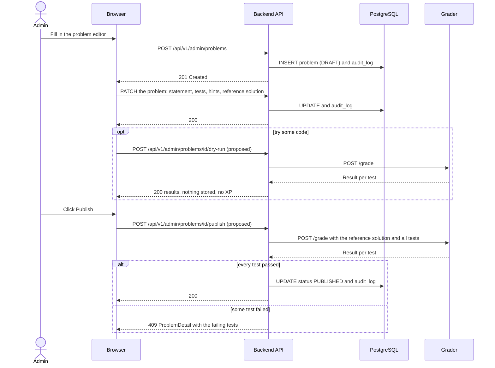

# Flows over time

The main sequences of the backend, in the order a user (and then an admin) meets them. Endpoint names that are not yet in [api-conventions.md](../api-conventions.md) are marked *proposed*.

## 1. Login and first-login user sync

**What it shows.** The browser logs in with Firebase and gets an ID token; the backend never sees the password. On the first request with a token whose `sub` is unknown, the backend creates the user (role `USER`, status `ACTIVE`, level 1, an empty streak row, time zone `UTC`). The browser then sets the real time zone with `PATCH /api/v1/me`. If two first requests arrive at the same moment, the unique `auth_subject` makes one insert fail and that request simply reads the existing user.

## 2. Creating the first admins at startup

**What it shows.** There is no admin UI before the first admin exists, so the backend creates them at startup from `ADMIN_BOOTSTRAP_EMAILS` and `ADMIN_BOOTSTRAP_PASSWORD`. In production it refuses to start if the password is weak or still the placeholder. The new admins are marked `must_change_password`, so they can do nothing else until they change it.

## 3. Checking a request (every call)

**What it shows.** The decisions made, in order, for every authenticated request. The token is checked locally with Firebase's public keys. The user's status is read from our database on every request, so blocking takes effect immediately even though the token itself stays valid for up to an hour. Roles are stored in our database and checked on the server; hiding a menu is not security.

## 4. Submitting code

**What it shows.** The full Submit chain. The browser sends only the source code. Before anything is stored, the backend rejects what it can: a problem that is not published or is locked for this user (the unlock rule is checked on the server), code that is too large, and rate limits. Otherwise it stores a `PENDING` submission and answers `202` immediately. The grader call runs in the background, with a timeout long enough for a sleeping grader to wake up and one retry. Meanwhile the browser polls until the status leaves `PENDING` and `RUNNING`.

## 5. After a verdict: XP, streak, badges

**What it shows.** Everything that happens in the single transaction that stores a verdict, so a verdict is never counted twice. The streak and the activity day are updated for **every** accepted submission. XP is awarded **only** if the user has no `xp_event` for this problem yet; the unique key in the database is the final guard if two submissions race. Badge rules and unlocks are evaluated from stored data after XP and streak are updated. All numbers (XP per difficulty, hint penalty, daily cap, level thresholds) are read from `app_settings`.

## 6. Daily streak calculation

**What it shows.** How the streak is updated when an accepted submission arrives. The "day" is the date in the user's stored time zone at the moment of the verdict. Same day: nothing changes except the activity counter. Next day: the streak grows. Two days ago (exactly one day missed): a freeze, if the user has one, is consumed and the streak continues. Anything older: the streak restarts from 1.

## 7. Revealing a hint

**What it shows.** Hints are revealed one by one, and the text is never available any other way: the problem detail returns only the number of hints. The backend records the reveal **before** returning the text, so a user cannot read a hint for free. Revealing the same hint twice is harmless. The XP penalty applies only to hints revealed before the first accepted solve; it is computed later, in the verdict transaction (diagram 5).

## 8. Blocking a user

**What it shows.** An admin blocks a user. The status change and the audit entry are written in the same transaction. The Firebase account is also disabled and its refresh tokens revoked, so the user cannot get new tokens. If the Firebase call fails, the block still works, because the status is checked on every request (diagram 3).

## 9. An admin creates and publishes a problem

**What it shows.** The content workflow. A problem starts as a draft; the admin adds tests, up to 3 hints and a reference solution. A dry run sends code to the grader without storing a submission or giving XP (it is rate-limited like normal submissions). Publishing is accepted only if the reference solution passes every test, checked through the grader at that moment. Every step goes to the audit log.

