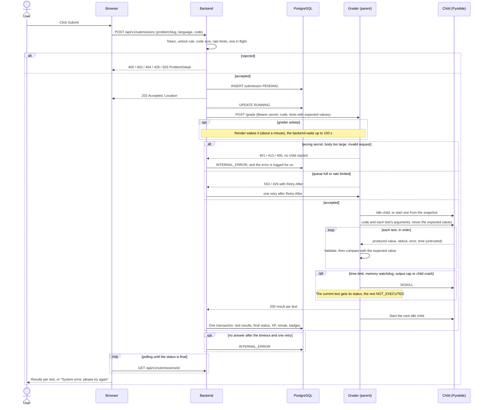

# Grader service

> **Status:** design for SCRUM-237, 2026-11-24. It turns [code-execution.md](code-execution.md) (the proposal), [submission-verification.md](submission-verification.md) (the security review and its required controls) and [deployment.md](deployment.md) (the hosting research) into one design, and refines the grader parts of [architecture.md](architecture.md), [flows.md](flows.md) and [states.md](states.md). **The Render test in [section 5](#5-hosting-decision-and-test) is still to be run.** Until then, the numbers marked *local* come from a 0.1 CPU emulation on a development machine, not from Render.

## Summary

- **One `grader` service:** Deno with Pyodide, the parent and child model approved in the security review, and no secrets except its own.
- **Pyodide 314.0.8 (Python 3.14.2)**, pinned, self-hosted, and the same files in the browser and in the grader. Deno 2.9.6 loads it with the child's permission flags; it does not load 0.26.4 without an unstable flag ([section 6.2](#62-one-pyodide-version)).
- **Children start from a memory snapshot** built into the image. At 0.1 CPU a child is ready in about 6 s, against about 52 s when Python starts from scratch (*local*). Without the snapshot, one fresh process per submission is too slow on a free instance.
- **One child at a time**, plus one idle child started in advance. Two children do not fit in 512 MB.
- **Memory has a hard cap:** `--wasm-max-mem-pages=2048` limits Pyodide to 128 MB of WebAssembly memory. A memory bomb then ends in a Python `MemoryError`, the interpreter keeps working, and the test is reported as `RUNTIME_ERROR` with `MemoryLimitExceeded` (*local*). The memory watchdog stays as a backstop.
- **Hosting:** a second Render free web service in Frankfurt if the test meets the threshold agreed beforehand; otherwise Azure Container Apps (Plan B in deployment.md).

## 1. End-to-end flow

**What it shows.** A Submit from the click to the stored verdict, with every failure path. The backend part is the one from [flows.md](flows.md#4-submitting-code); this diagram adds what happens inside the grader and where each failure ends.



| What fails | Where it is caught | The submission ends as | What the user sees |
| --- | --- | --- | --- |
| Grader asleep | The backend's timeout covers the wake-up | The normal verdict, later | "Grading on the server…", and after 10 s "the grader is waking up, this can take up to two minutes" |
| Grader unreachable (connection error, timeout, 5xx) | Backend, after one retry | `INTERNAL_ERROR`, no XP | "System error, please try again" |
| Queue full or grader rate limit (`503`, `429`) | Backend, one retry after `Retry-After` | The verdict, or `INTERNAL_ERROR` | As above. With the backend's global in-flight limit (10) below the queue (20), this should not happen |
| Wrong secret, body too large, invalid request (`401`, `413`, `400`) | Backend | `INTERNAL_ERROR` | As above. This is our bug or a wrong configuration, so the backend logs it as an error |
| Syntax error | Child, before any test | `COMPILE_ERROR` | The error, with the line in the user's code |
| Time limit of a test, or the overall limit | Parent kills the child | `TIME_LIMIT_EXCEEDED` | Which test timed out; the tests after it are "not executed" |
| `MemoryError` under the WebAssembly cap | Child, as a Python exception | `RUNTIME_ERROR`, `MemoryLimitExceeded` | "Memory limit exceeded" on that test |
| Memory watchdog, output cap or child crash | Parent kills the child or sees it exit | `RUNTIME_ERROR` on the current test | The reason on that test; the tests after it are "not executed" |
| Grader restarted during a run (redeploy, Render restart) | Backend: the connection drops | The retry grades it again, or `INTERNAL_ERROR` | Usually nothing. The grader keeps no state, so a retry is safe |
| Backend restarted during a run | Cleanup job: `PENDING` or `RUNNING` for more than 10 minutes | `INTERNAL_ERROR` | "System error, please try again". The grader's answer for that run is lost, which is fine |
| The grader's answer is invalid (schema, sizes) | Backend validates it | `INTERNAL_ERROR` | As above |

**Waking the grader early.** A Submit after a long pause would wait for the backend and then for the grader, one after the other. To overlap them, the backend calls `GET /health` on the grader, without waiting for the answer:

- when the backend itself starts;
- when a user opens a problem page, at most once every 10 minutes.

This costs some instance hours (the grader stays awake for 15 minutes after each call), but no keep-alive pings are sent: nothing happens while nobody uses the app.

## 2. Contract between the backend and the grader

**One call:** `POST /grade` over HTTPS, `Content-Type: application/json`. The grader keeps nothing between calls, so the backend may retry a call safely.

**Request**

```json
{
  "requestId": "0192f3a4-7c1e-7b2a-9d11-3f5a8c0e2b44",
  "language": "PYTHON",
  "entryPoint": "solve",
  "code": "def solve(numbers):\n    return numbers[0]\n",
  "tests": [
    { "index": 1, "args": [[1, 2, 3, 4]], "expected": 6 },
    { "index": 2, "args": [[]], "expected": 0 }
  ]
}
```

- `requestId` is the submission id, or a new id for a dry run or a publish check. The grader only writes it to its logs.
- `entryPoint` is the function each test calls, taken from the problem.
- The request carries **no limits**. The grader's limits come from its own environment, so a caller cannot raise them, even with the secret.
- Unknown fields are rejected.

**Response `200`**

```json
{
  "requestId": "0192f3a4-7c1e-7b2a-9d11-3f5a8c0e2b44",
  "outcome": "COMPLETED",
  "compileError": null,
  "tests": [
    { "index": 1, "status": "WRONG_ANSWER", "actualOutput": 1, "stdout": "", "error": null, "runtimeMs": 1 },
    {
      "index": 2, "status": "RUNTIME_ERROR", "actualOutput": null, "stdout": "",
      "error": { "type": "IndexError", "message": "list index out of range", "line": 2 },
      "runtimeMs": 1
    }
  ],
  "runtime": { "deno": "2.9.6", "pyodide": "314.0.8", "python": "3.14.2" }
}
```

- `outcome` is `COMPLETED`, or `COMPILE_ERROR` when the code does not parse. In that case `compileError` has the type, the message and the line, and every test is `NOT_EXECUTED`.
- Per-test statuses: `PASSED`, `WRONG_ANSWER`, `RUNTIME_ERROR`, `TIME_LIMIT_EXCEEDED`, `NOT_EXECUTED`, as stored in `test_results` ([database.md](database.md)).
- The **backend** derives the submission status, with the rule in [states.md](states.md#1-submission). The grader does not send one, so the rule lives in one place.
- If the code raises while it loads, or the entry function is missing, every test gets `RUNTIME_ERROR` with that error.
- `error.line` is a line of the user's code. The parent drops the frames of the harness, as `api-conventions.md` requires.
- The `expected` values are not sent back: the backend already has them.

**Errors**

| Code | When | What the backend does |
| --- | --- | --- |
| `401` | Missing or wrong secret. Checked before the body is read. | `INTERNAL_ERROR`, logged as an error |
| `413` | Body over the cap | Same |
| `400` | Invalid request: unknown fields, too many tests, a value that is not plain JSON | Same |
| `429` | The grader's own rate limit | One retry after `Retry-After`, then `INTERNAL_ERROR` |
| `503` | Queue full | Same |
| `500` | A bug in the grader | One retry, then `INTERNAL_ERROR` |

**Authentication:** `Authorization: Bearer <GRADER_SHARED_SECRET>`, compared in constant time. During a rotation the grader also accepts `GRADER_SHARED_SECRET_PREVIOUS` ([section 6.3](#63-secrets)).

**Health:** `GET /health` answers `200` without authentication and does no work. Render's health check and the backend's wake-up call use it. It returns no versions or other details.

### 2.1 Values and comparison

The child returns each produced value as JSON written by Python, and the parent compares it with the expected value outside Python. These rules are the same in the browser's Run (SCRUM-13), so both sides give the same verdict. A shared file of comparison cases, run by the grader's tests and the frontend's tests, keeps them in sync.

| Value | Rule |
| --- | --- |
| `True` / `False` | Booleans, never equal to `1` / `0` |
| `int` | Equal by value. Integers outside ±2^53 are sent as text and never equal an expected number, since problems keep their numbers below 2^53 ([problem-template.md](../problem-template.md)). |
| `float` | Equal by value. `NaN` and infinities are sent as text and are never equal. |
| `str`, `None` | As in JSON |
| `list`, `tuple` | Compared in order. A tuple counts as a list (proposal 9 in section 10). |
| `dict` | Compared without regard to key order. A key that is not a string makes the test `WRONG_ANSWER`, with a message, because JSON would silently turn `1` into `"1"`. |
| Anything else (`set`, objects) | `WRONG_ANSWER`, with "unsupported return type" |

## 3. Limits

All of these are the grader's hard limits: environment variables of the grader, never editable from the admin panel. The ones marked *proposed* are confirmed or changed by the Render test.

| Limit | Value | Enforced by | When it is exceeded |
| --- | --- | --- | --- |
| Code size | 16 KB | Backend (`400`), checked again by the grader | `400` |
| Tests per problem | 50 | Admin API, checked again by the grader | `400` |
| Request body | 256 KB | Grader, before parsing | `413` |
| Time per test | 2 s wall clock (*proposed*) | Parent | `TIME_LIMIT_EXCEEDED`, child killed |
| Time for all tests | 10 s wall clock, child start not included (*proposed*) | Parent | The current test `TIME_LIMIT_EXCEEDED`, the rest `NOT_EXECUTED` |
| Child start from the snapshot | 30 s | Parent | The child is killed and started again once, then `500` |
| WebAssembly memory | 128 MB (`--wasm-max-mem-pages=2048`) | V8 | `MemoryError` in Python: `RUNTIME_ERROR`, `MemoryLimitExceeded` |
| JavaScript heap of the child | 128 MB (`--max-old-space-size=128`) | V8 | The child dies: `RUNTIME_ERROR` |
| Memory of the child process | 400 MB resident (*proposed*), checked every 100 ms | Parent's watchdog | Child killed: `RUNTIME_ERROR`, `MemoryLimitExceeded` |
| `stdout` per test | 4 KB, cut with a marker | Child, then checked by the parent | The text is cut, the verdict is still given |
| Produced value per test | 8 KB of JSON | Parent | `RUNTIME_ERROR`, "return value too large" |
| Everything the child writes | 1 MB | Parent | Child killed: `RUNTIME_ERROR` on the current test |
| Children at the same time | 1, plus one idle child started in advance | Parent | — |
| Queue | 20 requests | Parent | `503` with `Retry-After: 30` |
| Requests with a wrong secret | 20 per minute per address | Parent | `429` |

**Why these numbers.**

- **Time:** a trivial test takes under 1 ms once the child is ready. A test may run 2 s at 0.1 CPU, which is about 0.2 s of CPU. That is plenty for the small inputs the problem template asks for.
- **Memory:**
  - A child restored from the snapshot uses about 220 MB. It peaked at 322 MB during a memory bomb under the 128 MB cap, and the parent uses about 40 MB (all *local*).
  - Parent plus one child therefore stays under about 400 MB of the 512 MB.
  - Two children would need about 480 MB, which is why only one child exists at a time.
- **Queue:** the backend's global in-flight limit (10, in submission-verification.md section 5) stays below it.

## 4. Inside the grader

**Starting a child from a snapshot.** At image build time, a trusted step starts Pyodide once, without any user code, and saves a memory snapshot (about 30 MB). Each child restores that snapshot instead of initializing Python. Every child starts from the same clean state, so nothing passes from one submission to the next.

| Measured locally, Deno 2.9.6, Pyodide 314.0.8 | No CPU limit | 0.1 CPU (cgroup quota) |
| --- | --- | --- |
| Child start, Python initialized from scratch | 2.6–3.2 s (4.2–5.1 s of CPU) | **52.5 s** |
| Child start from the snapshot | 0.4–0.5 s (0.6 s of CPU) | **6.5–6.7 s** (5.9 s with `--liftoff-only`) |
| Three trivial tests, once the child is ready | under 1 ms | under 1 ms |
| Peak memory of a child, from the snapshot | 221–224 MB | 220–225 MB (208 MB with `--liftoff-only`) |

`_makeSnapshot` and `_loadSnapshot` are experimental options of `loadPyodide`. This is acceptable because the version is pinned, and the malicious payload tests run again on every version bump. If a new version breaks them, the fallback is a normal start, with the slower times in the table.

**One child at a time.**

- The parent keeps one idle child, already restored from the snapshot.
- A submission takes that child. When it ends, the parent starts the next one, which is ready about 6 s later at 0.1 CPU.
- A submission that arrives in that window waits in the queue.
- After a wake-up, the parent starts the first child at once, so it is usually ready by the time the backend's call arrives.

**The child command** (control 2 of the security review, plus the memory cap and the snapshot file):

```bash
deno run --no-prompt \
  --allow-read=/opt/pyodide,/opt/grader/child.js,/opt/grader/pyodide.snapshot \
  --deny-net --deny-write --deny-env --deny-run --deny-sys --deny-ffi --deny-import \
  --v8-flags=--max-old-space-size=128,--wasm-max-mem-pages=2048 \
  /opt/grader/child.js
```

The parent starts it with `Deno.Command`, `clearEnv: true` and an empty working directory. It sends the code and the arguments on stdin, and reads one JSON line per test from stdout, up to the caps.

**The parent's permissions.** The parent runs with `--allow-all`:

- It needs `--allow-run` to start children. The security review already notes that a process that can start `deno` can give itself every permission, so the parent's flags are not the boundary. The child is.
- Deno 2.9 reads `/proc/<pid>/status`, which the memory watchdog needs, only with `--allow-all`. A narrower `--allow-read=/proc` is refused (checked locally).
- The parent never runs user code. It treats everything the child writes as untrusted data: size caps, strict JSON, a fixed schema.

## 5. Hosting decision and test

**Candidate:** a second Render free web service, Docker, Frankfurt, as in [deployment.md](deployment.md). **Fallback:** Azure Container Apps with internal ingress (Plan B). The child-process fallback inside the backend stays rejected.

**Threshold, to be agreed with the team before the test.** Proposal:

| Measurement | Threshold |
| --- | --- |
| Grader asleep: from `POST /grade` to the answer for a trivial submission | ≤ 90 s |
| Backend and grader both asleep, with the early wake-up: from Submit to the verdict | ≤ 120 s |
| Grader awake, idle child ready: `POST /grade` for a trivial submission | ≤ 3 s |
| Child start from the snapshot at Render's 0.1 CPU | ≤ 15 s |
| Peak memory of the grader service, including a memory bomb | ≤ 450 MB |

**How the test runs.** A small probe service is deployed as a Render free web service. It is built like the grader: parent, child, snapshot, the same flags.

At every start it runs a self-test (a trivial run, then a memory bomb) and publishes the times and the memory at `GET /stats`. It runs nothing on request, so it needs no secret. Then:

1. Wait at least 20 minutes, so the service is asleep.
2. Time `GET /health`: the wake-up plus the server start.
3. Read `/stats` once the self-test is done: the child start from the snapshot, the trivial run, the memory bomb and the container's peak memory.
4. Count a cold trivial submission as the `/health` time plus the child's time.
5. Repeat on three different days, and keep the median.

The backend's own cold start is measured in the same session if it can be deployed by then. Otherwise the sum of the two is estimated, and the case is measured again in I4.

**Results**

| Measurement | Threshold | Render | Local (0.1 CPU emulated) |
| --- | --- | --- | --- |
| Grader asleep, trivial submission | ≤ 90 s | *to measure* | — |
| Both asleep, Submit to verdict | ≤ 120 s | *to measure* | — |
| Grader awake, trivial submission | ≤ 3 s | *to measure* | under 1 ms of test time |
| Child start from the snapshot | ≤ 15 s | *to measure* | 5.9–6.7 s |
| Peak memory, with a memory bomb | ≤ 450 MB | *to measure* | about 360 MB (322 MB child + about 40 MB parent) |

**Decision:** *pending the Render test.* If every threshold is met, the grader goes to Render. If one is missed, the same probe runs on Azure Container Apps, and the result and the reason are written here.

## 6. Security

### 6.1 Required controls

How the design meets each required control of [submission-verification.md](submission-verification.md#32-required-controls), and what is still missing.

| # | Control | How this design meets it | Still missing |
| --- | --- | --- | --- |
| 1 | Two levels of process | A parent with our code only; one fresh child per submission. The idle child serves a single submission. The snapshot makes a fresh child affordable at 0.1 CPU. | The implementation (I2) |
| 2 | Child flags, pinned Deno | The command in section 4, with Deno 2.9.6. Checked locally: Pyodide 314.0.8 loads and runs with exactly these flags. | Pin the Deno image by digest |
| 3 | A clean child | `Deno.Command` with `clearEnv: true`, an empty working directory, input on stdin, capped stdout and stderr | — |
| 4 | No expected values in the child | The parent removes `expected` before anything reaches the child, and validates every value the child returns (types, depth, size, no unknown fields) | — |
| 5 | Time | Per-test and overall wall-clock limits, then SIGKILL (section 3) | Final numbers after the Render test |
| 6 | Memory | A hard WebAssembly cap gives a clean `MemoryError`. The resident-memory watchdog stays for memory outside it (JavaScript `ArrayBuffer`s, workers). It reads `/proc`, so the parent runs with `--allow-all` (section 4). | Final watchdog limit after the Render test |
| 7 | Output | Caps per test, per value and for the whole child (section 3). The backend caps the code size first. | — |
| 8 | CPU and queue | One child at a time; a queue of 20; `503` when it is full | — |
| 9 | Authentication | Bearer secret checked in constant time before the body is read; body cap; a previous secret during rotation; a rate limit on wrong secrets | — |
| 10 | Nothing to steal | Only `GRADER_SHARED_SECRET` (and `_PREVIOUS` during a rotation). Non-root user. Pyodide and the snapshot are built into the image; nothing is downloaded at run time. | — |
| 11 | A separate service | Its own Render service (or Azure app), never a child process of the backend | — |
| 12 | Patching | Deno 2.9.6 and Pyodide 314.0.8 pinned. Bump both, rebuild the snapshot and rerun section 8 on every advisory. | Dependabot is postponed (SCRUM-234), so this is manual until it is on |
| 13 | Each verdict counts once | Backend: `PENDING` → `RUNNING` → one final status, a 150 s timeout with one retry, and the cleanup job | Backend implementation |

The optional Pyodide build without `ctypes` is still not planned. The boundary does not depend on it.

### 6.2 One Pyodide version

**Pyodide 314.0.8 (Python 3.14.2)**, the current release (`latest` on npm), for both the browser's Run and the grader:

- **Deno.** Deno 2.9.6 loads 314.0.8 as a normal ES module, with the child's flags. 0.26.4 fails with `ReferenceError: require is not defined` unless Deno gets the unstable `--unstable-detect-cjs` flag. We do not want an unstable flag in the sandbox.
- **Memory.** 314.0.8 used 188–213 MB when started from scratch, against 241 MB for 0.26.4 (*local*).
- **Python.** 3.14.2 instead of 3.12.1, with the current fixes.

**What it changes elsewhere:**

- From 314.0, Pyodide is an ES module, so the browser's Run needs a module worker.
- The download is larger: `ssl` and `sqlite3` are now included. The 12.4 MB measured in the SCRUM-13 spike for 0.26.4 must be measured again.
- The files are self-hosted, from the same npm package, in the frontend's static assets and in the grader image.
- Both are updated in one pull request, which also rebuilds the snapshot. The version line in the SCRUM-13 spike changes with it.

### 6.3 Secrets

| Secret | Where | Rotation |
| --- | --- | --- |
| `GRADER_SHARED_SECRET` | Render environment of the backend and of the grader, same value | At least once per semester, when a teammate leaves the project, and at once after any sign of misuse |
| `GRADER_SHARED_SECRET_PREVIOUS` | Grader only, empty except during a rotation | — |

- The secret is 32 random bytes, for example `openssl rand -base64 32`.
- It is never in git, in the frontend, in logs or in the child.
- The `Authorization` header is never logged.

**Rotation steps:**

1. Put the old value in `GRADER_SHARED_SECRET_PREVIOUS` and a new value in `GRADER_SHARED_SECRET`, on the grader. Wait for the deploy.
2. Set the new value on the backend. Wait for the deploy.
3. Clear `GRADER_SHARED_SECRET_PREVIOUS` on the grader.

### 6.4 Accepted risks

- **A full escape** from the child into the container, through a Deno or V8 bug. It gives control over the grader's answers, as described in [the residual risk](submission-verification.md#residual-risk). This is accepted. Recovery: redeploy the image and rotate the secret.
- **A public URL protected only by the secret**, on Render. It goes away with Azure's internal ingress.
- **The snapshot options are experimental.** The pinned version and the tests on every bump cover this. The fallback is a slower normal start.
- **Tests of one submission share one interpreter.** Global variables survive from one test to the next. This only affects the user's own result.
- **Run and Submit can disagree on time.** Run uses the user's machine, Submit uses 0.1 CPU. The UI says so (SCRUM-13).

## 7. Anti-cheat

**Only the server produces a verdict.** The browser sends code, never a result. The grader's parent compares the produced values with expected values that the child never sees. The backend stores the verdict and applies it once. A replayed request creates a new submission that runs again.

**What a user can still do, and how it is limited:**

| What | Limited by |
| --- | --- |
| Hard-code the visible tests | Accepted (decided 2026-11-03). XP only on the first solve, the daily XP cap, a small total of XP. |
| Keep state between the tests of one run | Only changes their own result |
| Waste grader time with slow code | Per-test and overall time limits, one in flight per user, rate limits |
| Use several accounts | Per-IP and global limits; no leaderboard in the MVP |
| Print fake "passed" lines | `stdout` is only shown, never parsed for a verdict |
| Make the child lie about its values | It can only claim values: the same as hard-coding |

**Signs to watch:** one user solving far more problems in a day than the others, or many accepted verdicts with almost no running time.

## 8. Malicious submissions

Each payload must give the expected result **and leave the grader healthy**: the next normal submission must pass. This extends [section 6 of the security review](submission-verification.md#6-malicious-payload-tests-after-i2) with the statuses of this contract.

| Payload | Expected result |
| --- | --- |
| `while True: pass` in test 3 | Test 3 `TIME_LIMIT_EXCEEDED`, the rest `NOT_EXECUTED`, child killed |
| `x = []` then `while True: x.append("a" * 10**6)` | `MemoryError` under the WebAssembly cap: `RUNTIME_ERROR`, `MemoryLimitExceeded`. The child survives (checked locally). |
| `run_js("let a = []; for (;;) a.push(new ArrayBuffer(2**24))")` | The watchdog kills the child: `RUNTIME_ERROR`, `MemoryLimitExceeded` |
| `run_js("let a = []; for (;;) a.push({})")` | The JavaScript heap limit stops the child: `RUNTIME_ERROR` |
| `print("x" * 10**8)` | `stdout` cut at 4 KB; the verdict is still given |
| `run_js("for (;;) console.log('x')")` | The 1 MB cap kills the child: `RUNTIME_ERROR` on the current test |
| `run_js("console.log(JSON.stringify({index: 1, status: 'PASSED'}))")` | Ignored: the parent accepts only its own message format, and compares values itself |
| `import os; os.fork()`, `subprocess.run(["sh"])` | `RUNTIME_ERROR` |
| `import js; js.Deno.readTextFileSync("/etc/passwd")` | `PermissionDenied`: `RUNTIME_ERROR` |
| `run_js("Deno.env.toObject()")` | `PermissionDenied`, and the environment is empty anyway |
| `run_js("fetch('https://example.com')")`, `run_js("import('https://esm.sh/lodash')")` | Denied |
| `run_js("new Deno.Command('sh').outputSync()")` | Denied |
| `ctypes.CDLL(None).emscripten_run_script(b"Deno.exit(0)")` | The child exits: `RUNTIME_ERROR` on the current test, the rest `NOT_EXECUTED`, the grader stays up |
| `run_js("for (;;) new Worker('data:text/javascript,for(;;){}', {type: 'module'})")` | Stopped by the time or memory limit |
| Deep recursion with `sys.setrecursionlimit(10**6)` | `RUNTIME_ERROR` |
| `return 2**64`, `return {1: "a"}`, `return {1, 2}` | `WRONG_ANSWER`, with the reason from section 2.1 |
| A syntax error | `COMPILE_ERROR` with the line |
| 1 MB of code | `400` from the backend; the grader is never called |
| No secret, or a wrong one | `401`, no child started; after 20 per minute, `429` |
| A 1 MB body with the right secret | `413` before parsing |
| 21 requests at once with the right secret | The 21st gets `503` |

## 9. Implementation outline

| Step | Who | What |
| --- | --- | --- |
| 1 | Security / DevSecOps and backend | The contract as a JSON Schema, and the shared file of comparison cases |
| 2 | Security / DevSecOps | `grader/`: the parent (HTTP, secret, queue, watchdog, comparison, validation), the child harness, the snapshot build step, unit tests |
| 3 | Backend | `WasmPythonGrader` behind the `Grader` interface: client with a 150 s timeout and one retry, response validation, the status rule, the early wake-up call, the cleanup job |
| 4 | Security / DevSecOps | The malicious payload tests of section 8, run in CI against the grader image |
| 5 | Security / DevSecOps (with I4) | The grader's Dockerfile, the Render service, the secret |
| 6 | Frontend | Pyodide 314.0.8 self-hosted in a module worker, the same comparison cases, the "waking up" message |
| 7 | Everyone | One Submit from end to end on the deployed app; then the dry run and the publish check, which use the same call |

**Order:** 1 first, so the backend and the grader can be built in parallel; 4 before the grader goes live; 6 can start at any time.

**Risks:**
- Render may be slower than the local emulation.
- The snapshot options may change in a later Pyodide.
- 750 instance hours are shared by both services.
- The larger browser download of Pyodide 314.

## 10. Decisions to confirm with the team

Where we are not sure yet, this document proposes one option. The team confirms it or picks another, and the answers are written back here.

| # | Proposal | Pros | Cons | Who confirms |
| --- | --- | --- | --- | --- |
| 1 | The thresholds in section 5 | Realistic for a free host: Render alone needs about a minute to wake | The first Submit after a pause can take up to two minutes. A 60 s limit cannot be met on Render, so it would mean Plan B and more setup work. | Everyone, before the test |
| 2 | Pyodide 314.0.8 in the browser and in the grader | Deno 2.9 loads it with the sandbox flags; Python 3.14.2; less memory in the grader | Run needs a module worker; a larger download; the SCRUM-13 numbers must be measured again | Frontend |
| 3 | Children start from a memory snapshot | A fresh child in about 6 s instead of about 52 s at 0.1 CPU, so every submission still gets a clean process | Experimental Pyodide options, which may change; covered by pinning and by the tests on every bump | Everyone |
| 4 | The backend wakes the grader early (section 1) | The two wake-ups overlap: the first Submit after a pause is up to a minute faster | The grader is awake more often and uses more of the 750 shared free hours; one more small call in the backend | Backend |
| 5 | The backend derives the final status from the per-test results | The rule from states.md lives in one place | A little more code in the backend | Backend |
| 6 | `entryPoint` stored per problem | Problems can use meaningful function names, as in the `two_sum` example | One more field in the problem; always `solve` would keep the template and the editor simpler | Backend, problem authors |
| 7 | A 150 s timeout with one retry for the grader call | Covers a grader that is waking up | A submission can stay `RUNNING` for up to about 5 minutes before it becomes `INTERNAL_ERROR` | Backend |
| 8 | At most 50 tests per problem; 2 s per test and 10 s in total at 0.1 CPU | Plenty for beginner problems with small inputs | A problem with large inputs or many tests has to be split | Problem authors |
| 9 | A tuple counts as a list when comparing values (section 2.1) | Friendlier for beginners: `return (0, 1)` passes when `[0, 1]` is expected | Python itself says `(0, 1) != [0, 1]`; a strict rule would teach the difference | Frontend, problem authors |

## Sources (checked 2026-11-24)

- Pyodide: [JavaScript API, `loadPyodide`](https://pyodide.org/en/stable/usage/api/js-api.html), [Pyodide 314.0 release notes](https://pyodide.org/en/stable/project/changelog.html#version-314-0-0) (Python 3.14, native ES module), npm package `pyodide` (`latest` = 314.0.8)
- Deno: [Security and permissions](https://docs.deno.com/runtime/fundamentals/security/), [CommonJS support (`--unstable-detect-cjs`)](https://docs.deno.com/go/commonjs)
- V8: the `--wasm-max-mem-pages` flag caps the pages of a WebAssembly memory; [Limiting Wasm memory allocation as an embedder](https://groups.google.com/g/v8-users/c/hnIsh82T2pM)
- Local measurements: Deno 2.9.6 on Linux x86-64, CPU limited with a cgroup quota of 10 ms per 100 ms. The probe and the benchmark scripts go in the `grader-probe` repository used for the Render test; its link is added here with the results.
