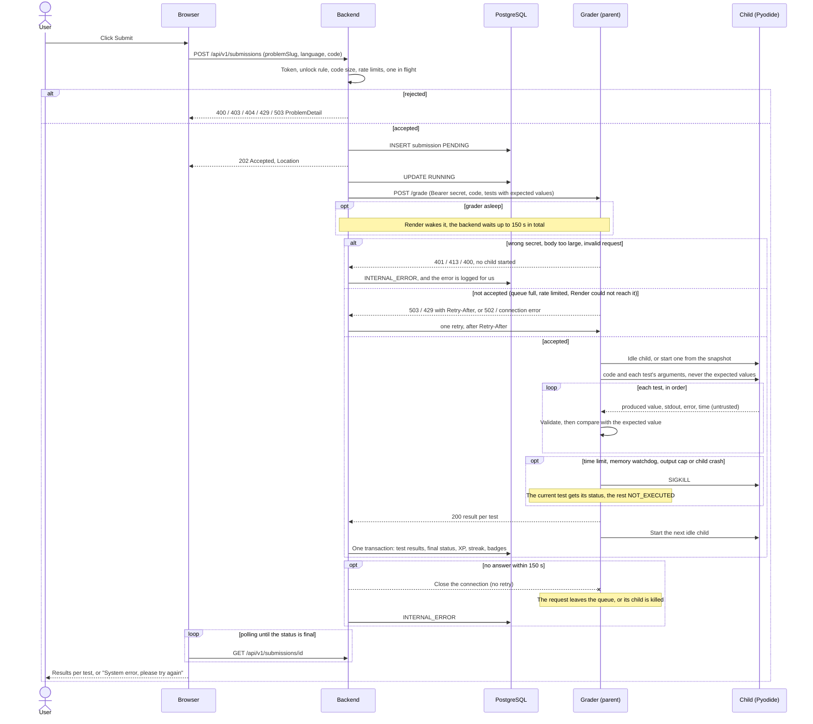

# Grader service

> **Status:** design for SCRUM-237, 2026-11-24. It turns [code-execution.md](code-execution.md) (the proposal), [submission-verification.md](submission-verification.md) (the security review and its required controls) and [deployment.md](deployment.md) (the hosting research) into one design, and refines the grader parts of [architecture.md](architecture.md), [flows.md](flows.md) and [states.md](states.md). **The Render test in [section 5](#5-hosting-decision-and-test) is running:** the first day was 2026-11-27, and the hosting decision follows the third. Numbers marked *local* come from a 0.1 CPU emulation on a development machine; the others come from Render.

## Summary

- **One `grader` service:** Deno with Pyodide, the parent and child model approved in the security review, and no secrets except its own.
- **Pyodide 314.0.8 (Python 3.14.2)**, pinned, self-hosted, and the same files in the browser and in the grader. Deno 2.9.6 loads it with the child's permission flags; it does not load 0.26.4 without an unstable flag ([section 6.2](#62-one-pyodide-version)).
- **Children start from a memory snapshot** built into the image. On Render a child has run three trivial tests 6.0–6.5 s after it started, against about 52 s when Python starts from scratch (*local*). Without the snapshot, one fresh process per submission is too slow on a free instance.
- **One child at a time**, plus one idle child started in advance. Two children do not fit in 512 MB.
- **Memory has a hard cap:** `--wasm-max-mem-pages=2048` limits Pyodide to 128 MB of WebAssembly memory. A memory bomb then ends in a Python `MemoryError` after 104 MB, the interpreter keeps working, and the test is reported as `RUNTIME_ERROR` with `MemoryLimitExceeded`. The whole service peaked at 283 MB of its 512 MB on Render. The memory watchdog stays as a backstop.
- **Limits calibrated on Render** with the 25 problems: the slowest correct solution needs about 95 ms for a test, so 2 s per test and 5 s in total leave a wide margin ([section 3](#3-limits)). The grader handles about 9 submissions per minute.
- **Hosting:** a second Render free web service in Frankfurt if the test meets the threshold agreed with the team; otherwise Azure Container Apps (Plan B in deployment.md). After the first day the grader meets all of its thresholds. The slow part of a Submit after a long pause is the backend: about 2 minutes to wake and start on Render, without the database.

## 1. End-to-end flow

**What it shows.** A Submit from the click to the stored verdict, with every failure path. The backend part is the one from [flows.md](flows.md#4-submitting-code); this diagram adds what happens inside the grader and where each failure ends.



| What fails | Where it is caught | The submission ends as | What the user sees |
| --- | --- | --- | --- |
| Grader asleep | The backend's timeout covers the wake-up | The normal verdict, later | "Grading on the server…", and after 10 s "the grader is waking up or busy, this can take up to three minutes" |
| Request not accepted (connection error, `502` from Render, `503` queue full, `429`) | Backend, one retry (after `Retry-After` when there is one) | The verdict, or `INTERNAL_ERROR`, no XP | As above, then "System error, please try again". With the backend's in-flight limit (5) below the queue (10), a full queue should not happen |
| No answer within 150 s | Backend closes the connection, without a retry; the grader drops the request or kills its child | `INTERNAL_ERROR`, no XP | "System error, please try again" |
| Wrong secret, body too large, invalid request (`401`, `413`, `400`) | Backend | `INTERNAL_ERROR` | As above. This is our bug or a wrong configuration, so the backend logs it as an error |
| Syntax error | Child, before any test | `COMPILE_ERROR` | The error, with the line in the user's code |
| Time limit of a test, or the overall limit | Parent kills the child | `TIME_LIMIT_EXCEEDED` | Which test timed out; the tests after it are "not executed" |
| `MemoryError` under the WebAssembly cap | Child, as a Python exception | `RUNTIME_ERROR`, `MemoryLimitExceeded` | "Memory limit exceeded" on that test |
| Memory watchdog, output cap or child crash | Parent kills the child or sees it exit | `RUNTIME_ERROR` on the current test | The reason on that test; the tests after it are "not executed" |
| Grader restarted during a run (redeploy, Render restart) | Backend: the connection drops before an answer | One retry grades it again, or `INTERNAL_ERROR` | Usually nothing. The run was lost with the old process, so the retry does not count twice |
| Backend restarted during a run | Cleanup job: `PENDING` or `RUNNING` for more than 5 minutes. The grader sees the connection close and stops the run | `INTERNAL_ERROR` | "System error, please try again" |
| The grader's answer is invalid (schema, sizes) | Backend validates it | `INTERNAL_ERROR` | As above |

**Waking the grader early.** A Submit after a long pause would wait for the backend and then for the grader, one after the other. To overlap them, the backend calls `GET /health` on the grader, without waiting for the answer:

- when the backend itself starts;
- when a user opens a problem page, at most once every 10 minutes.

This costs some instance hours (the grader stays awake for 15 minutes after each call), but no keep-alive pings are sent: nothing happens while nobody uses the app.

The early wake-up helps only when the user opens the problem some time before the Submit. A Submit that is the first request after a long pause still waits for the backend and then for the grader; section 5 measures that case.

## 2. Contract between the backend and the grader

**One call:** `POST /grade` over HTTPS, `Content-Type: application/json`. The grader keeps nothing between calls.

**Retries and cancellation.**

- The backend retries once, and only when the grader did not accept the request: a connection error, `502` from Render while the service wakes, `503` or `429` (after `Retry-After`), or `500`. No verdict reached the backend in those cases, so a retry cannot count twice.
- It never retries after its own 150 s timeout. It closes the connection instead.
- When the caller closes the connection, the parent removes the request from the queue, or kills its child if it is already running. An abandoned request never keeps the grader busy, so there is nothing to deduplicate by `requestId`.

**Request**

```json
{
  "requestId": "0192f3a4-7c1e-7b2a-9d11-3f5a8c0e2b44",
  "language": "PYTHON",
  "entryPoint": "solve",
  "code": "def solve(numbers):\n    return numbers[0]\n",
  "tests": [
    { "index": 1, "args": [[1, 2, 3, 4]], "expected": 6 },
    { "index": 2, "args": [[]], "expected": 0 }
  ]
}
```

- `requestId` is the submission id, or a new id for a dry run or a publish check. The grader only writes it to its logs.
- `tests` has at most 50 entries, and `entryPoint` is a Python identifier. Both are also checked by the admin API when a problem is saved.
- `entryPoint` is the function each test calls, taken from the problem.
- The request carries **no limits**. The grader's limits come from its own environment, so a caller cannot raise them, even with the secret.
- Unknown fields are rejected.

**Response `200`**

```json
{
  "requestId": "0192f3a4-7c1e-7b2a-9d11-3f5a8c0e2b44",
  "outcome": "COMPLETED",
  "compileError": null,
  "tests": [
    { "index": 1, "status": "WRONG_ANSWER", "actualOutput": 1, "stdout": "", "error": null, "runtimeMs": 1 },
    {
      "index": 2, "status": "RUNTIME_ERROR", "actualOutput": null, "stdout": "",
      "error": { "type": "IndexError", "message": "list index out of range", "line": 2 },
      "runtimeMs": 1
    }
  ],
  "runtime": { "deno": "2.9.6", "pyodide": "314.0.8", "python": "3.14.2" }
}
```

- `outcome` is `COMPLETED`, or `COMPILE_ERROR` when the code does not parse. In that case `compileError` has the type, the message and the line, and every test is `NOT_EXECUTED`.
- Per-test statuses: `PASSED`, `WRONG_ANSWER`, `RUNTIME_ERROR`, `TIME_LIMIT_EXCEEDED`, `NOT_EXECUTED`, as stored in `test_results` ([database.md](database.md)).
- The **backend** derives the submission status, with the rule in [states.md](states.md#1-submission). The grader does not send one, so the rule lives in one place.
- If the code raises while it loads, or the entry function is missing, every test gets `RUNTIME_ERROR` with that error.
- `error.line` is a line of the user's code. The parent drops the frames of the harness, as `api-conventions.md` requires.
- The `expected` values are not sent back: the backend already has them.

**Errors**

| Code | When | What the backend does |
| --- | --- | --- |
| `401` | Missing or wrong secret. Checked before the body is read. | `INTERNAL_ERROR`, logged as an error |
| `413` | Body over the cap | Same |
| `400` | Invalid request: unknown fields, too many tests, a value that is not plain JSON | Same |
| `429` | The grader's own rate limit | One retry after `Retry-After`, then `INTERNAL_ERROR` |
| `503` | Queue full | Same |
| `500` | A bug in the grader | One retry, then `INTERNAL_ERROR` |

**Authentication:** `Authorization: Bearer <GRADER_SHARED_SECRET>`, compared in constant time. During a rotation the grader also accepts `GRADER_SHARED_SECRET_PREVIOUS` ([section 6.3](#63-secrets)).

**Health:** `GET /health` answers `200` without authentication and does no work. Render's health check and the backend's wake-up call use it. It returns no versions or other details. It keeps answering while a child starts: on Render, the slowest `/health` during the probe's self-test took 0.56 s, about the same as an idle one (0.25–0.49 s from outside Render).

**Rate limits (control 9).** Everything except `/health` counts, but only requests that **fail** the secret check. Requests with the right secret are bounded by the queue instead. So a flood of wrong secrets can cost some CPU, but it can never lock the backend out.

- The per-client limit uses the last address in `X-Forwarded-For`. Render appends the connecting address there and keeps whatever the client sent before it, so the earlier entries cannot be trusted.
- The total limit covers clients that change addresses.
- With a secret of 32 random bytes, guessing it is not a realistic attack anyway. The limits only keep junk traffic cheap.
- The exact layout of `X-Forwarded-For` on Render is checked when the grader is deployed (I5).

**Logs.** The grader logs the `requestId`, the HTTP status, the per-test statuses, the times and its own errors. It never logs the code, `stdout`, produced values, the `Authorization` header or the secret.

### 2.1 Values and comparison

The child returns each produced value as JSON written by Python, and the parent compares it with the expected value outside Python. These rules are the same in the browser's Run (SCRUM-13), so both sides give the same verdict. A shared file of comparison cases, run by the grader's tests and the frontend's tests, keeps them in sync.

| Value | Rule |
| --- | --- |
| `True` / `False` | Booleans, never equal to `1` / `0` |
| `int` | Equal by value. Integers outside ±2^53 are sent as text and never equal an expected number, since problems keep their numbers below 2^53 ([problem-template.md](../problem-template.md)). |
| `float` | Equal when they differ by at most `1e-9` times the larger absolute value, and at least by `1e-9` (proposal 10 in section 10; exact equality is the alternative). `NaN` and infinities are sent as text and are never equal. |
| `str`, `None` | As in JSON |
| `list`, `tuple` | Compared in order. A tuple counts as a list (proposal 9 in section 10). |
| `dict` | Compared without regard to key order. A key that is not a string makes the test `WRONG_ANSWER`, with a message, because JSON would silently turn `1` into `"1"`. |
| Anything else (`set`, objects) | `WRONG_ANSWER`, with "unsupported return type" |

## 3. Limits

All of these are the grader's hard limits: environment variables of the grader, never editable from the admin panel. The time and memory values come from the Render probe (section 5): the calibration on the 25 problems and the memory figures of the self-test.

| Limit | Value | Enforced by | When it is exceeded |
| --- | --- | --- | --- |
| Code size | 16 KB | Backend (`400`), checked again by the grader | `400` |
| Tests per problem | 50 | Admin API, checked again by the grader | `400` |
| Request body | 256 KB | Grader, before parsing | `413` |
| Time per test | 2 s wall clock | Parent | `TIME_LIMIT_EXCEEDED`, child killed |
| Time for all tests | 5 s wall clock, child start not included | Parent | The current test `TIME_LIMIT_EXCEEDED`, the rest `NOT_EXECUTED` |
| Child start from the snapshot | 30 s | Parent | The child is killed and started again once, then `500` |
| WebAssembly memory | 128 MB (`--wasm-max-mem-pages=2048`) | V8 | `MemoryError` in Python: `RUNTIME_ERROR`, `MemoryLimitExceeded` |
| JavaScript heap of the child | 128 MB (`--max-old-space-size=128`) | V8 | The child dies: `RUNTIME_ERROR` |
| Memory of the child process | 360 MB resident, checked every 100 ms | Parent's watchdog | Child killed: `RUNTIME_ERROR`, `MemoryLimitExceeded` |
| `stdout` per test | 4 KB, cut with a marker | Child, then checked by the parent | The text is cut, the verdict is still given |
| Produced value per test | 8 KB of JSON, nested at most 32 levels | Parent, size first | `RUNTIME_ERROR`, "return value too large" or "too deeply nested" |
| Everything the child writes | 1 MB | Parent | Child killed: `RUNTIME_ERROR` on the current test |
| Children at the same time | 1, plus one idle child started in advance | Parent | — |
| Queue | 10 requests | Parent | `503` with `Retry-After: 30` |
| Requests with a wrong secret | 20 per minute per client address, and 120 per minute in total | Parent | `429` (requests with the right secret are never counted) |
| Response body | 1 MB | Parent; the backend's client rejects more | — |

**Why these numbers.**

- **Time, calibrated on Render.** The probe ran every test of the 25 problems three times, with the reference solution and with a naive but correct solution of each (for example trial division up to `n` in `is-prime`, a `while` loop in `sum-to-n`). Results at Render's 0.1 CPU:
  - The slowest test took **about 95 ms** (93–96 ms over three runs), with either solution. Tests that did not fall into a pause of the CPU quota took under 2 ms; the 95 ms ones fell into one pause (Render, like the local cgroup, appears to give 10 ms of CPU every 100 ms).
  - All the tests of one problem took at most **96 ms** together.
  - A recursive Fibonacci, which the `fibonacci` problem says is too slow, took under 0.1 s for `n = 20`, 0.3 s for `n = 23` and 0.8–1.1 s for `n = 25`. It stays under 2 s up to about `n = 26` and never finishes for `n = 70`, so it times out as the problem intends.
  - 2 s per test therefore leaves a margin of more than 20 times over the slowest correct solution. 5 s in total (instead of the 10 s first proposed) still leaves a margin of 50 times, and it cuts the longest time one submission can hold the grader from 16.5 s to 11.5 s (section 3.1).
  - A solution that passes Run in the browser times out in Submit only if it is more than 20 times slower than every solution measured here. The UI still says that Submit runs on a slower machine (SCRUM-13).
- **Memory, measured on Render:**
  - A child restored from the snapshot peaks at 211–222 MB of resident memory. The memory bomb stops at a `MemoryError` after 104 MB, with the child at 308–311 MB. The parent uses 48–50 MB. The whole container peaked at 283 MB, out of 512 MB.
  - The watchdog limit of 360 MB is 50 MB above the largest child a submission can legitimately reach (the bomb under the WebAssembly cap). The parent plus a child at the limit is about 410 MB, which leaves about 100 MB of the 512 MB.
  - The memory bomb grew at about 65 MB per second, so the 100 ms poll overshoots the limit by under 10 MB.
  - Two children would need about 480 MB, which is why only one child exists at a time.
- **Queue:** 10, above the backend's global in-flight limit (proposed at 5, section 3.1), so the queue never fills in normal use.
- **Response body:** 50 tests × (4 KB of `stdout` + 8 KB of value + an error) is about 650 KB, so 1 MB is enough.

### 3.1 Capacity and waiting times

From the Render self-test: a child starts in **6.0–6.5 s**, and a submission of small tests takes well under a second once its child is ready.

- **Throughput.** The idle child means that a single submission does not wait for a start. The next submission does: the parent starts a new child only after the previous one has exited. So each submission keeps the grader busy for about 6.6 s, which is **about 9 submissions per minute**. A submission that uses the whole 5 s takes 11.5 s, about 5 per minute.
- **Waiting in the queue.** With at most 5 submissions in flight (the backend's global limit, proposed at 5 instead of 10, decision 11), the last one waits for 4 others: about 26 s, and 46 s if all of them use the whole 5 s. Its own run comes on top.
- **With the grader asleep**, the wake-up from section 5 comes before all of this.
- **Dry runs and publish checks** count in the same in-flight limit, so an admin cannot fill the queue either.
- **Consequences for the backend** (decision 7):
  - one call with a 150 s timeout: the wake-up, the worst queue and the run fit in it;
  - a retry only when the grader did not accept the request (see section 2);
  - the cleanup job after 5 minutes instead of 10;
  - the message after 10 s: "the grader is waking up or busy, this can take up to three minutes".

## 4. Inside the grader

**Starting a child from a snapshot.** At image build time, a trusted step starts Pyodide once, without any user code, and saves a memory snapshot (about 30 MB). Each child restores that snapshot instead of initializing Python. Every child starts from the same clean state, so nothing passes from one submission to the next.

| Measured locally, Deno 2.9.6, Pyodide 314.0.8 | No CPU limit | 0.1 CPU (cgroup quota) |
| --- | --- | --- |
| Child start, Python initialized from scratch | 2.6–3.2 s (4.2–5.1 s of CPU) | **52.5 s** |
| Child start from the snapshot | 0.4–0.5 s (0.6 s of CPU) | **6.5–6.7 s** (5.9 s with `--liftoff-only`) |
| Three trivial tests, once the child is ready | under 1 ms | under 1 ms |
| Peak memory of a child, from the snapshot | 221–224 MB | 220–225 MB (208 MB with `--liftoff-only`) |

**On Render** (the probe, three starts): a child restored from the snapshot is ready in 4.4–5.4 s and has run three trivial tests after 6.0–6.5 s; it peaks at 211–222 MB.

**`--liftoff-only` is not used.** It starts a child about 10% faster (5.9 s against 6.5 s, *local*), but it keeps WebAssembly on V8's baseline compiler, so CPU-heavy user code runs more slowly for the whole run. The default tiering is kept.

`_makeSnapshot` and `_loadSnapshot` are experimental options of `loadPyodide`. This is acceptable because the version is pinned, and the malicious payload tests run again on every version bump. If a new version breaks them, the fallback is a normal start, with the slower times in the table.

**Build-time check.** Right after it writes the snapshot, the image build starts one child from it with the child's flags and runs a trivial test. If the snapshot does not load, the build fails, so a broken snapshot never reaches Render.

**One child at a time.**

- The parent keeps one idle child, already restored from the snapshot.
- A submission takes that child. When the child has exited, the parent starts the next one, which is ready about 6 s later at 0.1 CPU. There is never a second child while one is running or starting.
- A submission that arrives in that window waits in the queue.
- After a wake-up, the parent starts the first child at once, so it is usually ready by the time the backend's call arrives.

**The child command** (control 2 of the security review, plus the memory cap and the snapshot file):

```bash
deno run --no-prompt \
  --allow-read=/opt/pyodide,/opt/grader/child.js,/opt/grader/pyodide.snapshot \
  --deny-net --deny-write --deny-env --deny-run --deny-sys --deny-ffi --deny-import \
  --v8-flags=--max-old-space-size=128,--wasm-max-mem-pages=2048 \
  /opt/grader/child.js
```

The parent starts it with `Deno.Command`, `clearEnv: true` and an empty working directory. It sends the code and the arguments on stdin, and reads one JSON line per test from stdout, up to the caps.

**The protocol on stdout.** The harness sends Python's `print` output to a buffer, so it ends up in the `stdout` field of a result, never as a line of its own. User code can still write to the real stdout through JavaScript (`console.log`, `Deno.stdout`), so the parent treats every line as untrusted:

- A line in the valid format is the child's claim for that test. A forged one is no worse than hard-coding the answer (section 7).
- Anything else is a protocol violation: a line that is not JSON, an unknown field, a test index that is out of order or repeated, or a second answer for the same test. The parent kills the child; the current test gets `RUNTIME_ERROR` with "invalid output from the child", and the rest `NOT_EXECUTED`.

**The parent's permissions.** The parent runs with `--allow-all`:

- It needs `--allow-run` to start children. The security review already notes that a process that can start `deno` can give itself every permission, so the parent's flags are not the boundary. The child is.
- Deno 2.9 reads `/proc/<pid>/status`, which the memory watchdog needs, only with `--allow-all`. A narrower `--allow-read=/proc` is refused (checked locally).
- The parent never runs user code. It treats everything the child writes as untrusted data: size caps, strict JSON, a fixed schema.

## 5. Hosting decision and test

**Candidate:** a second Render free web service, Docker, Frankfurt, as in [deployment.md](deployment.md). **Fallback:** Azure Container Apps with internal ingress (Plan B). The child-process fallback inside the backend stays rejected.

**Threshold** (proposed; the team agrees on it while the test runs, decision 1):

| Measurement | Threshold |
| --- | --- |
| Grader asleep: from `POST /grade` to the answer for a trivial submission | ≤ 90 s |
| Backend and grader both asleep, with the early wake-up: from Submit to the verdict | ≤ 120 s |
| Grader awake, idle child ready: `POST /grade` for a trivial submission | ≤ 3 s |
| Child start from the snapshot at Render's 0.1 CPU | ≤ 15 s |
| Peak memory of the grader service, including a memory bomb | ≤ 450 MB |

**How the test runs.** Two Render free web services in Frankfurt, deployed from this branch ([`tools/grader-probe`](../../tools/grader-probe/README.md)):

- **The grader probe**, built like the grader: parent, child, snapshot, the same flags. At every start it runs a self-test, one child after the other: a trivial run, a memory bomb, an endless loop, escape attempts and the time limit calibration. It publishes the results at `GET /stats`. It runs nothing on request, so it needs no secret.
- **A backend stand-in:** the backend of this branch, started **without a database** (Flyway off, Hibernate without JDBC metadata). It measures Render's wake-up plus the Spring Boot start; the database connection, Flyway and the schema validation would come on top.

On three different days:

1. Nothing calls either service for at least 20 minutes, so both are asleep.
2. `measure.sh` wakes the backend and times it. When the backend answers, it wakes the grader and times its `/health`.
3. It times `/health` again while the children start, and reads `/stats` when the self-test is done.
4. **Grader asleep** is the grader's `/health` time plus the trivial child. **Both asleep** adds the backend's time in front: the worst case, a Submit that is the first request after the pause, so the early wake-up does not help.
5. The median of the three days goes in the decision.

The requests come from a machine outside Render, which adds about 0.3 s to every time.

**Results** (Render, Frankfurt, free plan)

| Measurement | Threshold | 27 Nov | 28 Nov | 29 Nov | Local (0.1 CPU emulated) |
| --- | --- | --- | --- | --- | --- |
| Grader asleep, trivial submission | ≤ 90 s | **20 s** (13.9 s wake-up + 6.2 s child) | *to measure* | *to measure* | — |
| Both asleep, Submit to verdict (worst case) | ≤ 120 s | **141 s** (120.7 s backend + 20 s grader) | *to measure* | *to measure* | — |
| Backend stand-in asleep, until it answers | — | 120.7 s (the JVM process: 107 s, of which Spring Boot 96 s) | *to measure* | *to measure* | 153 s Spring Boot start |
| Grader awake, trivial submission | ≤ 3 s | **0.5 s** (`/health` 0.25–0.49 s, tests 3.6 ms) | *to measure* | *to measure* | under 1 ms of test time |
| Child start from the snapshot, with three trivial tests | ≤ 15 s | **6.2 s** (6.0–6.5 s over three starts) | *to measure* | *to measure* | 6.5–6.7 s |
| Peak memory of the service, with a memory bomb | ≤ 450 MB | **282 MB** (child 309 MB resident, parent 50 MB) | *to measure* | *to measure* | about 360 MB |
| Slowest `/health` while children start | — | 0.56 s | *to measure* | *to measure* | 0.2 s |

**Reading after the first day.** The grader meets every threshold of its own with a wide margin: it wakes in about 14 s and grades a trivial submission 20 s after a pause. The case that misses is "both asleep", and only because of the backend: Render's wake-up plus the Spring Boot start take about 2 minutes at 0.1 CPU, before the grader is even called.

- This affects the first page load after a pause as much as the first Submit, so it belongs to the backend's hosting (I7 and I4), not to the grader.
- Options for the backend: a faster start (lazy initialization, Java 25's AOT cache, fewer starters), the 120 s threshold raised for the backend part, or Plan B for the backend only.
- The grader can stay on Render either way.

**Decision:** *after the third day.* If the next two days look like the first, the proposal is: **the grader goes to Render**, and the "both asleep" threshold is handed to the backend's hosting decision with these numbers (decision 1).

## 6. Security

### 6.1 Required controls

How the design meets each required control of [submission-verification.md](submission-verification.md#32-required-controls), and what is still missing.

| # | Control | How this design meets it | Still missing |
| --- | --- | --- | --- |
| 1 | Two levels of process | A parent with our code only; one fresh child per submission. The idle child serves a single submission. The snapshot makes a fresh child affordable at 0.1 CPU. | The implementation (I2) |
| 2 | Child flags, pinned Deno | The command in section 4, with Deno 2.9.6. Checked locally and on Render: Pyodide 314.0.8 loads and runs with exactly these flags. | Pin the Deno image by digest |
| 3 | A clean child | `Deno.Command` with `clearEnv: true`, an empty working directory, input on stdin, capped stdout and stderr | — |
| 4 | No expected values in the child | The parent removes `expected` before anything reaches the child, and validates every value the child returns (types, depth, size, no unknown fields) | — |
| 5 | Time | Per-test and overall wall-clock limits, then SIGKILL (section 3). Calibrated on Render; a child that uses all its CPU is gone 0.03–0.2 s after the kill (Render). | — |
| 6 | Memory | A hard WebAssembly cap gives a clean `MemoryError` (checked on Render). The resident-memory watchdog, at 360 MB, stays for memory outside it (JavaScript `ArrayBuffer`s, workers). It reads `/proc`, so the parent runs with `--allow-all` (section 4). | — |
| 7 | Output | Caps per test, per value and for the whole child (section 3). The backend caps the code size first. | — |
| 8 | CPU and queue | One child at a time; a queue of 10; `503` when it is full; abandoned requests are dropped (section 2) | — |
| 9 | Authentication | Bearer secret checked in constant time before the body is read; body cap; a previous secret during rotation; rate limits on every request that fails the check, per client and in total (section 2) | Check the `X-Forwarded-For` layout on Render (I5) |
| 10 | Nothing to steal | Only `GRADER_SHARED_SECRET` (and `_PREVIOUS` during a rotation). Non-root user. Pyodide and the snapshot are built into the image; nothing is downloaded at run time. | — |
| 11 | A separate service | Its own Render service (or Azure app), never a child process of the backend | — |
| 12 | Patching | Deno 2.9.6 and Pyodide 314.0.8 pinned. Bump both, rebuild the snapshot and rerun section 8 on every advisory. | Dependabot is postponed (SCRUM-234), so this is manual until it is on |
| 13 | Each verdict counts once | Backend: `PENDING` → `RUNNING` → one final status, a 150 s timeout, a retry only when the request was not accepted, and the cleanup job after 5 minutes | Backend implementation |

The optional Pyodide build without `ctypes` is still not planned. The boundary does not depend on it.

### 6.2 One Pyodide version

**Pyodide 314.0.8 (Python 3.14.2)**, the current release (`latest` on npm), for both the browser's Run and the grader:

- **Deno.** Deno 2.9.6 loads 314.0.8 as a normal ES module, with the child's flags. Older lines fail with `ReferenceError: require is not defined` unless Deno gets the unstable `--unstable-detect-cjs` flag. We do not want an unstable flag in the sandbox. Checked for 0.26.4 and for 0.29.5, the newest release of the previous line: in both, `pyodide.mjs` is an ES module, but it loads `pyodide.asm.js`, which is CommonJS. Marking the package as CommonJS in its `package.json` does not help.
- **Memory.** 314.0.8 used 188–213 MB when started from scratch, against 241 MB for 0.26.4 (*local*).
- **Python.** 3.14.2 instead of 3.12.1, with the current fixes.

**What it changes elsewhere:**

- From 314.0, Pyodide is an ES module, so the browser's Run needs a module worker.
- The download is larger: `ssl` and `sqlite3` are now included. The 12.4 MB measured in the SCRUM-13 spike for 0.26.4 must be measured again.
- The files are self-hosted, from the same npm package, in the frontend's static assets and in the grader image.
- Both are updated in one pull request, which also rebuilds the snapshot. The version line in the SCRUM-13 spike changes with it.

### 6.3 Secrets

| Secret | Where | Rotation |
| --- | --- | --- |
| `GRADER_SHARED_SECRET` | Render environment of the backend and of the grader, same value | At least once per semester, when a teammate leaves the project, and at once after any sign of misuse |
| `GRADER_SHARED_SECRET_PREVIOUS` | Grader only, empty except during a rotation | — |

- The secret is 32 random bytes, for example `openssl rand -base64 32`.
- It is never in git, in the frontend, in logs or in the child.
- The `Authorization` header is never logged.

**Rotation steps:**

1. Put the old value in `GRADER_SHARED_SECRET_PREVIOUS` and a new value in `GRADER_SHARED_SECRET`, on the grader. Wait for the deploy.
2. Set the new value on the backend. Wait for the deploy.
3. Clear `GRADER_SHARED_SECRET_PREVIOUS` on the grader.

### 6.4 Accepted risks

- **A full escape** from the child into the container, through a Deno or V8 bug. It gives control over the grader's answers, as described in [the residual risk](submission-verification.md#residual-risk). This is accepted. Recovery: redeploy the image and rotate the secret.
- **A public URL protected only by the secret**, on Render. It goes away with Azure's internal ingress.
- **The snapshot options are experimental.** The pinned version and the tests on every bump cover this. The fallback is a slower normal start.
- **Tests of one submission share one interpreter.** Global variables survive from one test to the next. This only affects the user's own result.
- **Run and Submit can disagree on time.** Run uses the user's machine, Submit uses 0.1 CPU. The UI says so (SCRUM-13).

## 7. Anti-cheat

**Only the server produces a verdict.** The browser sends code, never a result. The grader's parent compares the produced values with expected values that the child never sees. The backend stores the verdict and applies it once. A replayed request creates a new submission that runs again.

**What a user can still do, and how it is limited:**

| What | Limited by |
| --- | --- |
| Hard-code the visible tests | Accepted (decided 2026-11-03). XP only on the first solve, the daily XP cap, a small total of XP. |
| Keep state between the tests of one run | Only changes their own result |
| Waste grader time with slow code | Per-test and overall time limits, one in flight per user, rate limits |
| Use several accounts | Per-IP and global limits; no leaderboard in the MVP |
| Print fake "passed" lines | `stdout` is only shown, never parsed for a verdict |
| Make the child lie about its values | It can only claim values: the same as hard-coding |

**Signs to watch:** one user solving far more problems in a day than the others, or many accepted verdicts with almost no running time.

## 8. Malicious submissions

Each payload must give the expected result **and leave the grader healthy**: the next normal submission must pass. This extends [section 6 of the security review](submission-verification.md#6-malicious-payload-tests-after-i2) with the statuses of this contract. The rows marked *Render* were already checked by the probe's self-test, with the grader's flags.

| Payload | Expected result |
| --- | --- |
| `while True: pass` in test 3 | Test 3 `TIME_LIMIT_EXCEEDED`, the rest `NOT_EXECUTED`, child killed. *Render:* the child is gone 0.03–0.2 s after the kill, even while it uses all its CPU. |
| `x = []` then `while True: x.append("a" * 10**6)` | `MemoryError` under the WebAssembly cap: `RUNTIME_ERROR`, `MemoryLimitExceeded`. The child survives. *Render:* `MemoryError` after 104 MB, and the next statement runs. |
| `run_js("let a = []; for (;;) a.push(new ArrayBuffer(2**24))")` | The watchdog kills the child: `RUNTIME_ERROR`, `MemoryLimitExceeded` |
| `run_js("let a = []; for (;;) a.push({})")` | The JavaScript heap limit stops the child: `RUNTIME_ERROR` |
| `print("x" * 10**8)` | `stdout` cut at 4 KB; the verdict is still given |
| `run_js("for (;;) console.log('x')")` | The 1 MB cap kills the child: `RUNTIME_ERROR` on the current test |
| `run_js("console.log(JSON.stringify({index: 1, status: 'PASSED'}))")` | A protocol violation (an unknown field, and no value): child killed, `RUNTIME_ERROR` "invalid output from the child", the rest `NOT_EXECUTED` |
| A forged line in the valid format, for a test that has not run yet | Accepted as the child's claim for that test, like hard-coding (section 7): the parent still compares the claimed value with the expected one, and each test can be answered only once |
| `import os; os.fork()`, `subprocess.run(["sh"])` | `RUNTIME_ERROR` |
| `import js; js.Deno.readTextFileSync("/etc/passwd")` | `NotCapable` (Deno 2's permission error): `RUNTIME_ERROR`. *Render.* |
| `js.Deno.readTextFileSync("/proc/" + str(js.Deno.ppid) + "/environ")`: the parent's environment, which holds the secret | `NotCapable`: `RUNTIME_ERROR`. *Render*, also for `/proc/self/environ`. |
| `run_js("Deno.env.toObject()")` | `NotCapable`, and the environment is empty anyway. *Render.* |
| `js.Deno.writeTextFileSync("/tmp/x", "x")` | `NotCapable`. *Render.* |
| `run_js("fetch('https://example.com')")`, `run_js("import('https://esm.sh/lodash')")` | Denied. *Render*, for `fetch`. |
| `run_js("new Deno.Command('sh').outputSync()")` | Denied. *Render.* |
| State between two submissions: the first sets a global, a module attribute and a file in Pyodide's in-memory file system; the second looks for them | Nothing is found: each submission gets a new process restored from the read-only snapshot |
| `ctypes.CDLL(None).emscripten_run_script(b"Deno.exit(0)")` | The child exits: `RUNTIME_ERROR` on the current test, the rest `NOT_EXECUTED`, the grader stays up |
| `run_js("for (;;) new Worker('data:text/javascript,for(;;){}', {type: 'module'})")` | Stopped by the time or memory limit |
| Deep recursion with `sys.setrecursionlimit(10**6)` | `RUNTIME_ERROR` |
| `return 2**64`, `return {1: "a"}`, `return {1, 2}` | `WRONG_ANSWER`, with the reason from section 2.1 |
| A deeply nested return value: `x = []`, then `x = [x]` 100,000 times | `RUNTIME_ERROR`: either Python's own recursion limit while the value is written as JSON, or the parent's 8 KB and 32-level caps before it parses the value |
| A syntax error | `COMPILE_ERROR` with the line |
| 1 MB of code | `400` from the backend; the grader is never called |
| No secret, or a wrong one | `401`, no child started; after 20 per minute, `429` |
| A 1 MB body with the right secret | `413` before parsing |
| 11 requests at once with the right secret | The 11th gets `503` |
| The backend gives up on a running request (closes the connection) | The child is killed and the next request starts; nothing is returned |

## 9. Implementation outline

Sizes: **S** up to a day, **M** two or three days, **L** about a week, for one person.

| Step | Who | What | Size |
| --- | --- | --- | --- |
| 1 | Security / DevSecOps and backend | The contract as a JSON Schema, and the shared file of comparison cases | S |
| 2 | Security / DevSecOps | `grader/`: the parent (HTTP, secret, rate limits, queue, cancellation, watchdog, comparison, validation), the child harness, the snapshot build step with its check, unit tests | L |
| 3 | Backend | `WasmPythonGrader` behind the `Grader` interface: client with a 150 s timeout and the retry rule, response validation, the status rule, the early wake-up call, the cleanup job after 5 minutes, the in-flight limit of 5 | M |
| 4 | Backend | Problems: the `entryPoint` field (a Python identifier, `solve` by default) in the database, the admin API and the seed files; at most 50 tests per problem | S |
| 5 | Security / DevSecOps | The malicious payload tests of section 8, run in CI against the grader image | M |
| 6 | Security / DevSecOps (with I4) | The grader's Dockerfile, pinned by digest, the Render service, the secret | S |
| 7 | Frontend | Pyodide 314.0.8 self-hosted in a module worker, the same comparison cases, the "waking up or busy" message | M |
| 8 | Everyone | One Submit from end to end on the deployed app; then the dry run and the publish check, which use the same call | S |

**Order:** 1 first, so the backend and the grader can be built in parallel; 5 before the grader goes live; 4 and 7 can start at any time.

**Risks:**
- The backend's start on Render (section 5) may need Plan B for the backend, even if the grader stays on Render.
- The snapshot options may change in a later Pyodide.
- 750 instance hours are shared by both services.
- The larger browser download of Pyodide 314.

## 10. Decisions to confirm with the team

Where we are not sure yet, this document proposes one option. The team confirms it or picks another, and the answers are written back here.

| # | Proposal | Pros | Cons | Who confirms |
| --- | --- | --- | --- | --- |
| 1 | The thresholds in section 5. After the first day: the grader meets all of its own; "both asleep" misses (141 s) because the backend takes about 2 minutes to wake and start, so that threshold goes to the backend's hosting decision | The grader's thresholds are realistic for a free host and are met with a wide margin | The first page load or Submit after a pause still takes about 2 minutes until the backend starts faster or moves | Everyone; the backend part with I7 |
| 2 | Pyodide 314.0.8 in the browser and in the grader | Deno 2.9 loads it with the sandbox flags; Python 3.14.2; less memory in the grader | Run needs a module worker; a larger download; the SCRUM-13 numbers must be measured again | Frontend |
| 3 | Children start from a memory snapshot | A fresh child in about 6 s instead of about 52 s at 0.1 CPU, so every submission still gets a clean process | Experimental Pyodide options, which may change; covered by pinning and by the tests on every bump | Everyone |
| 4 | The backend wakes the grader early (section 1) | The two wake-ups overlap: the first Submit after a pause is up to a minute faster | The grader is awake more often and uses more of the 750 shared free hours; one more small call in the backend | Backend |
| 5 | The backend derives the final status from the per-test results | The rule from states.md lives in one place | A little more code in the backend | Backend |
| 6 | `entryPoint` stored per problem, `solve` by default. This also closes the open point "function or stdin and stdout" in the overview: problems are functions. | Problems can use meaningful function names, as in the `two_sum` example | One more field in the problem; always `solve` would keep the template and the editor simpler | Backend, problem authors |
| 7 | One grader call with a 150 s timeout; a retry only when the request was not accepted; the grader drops abandoned requests; the cleanup job after 5 minutes; "this can take up to three minutes" after 10 s (sections 2 and 3.1) | A submission becomes final within about 3 minutes in every case, and a slow or abandoned request never runs twice | The grader needs cancellation; a submission that would have finished after 150 s becomes `INTERNAL_ERROR` instead | Backend |
| 8 | At most 50 tests per problem; 2 s per test and 5 s in total at 0.1 CPU | Calibrated on Render: the slowest correct solution of the 25 problems takes 95 ms per test and per problem | A problem with large inputs or many tests has to be split | Problem authors |
| 9 | A tuple counts as a list when comparing values (section 2.1) | Friendlier for beginners: `return (0, 1)` passes when `[0, 1]` is expected | Python itself says `(0, 1) != [0, 1]`; a strict rule would teach the difference | Frontend, problem authors |
| 10 | Floats compared with a tolerance: equal when they differ by at most `1e-9` times the larger value (at least `1e-9`) | `0.1 + 0.2` passes when `0.3` is expected, as on most judges | Two values that really differ by less are accepted; Run must use the same rule | Frontend, problem authors |
| 11 | The backend's global in-flight limit to the grader goes from 10 to 5, and the grader's queue from 20 to 10 (section 3.1) | The worst wait in the queue (about 46 s) plus a wake-up fits in the 150 s timeout | At a peak, more users get "the grader is busy, try again" (`503`) instead of waiting | Backend |

## Sources (checked 2026-11-24)

- Pyodide: [JavaScript API, `loadPyodide`](https://pyodide.org/en/stable/usage/api/js-api.html), [Pyodide 314.0 release notes](https://pyodide.org/en/stable/project/changelog.html#version-314-0-0) (Python 3.14, native ES module), npm package `pyodide` (`latest` = 314.0.8)
- Deno: [Security and permissions](https://docs.deno.com/runtime/fundamentals/security/), [CommonJS support (`--unstable-detect-cjs`)](https://docs.deno.com/go/commonjs)
- V8: the `--wasm-max-mem-pages` flag caps the pages of a WebAssembly memory; [Limiting Wasm memory allocation as an embedder](https://groups.google.com/g/v8-users/c/hnIsh82T2pM)
- Local measurements: Deno 2.9.6 on Linux x86-64, CPU limited to 10 ms per 100 ms (a cgroup quota, or `docker run --cpus=0.1`).
- Render measurements, the probe and the calibration: [`tools/grader-probe`](../../tools/grader-probe/README.md) in this repository. The scripts behind the local numbers are in [`tools/grader-probe/local-bench`](../../tools/grader-probe/local-bench/).
- Render: [`X-Forwarded-For` is appended to, not replaced](https://feedback.render.com/features/p/send-the-correct-xforwardedfor) (a test by a Render user, not Render's documentation; to be checked in I5).
