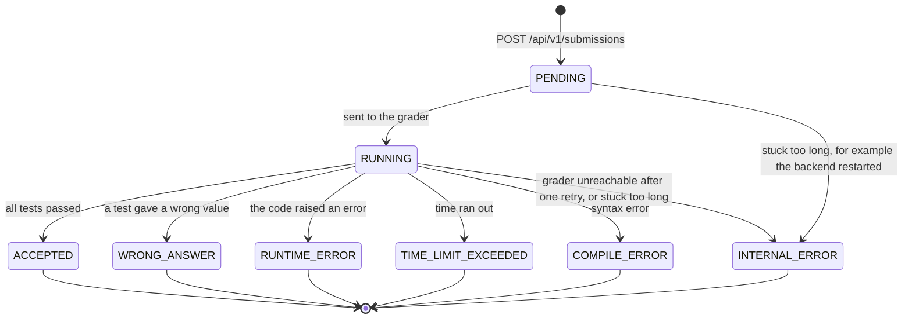
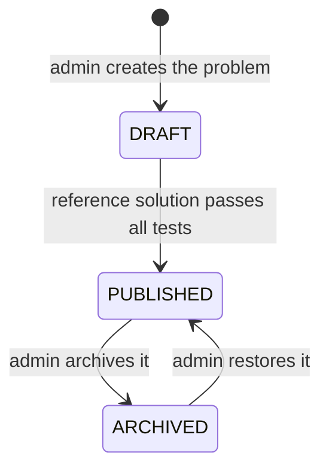
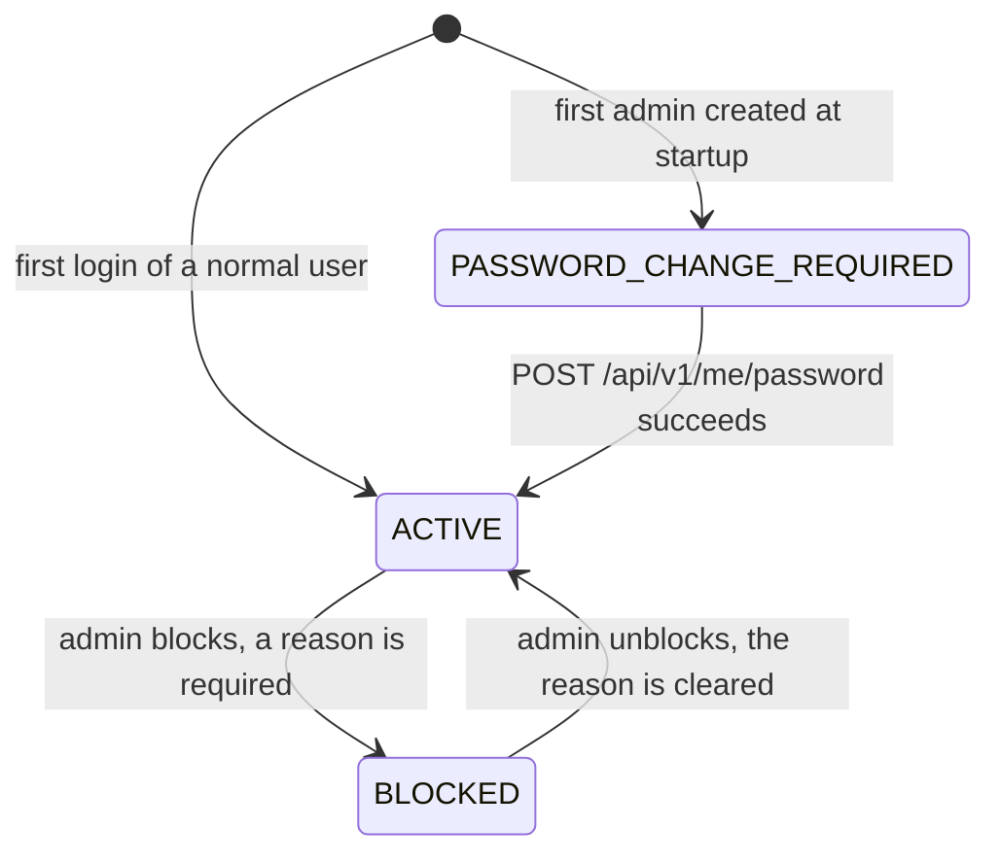
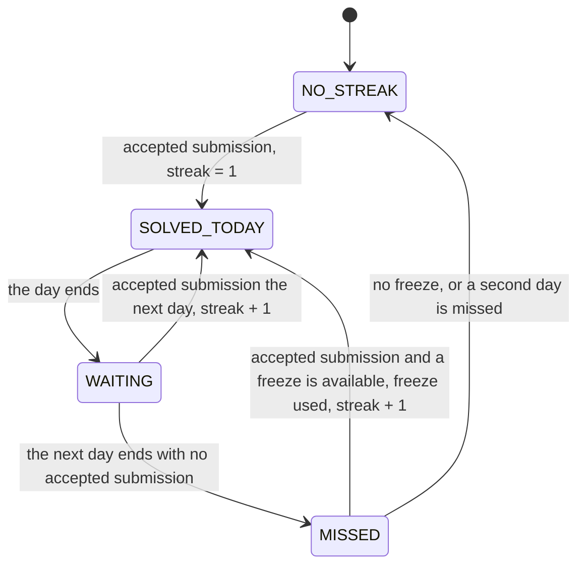

# States

The lifecycles that matter for the backend: a submission, a problem, a user account and the daily streak.

## 1. Submission

**What it shows.** A submission is created as `PENDING`, becomes `RUNNING` when the backend sends it to the grader, and ends in exactly one final status. A final status is never changed again, which is what makes "each verdict counts once" possible. `INTERNAL_ERROR` means the system failed, not the user's code: the grader was unreachable after one retry (always in `RUNNING`, because the status is set before the call), or the submission stayed `PENDING` or `RUNNING` for too long (for example the free host restarted the backend). A cleanup job handles the stuck ones. It never gives XP.

How the submission status is chosen from the per-test statuses: if every test passed it is `ACCEPTED`; otherwise it takes the status of the first test that was **executed** and did not pass. A test with the status `NOT_EXECUTED` only means that the previous test stopped the run (time or memory limit). A memory limit is reported as `RUNTIME_ERROR` with `error_type = MemoryLimitExceeded`, so there is no separate status for it.

## 2. Problem

**What it shows.** An admin creates a problem as a draft and edits it freely. Publishing is allowed only when the reference solution passes every test (checked through the grader). Users see only published problems. An archived problem disappears from the list but keeps its history, and can be published again.

## 3. User account

**What it shows.** A normal user is `ACTIVE` from the first login. The first admins are created at startup and must change their password before doing anything else (`PASSWORD_CHANGE_REQUIRED`, stored as the flag `must_change_password`). The flag is cleared only by the backend, inside `POST /api/v1/me/password`, which changes the password itself through the Firebase Admin SDK (see [flows.md](flows.md), section 10); a client cannot clear it. A blocked user is stopped at once, because the status is checked on every request. Blocking needs a reason (`blocked_reason`), which is cleared when the user is unblocked. Blocking and unblocking are admin actions and go to the audit log, which keeps the reason history.

## 4. Daily streak

**What it shows.** How the streak moves from day to day, in the user's own time zone. A day with at least one accepted submission keeps it alive. After a missed day the streak is in danger: a streak freeze (if the user has one) is used automatically when the next accepted submission arrives, and the streak continues. Without a freeze, or after a second missed day, it is broken and the next accepted submission starts again from 1. The state is evaluated when needed (on the next accepted submission or when the profile is read), not by a midnight job. The step-by-step calculation is in [flows.md](flows.md).

