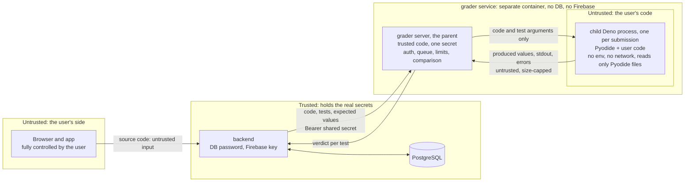

# Submission verification and anti-cheat

> **Status:** security review of the grader proposal (SCRUM-12), 2026-11-08. **Verdict: the Deno + Pyodide grader from [code-execution.md](code-execution.md) is approved, on the conditions in [Required controls](#32-required-controls).** The numbers are starting values. The free-tier spike (I7) and the malicious-payload tests (after I2) confirm them.

## Summary

- **The browser never decides.** Anything computed in the browser, signed or not, can be forged. The server runs the code again and computes the verdict itself.
- **Main finding of the review:** Python running in Pyodide can always reach the JavaScript of the process it runs in. Three routes:
  - the `js` module;
  - `pyodide.code.run_js`;
  - `ctypes` through the Emscripten exports.

  In 2026 the `ctypes` route was used to escape seven products built on the same idea, two of them on Deno. So the user's code must be treated as **arbitrary JavaScript running in the child process**. The security boundary is not Python but these layers together:
  - a separate process with almost no Deno permissions;
  - a parent process that keeps the expected outputs and computes the verdict;
  - a separate service that holds no secrets worth stealing.
- The child process never sees the expected outputs. Whatever it prints is untrusted data.
- V8's heap limit does not cover WebAssembly memory, so the parent enforces memory by watching the child.
- The fallback "grader as a child process of the backend" is **rejected** for security: an escape would land next to the database password and the Firebase key.
- Rate limiting: on `POST /api/v1/submissions` and the admin dry run, per user, with at most one submission in flight. Details in [section 5](#5-rate-limiting-proposal).

## 1. Ways to verify a submission

| Option | How it can be cheated | Cost | Free hosting? | Verdict |
| --- | --- | --- | --- | --- |
| **Only in the browser**: Pyodide computes the verdict and the client sends it, maybe signed or obfuscated | Trivially. Edit or replay the request in DevTools. Any key or check shipped to the browser belongs to the user. | Free | Yes | **Rejected** |
| **Re-execution on the server in WebAssembly**: Pyodide in Deno (our proposal) | Hard-coding the visible tests (accepted, see 4). Escaping from Python to JavaScript inside the child (contained by the controls in 3.2). Denial of service (limits). | Free: one small Docker service | Yes. No privileged container needed. | **Chosen, with conditions** |
| Variant: CPython's WASI build in **Wasmtime** | Same as above. There is no JavaScript bridge at all, and the runtime itself enforces memory limits and CPU budgets. | Free | Yes | **Plan B** if the payload tests show the Pyodide child cannot be contained. Drawback: the server's Python is then a different build from the browser's. |
| **External execution API**: Judge0 CE hosted, Piston public API | Same cheats as server execution. In addition, a third party sees every user's code, and the free quotas are small and change: the Piston public API closed to the public on 15 Feb 2026. | Small free quota or paid | Yes (only HTTPS) | **Rejected**: the core feature would depend on a third party |
| **Containers or microVMs on a server of our own**: Judge0 or Piston self-hosted (isolate), gVisor, Firecracker, nsjail | Same cheats as server execution. The strongest isolation and limits, with real CPython. | A VM to operate. Free VMs need a card. | **No.** It needs privileged containers or KVM, which free managed hosts do not offer. | **Rejected for now.** The best option if the project ever gets a server. |
| **GraalPy inside the backend's JVM** | Same cheats. Untrusted code would share a process with the database password and the Firebase key. | Free | Yes | **Rejected** |

## 2. Threat model for running user code

**What we protect:**
- Data: users, emails and progress.
- Secrets: the database password, the Firebase service account, the admin bootstrap password and the grader secret.
- The integrity of XP, streaks, badges and unlocks.
- Availability: free-tier hours, 0.1 CPU per service, 512 MB per service.

**Who attacks:**
- **A logged-in user who wants XP or badges** (the most likely).
- **A curious user testing the sandbox** (likely in a class of IT students).
- **Anonymous internet scanners**: the grader has a public URL on the free tier.
- **A stolen admin account.**

**Where they enter:**
- the code in `POST /submissions`;
- the grader URL;
- every `/api` endpoint;
- the client app, which the user fully controls;
- Markdown written by admins (statements, hints).

### Trust boundaries



| Threat | Example | Control |
| --- | --- | --- |
| Forged verdict | Sending "accepted" from DevTools | The client sends only code. The verdict is computed by the server and stored by the backend. |
| Escape from Python to JavaScript | `import js`, `run_js`, `ctypes` → `emscripten_run_script` | Assume it happens. The child has no Deno permissions except reading the Pyodide files (3.2). |
| Escape from the child to the container | A Deno or V8 bug | The container holds only the grader secret: no database, no Firebase. Non-root user, separate service, Deno and Pyodide kept patched. **Residual risk, accepted.** |
| Reading or forging the expected values | Searching memory for expected outputs, or printing fake "passed" lines | Expected values never reach the child. The parent parses the child's output strictly and compares outside it. |
| Resource exhaustion | Infinite loop, memory bomb, output flood, thousands of Web Workers, deep recursion | Per-child time, memory and output limits. One child at a time. A bounded queue. |
| Data exfiltration or network access | `fetch`, remote `import()` | `--deny-net` and `--deny-import`. Even a successful request would find no secrets to send. |
| Strangers calling the grader | Scanners, brute force | Shared secret checked in constant time before any work is done. Requests are rejected without starting a child. |
| Stored XSS | Malicious Markdown from a stolen admin account; HTML in a user's output | Sanitize statements and hints. Render output and `stdout` as text, never as HTML. |
| Leaking internals in errors | A traceback that shows the harness or file paths | The parent keeps only the frames from the user's code (as `api-conventions.md` already requires). |
| Game-rule abuse | XP farming, replay, several accounts, a modified client, time zone tricks | Section 4 |

## 3. Review of the proposed grader

### 3.1 Finding: Python inside Pyodide reaches JavaScript

- **The `js` module.** By default it is `globalThis`, which in Deno includes the `Deno` namespace. The `jsglobals` option of `loadPyodide` can point it at a smaller object, but it narrows only this one route.
- **`pyodide.code.run_js(code)`.** Documented as "a wrapper for the `eval()` function": it runs any JavaScript string.
- **`ctypes`.** `ctypes.CDLL(None)` exposes Emscripten exports such as `emscripten_run_script`, which evaluates JavaScript in the host. In August 2026, Cyera showed this route escaping the Python-level restrictions of seven products. Two of them, smolagents' Wasm executor and langchain-sandbox, ran Pyodide inside Deno: the same design as ours. The authors point out that Deno permissions limit what the escaped code can do afterwards but do not stop the escape itself, and that smolagents ran with `--allow-run`.

**Conclusion:** blocking imports, removing `js` or narrowing `jsglobals` is not a boundary. The design must hold even if the user's code runs arbitrary JavaScript inside the child process. The controls below are built on that assumption.

### 3.2 Required controls

These are the conditions for approving the grader. Each one maps to a test in [section 6](#6-malicious-payload-tests-after-i2).

**Process model**

1. **Two levels of process.**
   - The **grader server** (the parent) runs only our code. It handles the HTTP endpoint, the secret check, the queue, the limits and the comparison.
   - For each submission it starts **one fresh child** that runs Pyodide and the user's code. A child is never reused.
   - Pyodide is slow to start, especially at 0.1 CPU, so the parent may keep **one child pre-started and idle**. That child still serves a single submission.
2. **Child flags** (with a pinned Deno version):

   ```bash
   deno run --no-prompt \
     --allow-read=/opt/pyodide,/opt/grader/child.js \
     --deny-net --deny-write --deny-env --deny-run --deny-sys --deny-ffi --deny-import \
     --v8-flags=--max-old-space-size=128 \
     /opt/grader/child.js
   ```

   - Deny flags override allow flags. `--deny-import` matters: by default Deno allows imports from `deno.land`, `jsr.io`, `esm.sh`, `cdn.jsdelivr.net` and `raw.githubusercontent.com`, among others.
   - **Never** give the child `--allow-run`, `--allow-env` or `--allow-all`. A process that can start `deno` can start it with every permission.
3. **A clean child.** Start it with `Deno.Command` and `clearEnv: true`, so the grader secret is not in its environment, and with an empty working directory. The input goes through stdin; the parent captures stdout and stderr with a byte cap.

**Data flow**

4. **The child never receives expected values.** It gets the code and each test's arguments. For each test it returns:
   - the value it produced (JSON);
   - its `stdout`, capped;
   - the error type, message and line;
   - the time taken.

   The parent **validates** this output before comparing:
   - allowed types are number, string, boolean, null, list, and dict with string keys;
   - depth and size are limited;
   - unknown fields are rejected.

   A child that forges its output can only claim values, which amounts to hard-coding the visible tests, a cheat already accepted. It cannot mark a test as passed.

**Limits enforced by the parent**

5. **Time.** A wall-clock limit per test and overall. When it is reached, the parent kills the child with SIGKILL and reports the unfinished tests as not executed or `TIME_LIMIT_EXCEEDED`.
6. **Memory.** `--max-old-space-size` limits only V8's JavaScript heap, and **WebAssembly memory is outside it**. The parent therefore polls the child's resident memory and kills it above the limit. The test is reported as `RUNTIME_ERROR` with a memory error (or a new `MEMORY_LIMIT_EXCEEDED` status, if the backend prefers one).
7. **Output.** Caps on `stdout` per test, on the child's total output and on the size of the result. The backend caps the code size before the grader is even called.
8. **CPU.** One child at a time; at 0.1 CPU, parallel runs only slow everyone down. The waiting queue is bounded. When it is full, the grader answers `503`, and the backend retries later or reports `INTERNAL_ERROR`.

**Service and container**

9. **Authentication.**
   - The grader accepts only `POST /grade` with `Authorization: Bearer <GRADER_SHARED_SECRET>`.
   - It compares the secret in constant time before reading the body, and it caps the body size.
   - The free Render service must be public, so this check is what keeps strangers out.
10. **Nothing to steal.**
    - The parent holds only `GRADER_SHARED_SECRET`. The child holds nothing.
    - No database, no Firebase, no other secrets in the container.
    - The container runs as a non-root user, from the official Deno image pinned by digest. Pyodide and its packages are vendored, with no `micropip` and no download at run time.
11. **A separate service.** The grader is never a child process of the backend. An escape from the child must not land next to the database password and the Firebase service account.
12. **Patching.** Pin the Deno and Pyodide versions, follow their security advisories, and let Dependabot watch the Dockerfile.

**Backend side**

13. **Each verdict counts once.**
    - A submission moves `PENDING` → `RUNNING` → one final status, exactly once.
    - The grader call is asynchronous, with a timeout long enough for a sleeping grader to wake (see [deployment.md](deployment.md)) and one retry.
    - A periodic job marks submissions stuck in `RUNNING` as `INTERNAL_ERROR`, which gives no XP.

**Optional hardening, if time allows:** a Pyodide build without `ctypes` and without the `emscripten_run_script*` exports. This is defense in depth, not the boundary, and rebuilding Pyodide is costly.

### 3.3 The risks listed in code-execution.md

| Risk | Finding | Control |
| --- | --- | --- |
| Pyodide exposes the JavaScript globals (`js`) | It cannot be closed from inside Python. `jsglobals` narrows `js` only; `run_js` and `ctypes` remain. | 1–4 |
| The Deno flags for the pinned version; sensitive files in the read path | Only the Pyodide folder and the child script are readable, and both are public. Add `--deny-import`. | 2, 3, 10 |
| Pyodide's memory on a small instance; the instance killed mid-run | Memory is enforced by the watchdog, not by V8 flags. A killed run is retried once, and a stuck one becomes `INTERNAL_ERROR`. | 6, 8, 13 |
| Many submissions at once | Queue and concurrency limits in the grader, rate limits in the backend | 8, section 5 |
| Testing with malicious payloads | A test plan with the expected result of each payload | Section 6 |

## 4. Other ways to cheat

| Cheat | How | Control | Who implements it |
| --- | --- | --- | --- |
| **Hard-coding the visible tests** | Returning the expected values | **Accepted** (decided 2026-11-03). Limited by: XP on the first solve only, the daily XP cap, and a small total of XP to win. Hidden tests can be added later because results are stored per test. | backend |
| **Farming XP** | Re-submitting solved problems; solving many problems fast with hard-coded answers | XP only on the first accepted solve, enforced with a unique `(user, problem)` key in the database. Daily XP cap. Rate limits. | backend |
| **Reading hints for free** | Reading hint text from the API without "revealing" it | `GET` on a problem returns only the number of hints. The text comes only from the reveal endpoint, which records the reveal **before** answering. | backend |
| **Opening locked problems** | Calling the API for a Medium problem directly | The unlock rule is checked on the server, on the problem detail and on `POST /submissions` (`403` with a ProblemDetail). | backend |
| **Replaying requests** | Sending an old `POST /submissions` or an old verdict again | A replayed POST creates a new submission that runs again; it can never carry a verdict. A verdict is applied once (state machine and unique keys). Firebase ID tokens expire after an hour and travel only over HTTPS. | backend |
| **Several accounts** | Throwaway accounts that multiply the rate limits | No leaderboard in the MVP, so there is little to gain. The global queue and concurrency limits protect capacity. Submitting requires a verified email (the `email_verified` claim), and registration can be closed from the settings. | backend |
| **A modified client** | Changing the app to show more XP, unlock things, skip penalties | Purely cosmetic: XP, level, streak, badges, unlocks and owned cosmetics are all computed or checked on the server. | backend |
| **Time zone tricks with the streak** | Changing the time zone to gain or save a day | The time zone is stored in the profile and can change at most once every 7 days (a setting). The day of a verdict is computed with the stored time zone at verdict time. | backend |
| **Two submissions at the same moment** | Racing two "first solves" | One transaction per verdict and the unique `(user, problem)` key: XP is awarded once. | backend |
| **"First try" for Sharpshooter** | Practising with Run before the first Submit | Accepted: Run is practice, and only Submits are counted. | — |
| **Admin abuse** | Using the dry run as a free runner, injecting script in statements | The dry run is rate-limited like normal submissions, Markdown is sanitized, and every admin action goes to the audit log. | backend, frontend |

## 5. Rate limiting proposal

**Where:**
- In the backend, on `POST /api/v1/submissions` and on the admin dry run.
- The key is the **user**, not the IP address: every request arrives through the proxy.
- The free tier runs a single backend instance, so an in-memory token bucket is enough (Bucket4j or a small map).
- The "in flight" check reads the submission status from the database, so it survives restarts.

**How much** (start values, editable from the admin panel within allowed ranges):

| Limit | Start value | Kept in | When it is exceeded |
| --- | --- | --- | --- |
| Submissions in flight per user (`PENDING` or `RUNNING`) | 1 | `app_settings` | `429`, "a submission is already being graded", `Retry-After: 5` |
| Submissions per user per minute | 5 | `app_settings` | `429`, with `Retry-After` set to when the next one is allowed |
| Submissions per user per day | 200 | `app_settings` | `429`, with `Retry-After` set to midnight UTC |
| Maximum code size | 16 KB | `app_settings` | `400` validation error |
| Grader queue length | 20 | grader environment (hard limit) | `503` from the grader; the backend retries or reports `INTERNAL_ERROR` |
| Grader concurrency | 1 | grader environment (hard limit) | — |
| Grader time, memory and output limits | measured in I7 | grader environment (hard limit) | per-test verdict |

- Every `429` is a ProblemDetail with the `Retry-After` header, as in `api-conventions.md`. The frontend disables Submit and shows a countdown.
- The grader's hard limits are never editable from the admin panel; they protect the infrastructure.

## 6. Malicious payload tests (after I2)

Each payload must give the expected result **and leave the grader healthy for the next submission**.

| Payload | Expected result |
| --- | --- |
| `while True: pass` | `TIME_LIMIT_EXCEEDED`, child killed |
| `x = []` then `while True: x.append("a" * 10**6)` | Memory error, child killed by the watchdog |
| `print("x" * 10**8)` | Output cut at the cap, a verdict is still returned |
| Fork bomb: `import os` then `while True: os.fork()`; also `subprocess.run(["sh"])` | `RUNTIME_ERROR`: WebAssembly has no processes, and the child has `--deny-run` |
| `import js; js.Deno.readTextFileSync("/etc/passwd")` | `PermissionDenied` (a `RUNTIME_ERROR` for that test) |
| `from pyodide.code import run_js; run_js("Deno.env.toObject()")` | `PermissionDenied`, and the environment is empty anyway |
| `run_js("fetch('https://example.com')")` and `run_js("import('https://esm.sh/lodash')")` | Denied: no network, no remote imports |
| `run_js("new Deno.Command('sh').outputSync()")` | Denied |
| `import ctypes; ctypes.CDLL(None).emscripten_run_script(b"Deno.exit(0)")` | The child exits; unfinished tests are reported, and the grader stays up |
| `run_js("for(;;) new Worker('data:text/javascript,for(;;){}', {type: 'module'})")` | Killed by the time or memory limit |
| `run_js` printing fake result lines | The parent compares the produced values with the expected ones: no worse than hard-coding |
| `import sys; sys.setrecursionlimit(10**6)` then deep recursion | `RUNTIME_ERROR`, the grader stays up |
| 1 MB of source code | `400` from the backend, the grader is never called |
| A call to the grader without the secret, or with a wrong one | `401` at once, no child started |
| 50 submissions in a minute from one user; then from 10 accounts | `429` after the 5th; then `503` and a bounded queue |

## Open points

- `MEMORY_LIMIT_EXCEEDED` as a separate status, or `RUNTIME_ERROR` with a memory error (backend decides).
- The exact time, memory and output limits, after I7 measures Pyodide at 0.1 CPU.
- Whether the optional Pyodide build without `ctypes` is worth the time.

## Sources (checked 2026-11-08)

- [Sandcastles, Not Sandboxes: How One Architectural Flaw Exposed Seven Products](https://www.cyera.com/research/sandcastles-not-sandboxes-how-one-architectural-flaw-exposed-seven-products), Cyera, August 2026
- Pyodide: [JavaScript API (`loadPyodide`, `jsglobals`)](https://pyodide.org/en/stable/usage/api/js-api.html), [`pyodide.code.run_js`](https://pyodide.org/en/stable/usage/api/python-api/code.html)
- Deno: [Security and permissions](https://docs.deno.com/runtime/fundamentals/security/), [Permissions reference (default import hosts, `--deny-*`)](https://docs.deno.com/runtime/reference/permissions/)
- V8: [Limiting Wasm memory allocation as an embedder](https://groups.google.com/g/v8-users/c/hnIsh82T2pM) (the heap limit does not cover Wasm memory)
- [Piston README: the public API is no longer freely available](https://github.com/engineer-man/piston)
- [Running Python code in a Pyodide sandbox via Deno](https://til.simonwillison.net/deno/pyodide-sandbox), Simon Willison
