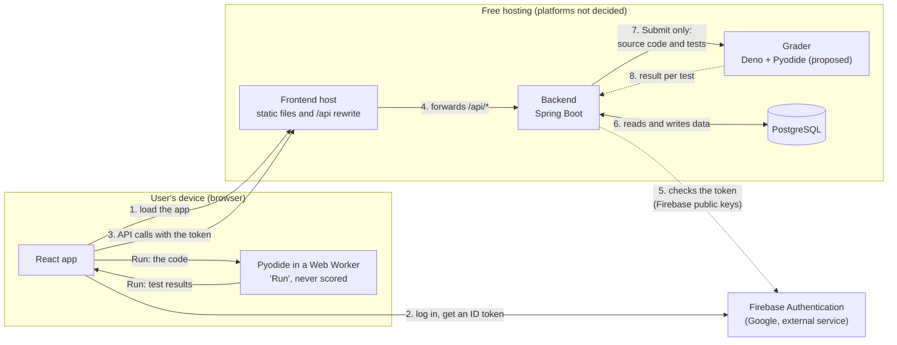

# Overview: start here

Everything a teammate needs to understand the app before drawing a diagram, designing a screen or writing code. It is a summary and a map: the details live in the linked documents, which stay the source of truth.

## What we are building

A **learning platform for Python beginners**, in the style of LeetCode. Users solve small programming problems in the browser, see exactly which tests passed and why the others failed, and are rewarded with XP, levels, badges and a daily streak. Theme (a working choice, the team decides the final look): **space**. Problems are "missions", XP is "stardust", the streak is "days in orbit".

University project for Software Engineering II, team **TTVZ**. The product name is not decided yet (SE2 is a placeholder).

## Scope

**In the first version (MVP):** login, problems grouped by topic, editor with Run, Submit verified by the server, results per test, hints, XP and levels, daily streak with freeze, 6 badges, unlocks, profile with the star-map grid, cosmetics, and the admin panel (problems, hints, users, settings, preview, audit log).

**Not now:** leaderboard, languages other than Python, discussions or comments, hidden tests, learning paths beyond the topic order, a daily challenge, a mobile app. They may come later; do not design for them yet.

## Constraints

- **Free hosting only.** No server of our own. Free plans sleep when idle (the first request is slow), may have little memory (a Java application needs care on a small instance), and their limits change often.
- **Stack:** Java 25 with Spring Boot and PostgreSQL 18 on the backend; React, TypeScript, Vite, Tailwind CSS and DaisyUI on the frontend; an API client generated from the backend's OpenAPI file; Firebase for login.
- **Python only** for the code users write.
- **No deadline known yet.** We work in slices that can stop anywhere: first the whole chain with one problem, then gamification, then admin and content.
- **Language of the repository:** English (code, comments, commits, docs). The language of the user interface is not decided.

### What the hosting research must check

- Can the frontend host forward `/api/*` to a backend on another host (the "forward" in the diagram above)?
- Does that forwarding wait long enough for a sleeping backend to wake up, and does it pass the `Authorization` header and request bodies unchanged and without caching?
- Do the backend and the grader (two services) fit in the free memory and monthly hours?
- Does the free database expire, and how big can it be?
- What do the free plans allow (for example non-commercial use only) and do they need a payment card?

## Reading order

| You work on | Read, in this order |
| --- | --- |
| Anything (everyone) | this file, [README.md](../README.md) (setup), [CONTRIBUTING.md](../CONTRIBUTING.md) (workflow) |
| Database and architecture diagrams (ER, flows, states) | this file, [gamification.md](design/gamification.md), [admin-panel.md](design/admin-panel.md), [code-execution.md](design/code-execution.md), [api-conventions.md](api-conventions.md) |
| UI design | this file, [gamification.md](design/gamification.md) (ranks, badges, unlocks), [admin-panel.md](design/admin-panel.md) (admin screens), the screens listed below |
| Grader research and anti-cheat | [code-execution.md](design/code-execution.md), then this file |
| Hosting research and deployment diagrams | this file (the parts of the system and the hosting section), [code-execution.md](design/code-execution.md) (the grader is a second service), [api-conventions.md](api-conventions.md) |
| Writing problems | [problem-template.md](problem-template.md), [gamification.md](design/gamification.md) (topics, difficulty, hints) |
| Backend work | [api-conventions.md](api-conventions.md) and the database and architecture diagrams |

Tasks, owners and their order are in Jira.

[CLAUDE.md](../CLAUDE.md) is context for AI assistants; it repeats much of this, but you do not need it.

## Who uses the app

| Who | What they can do |
| --- | --- |
| **Visitor** | See the landing page and log in or register. Nothing else. |
| **User** | Everything in "The user journey" below. |
| **Admin** | Everything a user can do, plus the admin panel: problems, hints, users, settings. |

Login is email and password through **Firebase Authentication**. Roles (`USER`, `ADMIN`) live in our own database, not in Firebase.

## The user journey (MVP flow)

**Log in, pick a problem, write code, submit, see results, streak and XP update.**

1. **Log in.** The browser logs in with Firebase and gets an ID token. It sends the token to the backend with every request. On the first login the backend creates the user (the Firebase UID is stored as `authSubject`).
2. **Browse problems.** The list is grouped by **topic** (variables and conditions, loops, strings, lists, dictionaries, functions), ordered inside each topic, with filters. Medium problems are **locked** until the user solved 10 Easy ones; locked problems stay visible with a message.
3. **Solve.** The problem page shows the statement (Markdown), an editor with starter code, and the tests. The user presses **Run**: the code runs in the browser (Pyodide, in a Web Worker) for instant feedback. Run is never trusted for scoring.
4. **Hints.** Up to 3 per problem, revealed one by one. Each hint revealed before the first accepted solve lowers the XP of that solve.
5. **Submit.** The browser sends the **source code** (never a result). The backend stores a submission as `PENDING`, the **grader** (a separate service) runs it against the tests, and the submission ends with a verdict. The browser polls for the result. The user sees every test: which passed, and for the failed ones where and why.
6. **After an accepted verdict** (all in one transaction, once per verdict): XP is awarded (first solve of the problem only), the level is recomputed, the daily streak is updated, badges are checked, unlocks are checked.
7. **Profile.** Level and rank, XP, current and longest streak, the star-map activity grid (one cell per day), badges (earned and not yet earned), streak freeze, cosmetics.

## The admin journey

1. The **first admins** are created at backend startup from environment variables; they must change the password at the first login.
2. **Problems:** create a draft, add tests and up to 3 hints, write a reference solution. A **preview** shows the problem as users see it, and a **dry run** sends code to the grader without storing a submission or giving XP. Publishing needs the reference solution to pass all tests. Problems can be archived.
3. **Users:** list, search, see progress, **block** and **unblock** (the backend checks the status on every request, so a blocked user is stopped at once).
4. **Settings:** edit XP values, hint penalty, level thresholds, unlock thresholds and limits. Stored in the database, not in code. Secrets and the grader's hard limits are never editable here.
5. Every admin action goes to the **audit log**.

## Screens (for the design)

Landing, login and register, forced password change (first admins), problem list by topic, problem page (statement, editor, Run, Submit, results per test, hints), profile (level, streak, star map, badges, cosmetics), admin: problems list and editor with preview, users, settings, audit log. Plus empty, loading, error and "locked" states.

## The parts of the system

The diagram shows **who talks to whom**. Its step numbers follow what happens, in order, when a user logs in and submits code.

### Who talks to whom

An arrow points from the caller to the callee; a double arrow is a request and its answer (the backend and the database); dotted arrows are replies or occasional calls. The Admin SDK (create the first admins, block users) also uses the dotted arrow between the backend and Firebase.

### The steps, in order

The numbers on the diagram follow a login and a Submit. The sequence diagrams (login, Submit) are part of the backend design.

| Step | What happens |
| --- | --- |
| **1** | The browser loads the app (static files) from the **frontend host**. This happens first, before any login. |
| **2** | The user logs in. The browser talks to **Firebase** and gets an **ID token**. |
| **3** | From now on, every action calls `/api` on the frontend host, sending the token. |
| **4** | The frontend host forwards `/api/*` to the **backend**. |
| **5** | The backend checks the token **locally**, with Firebase's public keys (no call to Firebase on each request). The Admin SDK is used only at startup (first admins) and when blocking a user. |
| **6** | The backend applies the rules and reads or writes **PostgreSQL**. It is the only part that touches the database. |
| **7** | **Only for Submit:** the backend sends the source code and the tests to the **grader**. |
| **8** | The grader returns one result per test; the backend stores the verdict and updates XP, streak, badges and unlocks. |
| **9** | The browser asks for the result again and again (steps 3, 4, 6) until the verdict is ready. |
| **Run** | "Run" never leaves the browser: the app gives the code to Pyodide and gets test results back. Steps 3 to 9 do not happen. |

Steps 1 and 2 happen once per visit. Steps 3 to 9 repeat for every action.

Notes:

- The browser talks to **two addresses only**: Firebase (login) and the frontend host (the app and `/api`). It never calls the backend or the grader directly.
- **Submit is asynchronous:** the backend answers `202` and the browser polls (step 9) until there is a verdict.
- The grader is a separate service, called only by the backend (with a shared secret). It has no secrets and no database access. If two free services do not fit, the fallback is to run it as a child process of the backend (see [code-execution.md](design/code-execution.md)).
- **In development** the Vite proxy replaces the frontend host, PostgreSQL runs in Docker, the backend runs on the developer's machine, and Firebase is the real project or its local emulator.

This is the context-level view. The architecture diagrams add what happens inside the backend; the deployment diagrams add the real platforms, networks and secrets.

### What each part does

| Part | Role |
| --- | --- |
| **Frontend** | React app. Runs Python for "Run" with Pyodide. Talks to Firebase to log in and, through the frontend host's `/api` rewrite, to the backend for everything else. |
| **Firebase Authentication** | Accounts, passwords, password reset emails, ID tokens. Free plan. |
| **Backend** | Spring Boot REST API under `/api/v1`. Validates tokens (issuer and audience), owns all rules: problems, submissions, XP, streak, badges, unlocks, hints, admin, settings. The only part that writes to the database. |
| **PostgreSQL** | All application data. Docker locally; a free hosted database in production. |
| **Grader** | Separate service that re-runs submitted code in a WebAssembly sandbox and returns a result per test. No secrets, no database access. Called only by the backend. **Proposed**, pending the security review. |
| **Hosting** | Free managed platforms: a static host for the frontend, a Docker host for the backend and the grader, a hosted database. **Not decided**: the hosting research and a small deployment test will choose. In production the browser talks to one origin; a rewrite rule forwards `/api/*` to the backend, as the Vite proxy does in development. |

## Rules that must always hold

- XP, streaks, badges and unlocks come **only** from verdicts the server computed itself. The client never sends a verdict.
- XP is awarded **only on the first accepted solve** of a problem.
- All tests are visible; there are no hidden tests. The user sees where and why a test failed.
- Expected outputs never enter the interpreter that runs user code.
- Admin routes are checked on the server; hiding a menu is not security.
- Secrets live in environment variables, never in git.
- Numbers (XP, thresholds, limits) are settings in the database, not constants in code.

## Glossary

| Term | Meaning |
| --- | --- |
| **Problem** (mission) | A task with statement, starter code, tests and hints. Has a difficulty, a topic and a position. |
| **Topic** | A group of problems ("sector"): loops, strings, ... Problems in a topic are ordered. |
| **Test** | One input and the expected output, with a short description. Visible to everyone. |
| **Run** | Execution in the browser for instant feedback. Not scored. |
| **Submit / submission** | Code sent to the server. States: `PENDING`, `RUNNING`, then one final verdict. |
| **Verdict** | The server's final result of a submission, with a result per test. |
| **Grader** | The service that executes submitted code on the server side. |
| **Dry run** | An admin runs code through the grader without creating a submission. |
| **Reference solution** | An admin's correct solution, used to check the tests before publishing. Never shown to users. |
| **XP** (stardust) | Points from first solves. Decide the level. |
| **Level / rank** | Cadet, Pilot, Navigator, Engineer, Captain, Commander, from XP thresholds. |
| **Streak** (days in orbit) | Consecutive days with at least one accepted submission, in the user's time zone. |
| **Streak freeze** | Unlocked at level 3; saves the streak when exactly one day is missed. |
| **Badge** | One of 6 achievements, evaluated by the server after each verdict. |
| **Unlock** | Medium problems after 10 Easy solved; the streak freeze; cosmetics. |
| **Hint** | Help text on a problem; max 3; each one revealed before solving lowers the XP. |
| **Preview** | Admin view of a draft problem as users see it. |
| **Settings** | Values editable in the admin panel (`app_settings`). |
| **Audit log** | Read-only record of admin actions. |

## Still undecided

- Hosting platforms.
- Whether the grader proposal is approved, and if two free services fit.
- Problem style: function (`def solve(...)`) or stdin and stdout.
- Product name and logo, and the final look of the theme.
- Language of the user interface (English or Romanian), desktop-first or mobile-first, light and dark themes.
- Code editor: Monaco or CodeMirror.
- Small gamification numbers: daily XP cap, hard problem unlock, extra streak freezes.

The full list is under "Open decisions" in [CLAUDE.md](../CLAUDE.md) and in the "Open points" of each design document.
