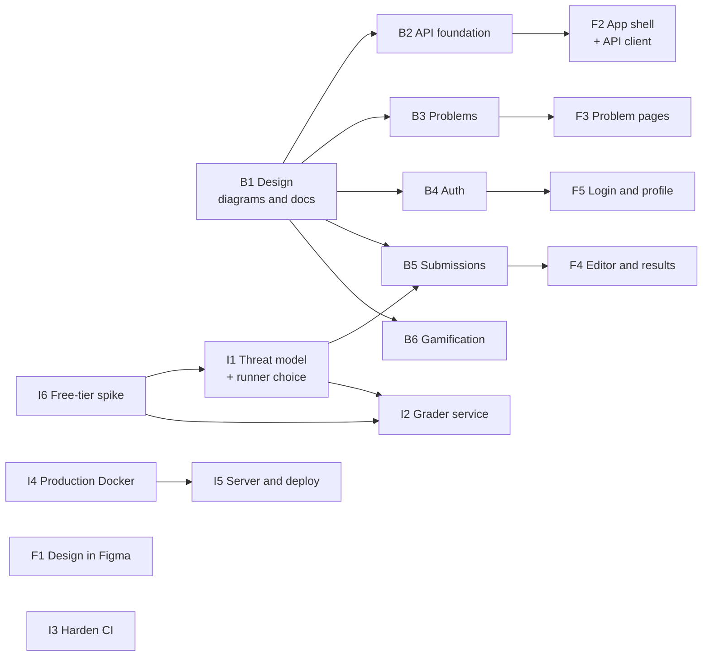

# Roadmap

The plan for the first big tasks of each teammate, in order. **Jira is the source of truth for status**; this file is the plan and the reasoning behind the order. Create each task in Jira with the title and labels given here.

- Title format: `[TTVZ][Area] Description` (see [CONTRIBUTING.md](../CONTRIBUTING.md)).
- Labels: `ttvz` plus one type label (`backend`, `frontend`, `devops` or `docs`).
- A task that gives the user something visible can be a **Story** ("As a user, I want… so that…"); the rest are **Tasks**.

Task ids (`B1`, `F2`, `I3`, …) exist only in this file, to describe dependencies.

## Order and dependencies

Can start right away, in parallel: **B1, F1, I3, I4, I6**; I1 starts together with I6 and is finished with its result. Everything else waits for what points to it.

## Decisions that block tasks

| Decision | Blocks | Who prepares it |
| --- | --- | --- |
| Code runner: the Deno + Pyodide grader proposed in [decisions/0001](decisions/0001-auth-hosting-and-execution.md) needs the security review and the free-tier check (I6); also function-based or stdin/stdout problems | B5, I2, F4 | Infra (task I1), with the backend |
| Rate limiting: where and how much | B5 | Infra (task I1) |
| Code editor: Monaco or CodeMirror | F4 | Frontend |
| Provisional items in [api-conventions.md](api-conventions.md): DTOs, packages by feature | B2 | Backend (task B1) |

## Backend

The backend starts with design, **before any code**: B1 is reviewed by the whole team, and only then do the other tasks begin.

| Id | Jira title | Labels | Scope |
| --- | --- | --- | --- |
| B1 | `[TTVZ][Setup] Design the data model and core flows` | `ttvz`, `backend`, `docs` | Documents in `docs/design/`, with diagrams written in Mermaid (rendered by GitHub, reviewable in a pull request). The checklist below is a starting point; add whatever else you think the team needs. |
| B2 | `[TTVZ][Setup] Build the API foundation` | `ttvz`, `backend` | `/api/v1` prefix configured in one place, global `ProblemDetail` handler, springdoc setup (tags and `operationId`), the convention test, `backend/openapi.json` and `just gen-api`. Confirms the provisional points of the API conventions. Unblocks the frontend client. |
| B3 | `[TTVZ][Problems] Implement problems domain and API` | `ttvz`, `backend` | Flyway schema from the approved design, list and detail endpoints with pagination, filters and sorting, seed data. Problem administration (`/admin/problems`) comes after authentication. |
| B4 | `[TTVZ][Auth] Validate JWT and sync users` | `ttvz`, `backend` | Resource server, `users` table with `authSubject`, roles `USER` and `ADMIN`, `/me`, guard for `/admin/**`. The provider is Firebase (see [decisions/0001](decisions/0001-auth-hosting-and-execution.md)): validate the issuer and the audience. |
| B5 | `[TTVZ][Execution] Implement submissions API` | `ttvz`, `backend` | `POST /submissions` returning `202`, polling on `GET /submissions/{id}`, a result per test (where and why it failed), the internal `Grader` interface. Waits for I1. |
| B6 | `[TTVZ][Gamification] Implement XP, levels and daily streak` | `ttvz`, `backend` | XP and levels awarded only from server verdicts, daily streak that respects the user's time zone. |

### B1: a suggested set of documents

This is a starting point in broad strokes, not a closed list. The backend teammate knows best what is needed to start coding with confidence, so add, merge or drop diagrams as you see fit.

**1. What the application does** (a short text)
- Who uses it: visitor, user, admin.
- The main use cases, and the MVP flow: log in, pick a problem, write code, submit, see which tests passed and why the others failed, streak and XP update.
- What is out of scope for now.

**2. How the pieces fit together** (one architecture diagram)
- Browser, frontend, backend, PostgreSQL, the auth provider and the code runner (`Grader`), and who talks to whom.

**3. The database** (ER diagram)
- Main entities: users, problems, test cases, tags, submissions, result per test, XP and streak records, badges.
- Keys, relations and the important constraints (for example, one submission has many test results).

**4. States** (state diagrams)
- A submission: `PENDING` → `RUNNING` → one final verdict.
- A problem: draft, published, archived.
- If useful: the daily streak (kept, broken, restored) and how the user's time zone affects it.

**5. Flows over time** (two or three sequence diagrams)
- Login and the first-login user sync.
- Submitting code: browser, backend, `Grader`, polling for the result.
- Awarding XP and updating the streak after a verdict.

**6. Other things that may help** (add what you find useful)
- An admin creating a problem; how a token is checked on each request; how the daily streak is computed step by step (flowchart); a glossary of terms.

**7. Open questions** found along the way, listed at the end, so the team can settle them in the review.

The diagrams must agree with [api-conventions.md](api-conventions.md) (UUID v7, `authSubject`, a result per test, no hidden tests). If the design needs a different convention, change that document in the same pull request. The whole team reviews B1 before the other backend tasks start.

## Frontend

The frontend teammate owns the visual design and picks the tool they work best in (Figma, Penpot or anything else). What matters is the result: a design that shows **how the app will actually look**, not only the layout, and that the whole team can open (a shared link, or exported images committed under `docs/design/`).

| Id | Jira title | Labels | Scope |
| --- | --- | --- | --- |
| F1 | `[TTVZ][Setup] Design the look and feel of the app` | `ttvz`, `frontend`, `docs` | A finished visual design, not just wireframes: the bee theme (colors, typography, spacing, icons), the components, and the main screens as they should look in the end (problem list, problem page with editor and results, login, profile with the honeycomb grid), in light and dark if you want both. The colors become the DaisyUI theme. The design is walked through with the whole team, and the project lead gives a final OK before it is built, so everyone agrees on the direction. No dependencies. |
| F2 | `[TTVZ][Setup] Build the app shell and API client` | `ttvz`, `frontend` | Routing, layout, navbar, DaisyUI theme from F1, TanStack Query and Axios, display of `ProblemDetail` errors, Orval (after B2). |
| F3 | `[TTVZ][Problems] Build problem list and detail pages` | `ttvz`, `frontend` | List with filters and pagination, problem page with the statement in Markdown. Can start with mocked data before B3. |
| F4 | `[TTVZ][Execution] Build code editor and results view` | `ttvz`, `frontend` | Editor (Monaco or CodeMirror), "Run" in the browser, "Submit" with polling, and a view of every test showing where and why it failed. |
| F5 | `[TTVZ][Auth] Build login flow and profile with streak grid` | `ttvz`, `frontend` | Login and logout, profile page with XP, level, streak and the honeycomb activity grid. Firebase JS SDK for login, ID token sent to the API. Waits for B4. |

## Infrastructure and DevSecOps

| Id | Jira title | Labels | Scope |
| --- | --- | --- | --- |
| I1 | `[TTVZ][Security] Write threat model and review the code runner` | `ttvz`, `devops`, `docs` | Threat model for running user code and a review of the proposed Deno + Pyodide grader (the risks are listed in [decisions/0001](decisions/0001-auth-hosting-and-execution.md)), a proposal for rate limiting. The result goes in `docs/`. First in the queue: B5 and I2 depend on it. |
| I2 | `[TTVZ][Execution] Implement the grader service` | `ttvz`, `devops` | The approved grader: a separate Docker service (Deno + Pyodide) with denied permissions, one process per submission, time, heap and output limits, no secrets, a shared secret with the backend, and the contract with `Grader`. |
| I3 | `[TTVZ][Setup] Harden CI and repository security` | `ttvz`, `devops` | Branch protection on `main` with the `CI` check required, Dependabot, CodeQL, secret scanning, image scanning, CI caching. |
| I4 | `[TTVZ][Deploy] Prepare the deployment files` | `ttvz`, `devops` | Multi-stage Dockerfiles for the backend and the grader (for Render), `frontend/vercel.json` with the `/api/*` rewrite to the backend, environment variables documented in `.env.example`. |
| I5 | `[TTVZ][Deploy] Set up hosting and automatic deployment` | `ttvz`, `devops` | Vercel (frontend), Render (backend and grader), Neon (PostgreSQL) and the Firebase project, secrets in each platform, deploy on merge to `main`, a check of the free-tier limits. |
| I6 | `[TTVZ][Deploy] Verify free-tier limits with a spike` | `ttvz`, `devops` | A short experiment, result in `docs/`: deploy a hello-world backend and a hello-world Deno + Pyodide service on Render; measure RAM, cold start and the time to run a trivial Python test; check the free instance hours for two services, Neon limits and Vercel Hobby terms. Answers whether two Render services fit or the child-process fallback is needed. |

## Later

- Testing the grader with malicious payloads (after I2).
- Leaderboard (after the MVP).
- Support for more languages than Python.
