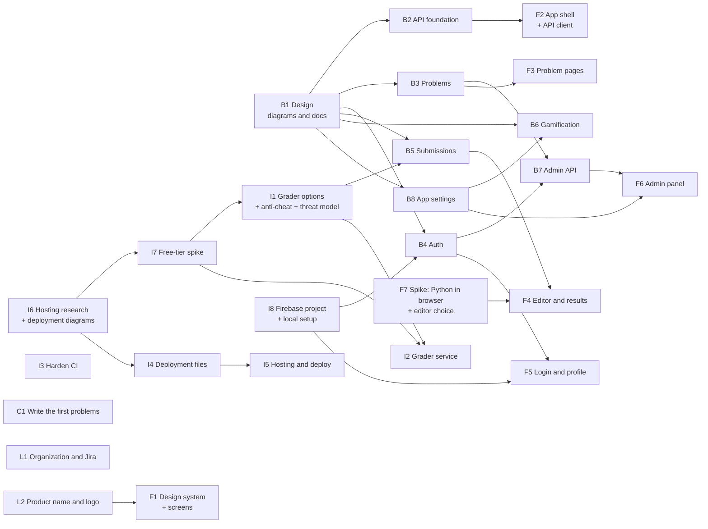

# Roadmap

The plan for the first big tasks of each teammate, in order. **Jira is the source of truth for status**; this file is the plan and the reasoning behind the order. Create each task in Jira with the title and labels given here.

- Title format: `[TTVZ][Area] Description` (see [CONTRIBUTING.md](../CONTRIBUTING.md)).
- Labels: `ttvz` plus one type label (`backend`, `frontend`, `devops` or `docs`).
- A task that gives the user something visible can be a **Story** ("As a user, I want… so that…"); the rest are **Tasks**.

Task ids (`B1`, `F2`, `I3`, …) exist only in this file, to describe dependencies.

## Order and dependencies

Can start right away, in parallel: **B1, F1, F7, I3, I6, I8, C1, L1, L2**. I1 and I7 start together and I1 is finished with the result of I7. Everything else waits for what points to it.

## Milestones

The work is cut in slices that can stop at any point, because the deadline is not known yet.

1. **Walking skeleton:** log in with Firebase, one problem, "Run" in the browser, "Submit" judged by the grader, per-test results, all deployed. It proves the whole chain (including the hosting limits) early.
2. **Gamification:** XP, levels, streak with freeze, the 6 badges, unlocks, hints with the XP penalty, profile with the star-map grid.
3. **Admin and content:** admin panel, settings, about 25 problems by topic, polish.

## Decisions that block tasks

| Decision | Blocks | Who prepares it |
| --- | --- | --- |
| Code runner: the Deno + Pyodide grader proposed in [design/code-execution.md](design/code-execution.md) needs the security review and the free-tier check (I6); also function-based or stdin/stdout problems | B5, I2, F4 | Infra (task I1), with the backend |
| Rate limiting: where and how much | B5 | Infra (task I1) |
| Code editor: Monaco or CodeMirror | F4 | Frontend (spike F7) |
| Hosting platforms (frontend, Docker backend and grader, PostgreSQL) | I4, I5, I7 | Infra (task I6) |
| Product name and logo | F1 | `[TTVZ][Setup] Design the look and feel of the app` | `ttvz`, `frontend`, `docs` | A finished, professional design, built **design-system first** so every screen looks like the same product. Step 1: a one-page style guide (colors, typography, spacing, header and footer, buttons, cards, forms, the editor panel, badges, the star-map activity grid, icons, light and dark if wanted) that becomes the DaisyUI theme and is the single source of truth. Step 2: the screens (landing, login, problem list by topic, problem page with editor, results and hints, profile with level, streak and badges, admin panel), made with an AI design tool (for example Google Stitch or Claude; check what each offers now) or Figma, always starting from the same style guide and the same prompt, so colors and headers do not drift between screens. Step 3: the result in a place the whole team can open (a shared link, or images in `docs/design/`). The tool's output is a reference; the real UI is built from the DaisyUI theme. Professional finish: real content instead of lorem ipsum, empty, loading and error states, responsive layouts. The whole team walks through it and the project lead gives the final OK before it is built. Uses the name and logo from L2 when ready. |
| Provisional items in [api-conventions.md](api-conventions.md): DTOs, packages by feature | B2 | Backend (task B1) |

## Backend

The backend starts with design, **before any code**: B1 is reviewed by the whole team, and only then do the other tasks begin.

| Id | Jira title | Labels | Scope |
| --- | --- | --- | --- |
| B1 | `[TTVZ][Setup] Design the data model and core flows` | `ttvz`, `backend`, `docs` | Documents in `docs/design/`, with diagrams written in Mermaid (rendered by GitHub, reviewable in a pull request). The checklist below is a starting point; add whatever else you think the team needs. |
| B2 | `[TTVZ][Setup] Build the API foundation` | `ttvz`, `backend` | `/api/v1` prefix configured in one place, global `ProblemDetail` handler, springdoc setup (tags and `operationId`), the convention test, `backend/openapi.json` and `just gen-api`. Confirms the provisional points of the API conventions. Unblocks the frontend client. |
| B3 | `[TTVZ][Problems] Implement problems domain and API` | `ttvz`, `backend` | Flyway schema from the approved design, list and detail endpoints with pagination, filters and sorting, seed data. Problem administration comes after authentication (see B7). Problems have `difficulty`, `topic` and `position`; locked problems (Medium before 10 Easy solved) stay visible with the unlock message. Format of the seed files: [problem-template.md](problem-template.md). |
| B4 | `[TTVZ][Auth] Validate JWT and sync users` | `ttvz`, `backend` | Resource server, `users` table with `authSubject`, roles `USER` and `ADMIN`, `/me`, guard for `/admin/**`. The provider is Firebase (see Firebase documentation): validate the issuer and the audience. Also creates the first admins at startup from `ADMIN_BOOTSTRAP_EMAILS` and `ADMIN_BOOTSTRAP_PASSWORD` (Firebase Admin SDK, `mustChangePassword`, refuses to start in production with a weak or placeholder password); see [design/admin-panel.md](design/admin-panel.md). |
| B5 | `[TTVZ][Execution] Implement submissions API` | `ttvz`, `backend` | `POST /submissions` returning `202`, polling on `GET /submissions/{id}`, a result per test (where and why it failed), the internal `Grader` interface. Waits for I1. |
| B6 | `[TTVZ][Gamification] Implement XP, levels and daily streak` | `ttvz`, `backend` | XP and levels awarded only from server verdicts, daily streak that respects the user's time zone. Rules, numbers and badges: [design/gamification.md](design/gamification.md). Includes the 6 badges (rules evaluated after each verdict), the unlock of Medium problems, the streak freeze (level 3) and the selected cosmetics. Each hint revealed before the first accepted solve lowers the XP of that solve; the Sharpshooter badge requires no hints. |
| B7 | `[TTVZ][Admin] Implement admin API for problems, hints and users` | `ttvz`, `backend` | Under `/api/v1/admin`: create, edit, publish and archive problems with tests and hints, a reference solution that must pass all tests before publishing, users list and search, block and unblock (the status is checked on every request), audit log. Details: [design/admin-panel.md](design/admin-panel.md). Needs B3 and B4; publishing needs B5. Hints: at most 3 per problem, every reveal is recorded. Preview of a draft problem with an admin-only **dry run** through the grader (not stored, no XP). |
| B8 | `[TTVZ][Admin] Implement configurable app settings` | `ttvz`, `backend` | `app_settings` table read through one cached component with validation and audit; the XP, level, unlock and limit values of [design/gamification.md](design/gamification.md) come from here, not from constants. Do it **before or together with B6**. |

### B1: a suggested set of documents

This is a starting point in broad strokes, not a closed list. The backend teammate knows best what is needed to start coding with confidence, so add, merge or drop diagrams as you see fit.

**1. What the application does** (a short text)
- Who uses it: visitor, user, admin.
- The main use cases, and the MVP flow: log in, pick a problem, write code, submit, see which tests passed and why the others failed, streak and XP update.
- What is out of scope for now.

**2. How the pieces fit together** (one architecture diagram)
- Browser, frontend, backend, PostgreSQL, the auth provider and the code runner (`Grader`), and who talks to whom.
- How **Firebase** connects to the app: login in the browser, the ID token sent to the API, token validation (issuer and audience), the block check, the first-login user sync, the creation of the first admins.
- A component view of the backend features (problems, submissions, gamification, hints, admin, settings) and how they depend on each other, for example how one verdict triggers XP, streak, badges and unlocks.

**3. The database** (ER diagram)
- Main entities: users, problems, topics, test cases, hints and hint reveals, submissions, result per test, XP events, streak and streak freeze, badges and user badges, selected cosmetics, app settings, audit log.
- Keys, relations and the important constraints (for example, one submission has many test results).

**4. States** (state diagrams)
- A submission: `PENDING` → `RUNNING` → one final verdict.
- A problem: draft, published, archived.
- If useful: the daily streak (kept, broken, restored) and how the user's time zone affects it.

**5. Flows over time** (two or three sequence diagrams)
- Login and the first-login user sync (with Firebase).
- Revealing a hint and the XP penalty; blocking a user.
- Submitting code: browser, backend, `Grader`, polling for the result.
- Awarding XP and updating the streak after a verdict.

**6. Other things that may help** (add what you find useful)
- An admin creating a problem; how a token is checked on each request; how the daily streak is computed step by step (flowchart); a glossary of terms.

**7. Open questions** found along the way, listed at the end, so the team can settle them in the review.

The diagrams must agree with [api-conventions.md](api-conventions.md) (UUID v7, `authSubject`, a result per test, no hidden tests). If the design needs a different convention, change that document in the same pull request. The whole team reviews B1 before the other backend tasks start.

## Frontend

The frontend teammate owns the visual design and picks the tool they work best in (Figma, Penpot or anything else). What matters is the result: a design that shows **how the app will actually look**, not only the layout, and that the whole team can open (a shared link, or exported images committed under `docs/design/`).

| Id | Jira title | Labels | Scope |
| --- | --- | --- | --- |
| F1 | `[TTVZ][Setup] Design the look and feel of the app` | `ttvz`, `frontend`, `docs` | A finished visual design, not just wireframes: the space theme (colors, typography, spacing, icons), the components, and the main screens as they should look in the end (problem list, problem page with editor and results, login, profile with the honeycomb grid), in light and dark if you want both. The colors become the DaisyUI theme. The design is walked through with the whole team, and the project lead gives a final OK before it is built, so everyone agrees on the direction. No dependencies. |
| F2 | `[TTVZ][Setup] Build the app shell and API client` | `ttvz`, `frontend` | Routing, layout, navbar, DaisyUI theme from F1, TanStack Query and Axios, display of `ProblemDetail` errors, Orval (after B2). |
| F3 | `[TTVZ][Problems] Build problem list and detail pages` | `ttvz`, `frontend` | List with filters and pagination, problem page with the statement in Markdown. Can start with mocked data before B3. Group by topic, show locked problems with the unlock message. |
| F4 | `[TTVZ][Execution] Build code editor and results view` | `ttvz`, `frontend` | Editor (Monaco or CodeMirror), "Run" in the browser, "Submit" with polling, and a view of every test showing where and why it failed. Hints are revealed one by one, with a warning that each one lowers the XP. |
| F5 | `[TTVZ][Auth] Build login flow and profile with streak grid` | `ttvz`, `frontend` | Login and logout, profile page with XP, level, streak and the star-map activity grid. Firebase JS SDK for login, ID token sent to the API. Waits for B4. Level and rank, the 6 badges (earned and not yet earned), streak freeze status and cosmetics selection. |
| F6 | `[TTVZ][Admin] Build the admin panel` | `ttvz`, `frontend` | Problem editor (Markdown preview, tests table, hints list, publish), users table with block and unblock, settings page, audit log view. Visible only to admins, but the server enforces the role. Needs B7 and B8. Preview of a draft problem (as users see it, with Run and dry run), forced password change for the first admins. |
| F7 | `[TTVZ][Execution] Spike: Python in the browser and the editor choice` | `ttvz`, `frontend`, `docs` | A short experiment, result in `docs/`: Pyodide in a Web Worker, stopping an infinite loop by terminating the worker, download size and start time, running function-style tests with a result per test. In the same spike, compare Monaco and CodeMirror (size, mobile, theming with our colors) and pick one. Unblocks F4. |

## Lead and content

| Id | Jira title | Labels | Scope |
| --- | --- | --- | --- |
| L1 | `[TTVZ][Setup] Move the repository to the organization and connect GitHub with Jira` | `ttvz`, `devops` | Transfer the repository to the team organization, install the GitHub for Atlassian app (needs a Jira site admin), turn on branch protection once I3 is done. |
| L2 | `[TTVZ][Setup] Choose the product name and logo` | `ttvz`, `docs` | The final name (SE2 is a placeholder in the repo, the database, Compose and the env vars), a logo for the favicon and the header, short tagline. Feeds F1. Renaming in the repo is a separate small change afterwards. |
| C1 | `[TTVZ][Content] Write the first problems` | `ttvz`, `docs` | Follow [problem-template.md](problem-template.md): the lead makes the template and one complete example, each teammate then writes 5 to 8 problems (target about 25 across the topics and the three difficulties), with up to 3 hints each and a reference solution that passes all its tests. Another teammate reviews each problem. The problems are imported through B3 or entered in the admin panel (F6). |

## Infrastructure and DevSecOps

| Id | Jira title | Labels | Scope |
| --- | --- | --- | --- |
| I1 | `[TTVZ][Security] Research how to verify submissions and prevent cheating` | `ttvz`, `devops`, `docs` | Compare the ways to verify a submission: only in the browser, re-execution on the server in WebAssembly (our proposal in [design/code-execution.md](design/code-execution.md)), an external execution API, containers or microVMs on a server of our own, and anything else you find. For each option: how it can be cheated, what it costs, and whether it works on free hosting. Then the threat model for running user code, the review of the proposed grader, the other ways to cheat (XP farming, replayed requests, several accounts, tampering with the client) and a proposal for rate limiting. The result goes in `docs/`. B5 and I2 depend on it; it starts together with I7. |
| I2 | `[TTVZ][Execution] Implement the grader service` | `ttvz`, `devops` | The approved grader: a separate Docker service (Deno + Pyodide) with denied permissions, one process per submission, time, heap and output limits, no secrets, a shared secret with the backend, and the contract with `Grader`. |
| I3 | `[TTVZ][Setup] Harden CI and repository security` | `ttvz`, `devops` | Branch protection on `main` with the `CI` check required, Dependabot, CodeQL, secret scanning, image scanning, CI caching. |
| I4 | `[TTVZ][Deploy] Prepare the deployment files` | `ttvz`, `devops` | Waits for the platform choice in I6. Multi-stage Dockerfiles for the backend and the grader, the `/api/*` rewrite file of the chosen frontend host, environment variables documented in `.env.example`. |
| I5 | `[TTVZ][Deploy] Set up hosting and automatic deployment` | `ttvz`, `devops` | The chosen platforms and the Firebase project, secrets in each platform, deploy on merge to `main`, a check of the free-tier limits. |
| I6 | `[TTVZ][Deploy] Research free hosting options and draw the deployment diagrams` | `ttvz`, `devops`, `docs` | Find out what free options exist for the three parts: a static frontend host, a Docker host for the backend and the grader, and a hosted PostgreSQL. A comparison table per part (free limits, sleep behaviour, expiry, terms of use, region, deploy from GitHub, secrets handling), and a recommendation of one or two combinations. Then the diagrams in Mermaid, in `docs/design/deployment.md`: production (what runs where, how a request travels, where each secret lives), the CI/CD flow (merge to `main`, build, deploy) and local development. No dependencies; I4 and I7 wait for it. |
| I7 | `[TTVZ][Deploy] Verify free-tier limits with a spike` | `ttvz`, `devops` | A short experiment, result in `docs/`, on the platforms chosen in I6: deploy a hello-world backend and a hello-world Deno + Pyodide service on the most promising one; measure RAM, cold start and the time to run a trivial Python test; check the free instance hours for two services, the database limits and the terms of each free plan. Things to watch: free backends usually sleep when idle (slow first request), some free databases expire, some free plans are for non-commercial use only, and limits change often. Its result decides the hosting platforms and whether two services fit or the child-process fallback is needed. |
| I8 | `[TTVZ][Auth] Create the Firebase project and the local development setup` | `ttvz`, `devops` | The Firebase project (free plan) with email and password login, the authorized domains, the service account kept as a secret (never in git) and a rule for how teammates get access. The Firebase Auth emulator for local development and CI, so tests need no real accounts. All variables in `.env.example`. Unblocks B4 and F5. |

## Later

- Testing the grader with malicious payloads (after I2).
- Leaderboard (after the MVP).
- Support for more languages than Python.
